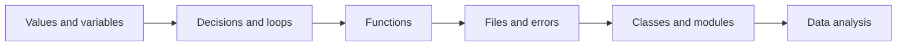
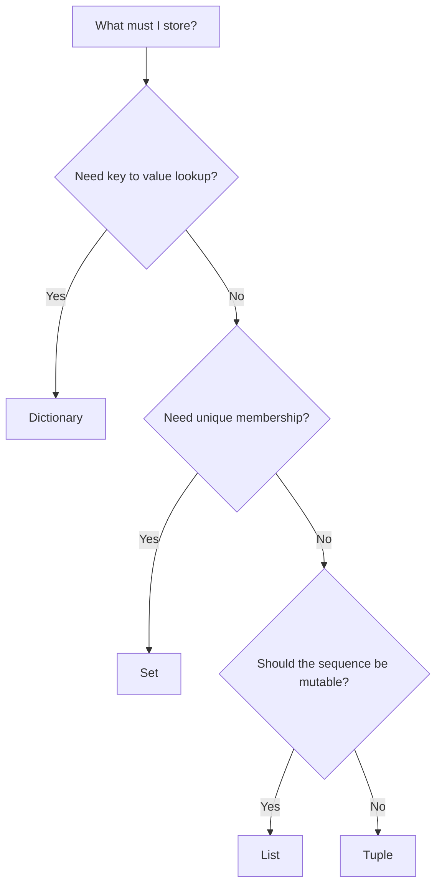
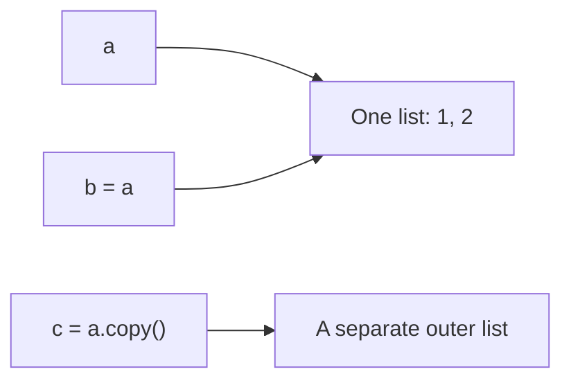
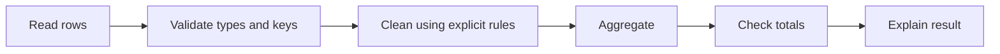

# Python: from first program to reusable data code

[Subject home](../README.md) · [Theory index](README.md)

Python is the language we use to express a sequence of steps. A notebook is useful for exploring; a function makes a step reusable; a module lets several programs share it. Work through this guide, run the practicals, then solve the questions without looking at the answers.




## On this page

- [1. Output, values, names and input](#1-output-values-names-and-input)
- [2. Operators, strings and slicing](#2-operators-strings-and-slicing)
- [3. Choose a collection by the question](#3-choose-a-collection-by-the-question)
- [4. Decisions and loops](#4-decisions-and-loops)
- [5. Functions: name a useful transformation](#5-functions-name-a-useful-transformation)
- [6. Files, exceptions, modules and environments](#6-files-exceptions-modules-and-environments)
- [7. Classes, iteration and decorators](#7-classes-iteration-and-decorators)
- [8. From Python objects to analysis](#8-from-python-objects-to-analysis)
- [Before moving to practicals](#before-moving-to-practicals)

## 1. Output, values, names and input

```python
name = "Subhash"
completed = 3
print(f"{name} completed {completed} lessons")
```

`"Subhash"` and `3` are literal values. `name` and `completed` are names bound to objects. `=` assigns; `==` compares. A variable name should describe the meaning: `monthly_sales` is easier to understand than `x1`. Names are case-sensitive; `Sales` and `sales` differ. Keywords such as `for` cannot be variable names. A comment begins with `#`; explain a decision rather than repeating the code.

`input()` returns text even when the user types digits. Convert it before arithmetic:

```python
raw_age = "28"  # The same type of value that input() returns.
age = int(raw_age)
assert age + 2 == 30
```

`int("28.5")` raises `ValueError`; `float("28.5")` succeeds. Do not silently truncate measurements unless that is intended. `bool("False")` is `True`, because a nonempty string is truthy. Parse textual flags explicitly.

| Type | Example | Use |
|---|---|---|
| `int`, `float` | `3`, `3.5` | Counts and approximate measurements |
| `bool` | `True` | Conditions |
| `str` | `"Kolkata"` | Text, labels, IDs |
| `None` | `None` | An absent value |
| `list`, `tuple` | `[1, 2]`, `(1, 2)` | Ordered collections |
| `dict`, `set` | `{"city": "Kolkata"}`, `{1, 2}` | Lookup and unique membership |

A PIN code is an identifier, even if it contains only digits. Keep `"001234"` as text to preserve leading zeros. Binary floating-point is approximate: compare calculated floats with a tolerance, rather than assuming `0.1 + 0.2 == 0.3`.

## 2. Operators, strings and slicing

Arithmetic: `+ - * / // % **`. `/` produces division; `//` floors, so `-3 // 2` is `-2`. `%` gives a remainder and helps test divisibility. `**` is exponentiation; `^` is bitwise XOR. Comparisons include `< <= > >= == !=`. Boolean operators are `and`, `or`, `not`; membership uses `in`.

```python
text = "Data Science"
assert text[0] == "D"
assert text[0:4] == "Data"
assert text[::-1] == "ecneicS ataD"
assert 12 % 3 == 0
assert "science" in text.lower()
```

A slice is `[start:stop:step]`; `stop` is excluded. Negative indexes count from the end. Strings are immutable: `text.lower()` returns another string. Useful operations include `.strip()`, `.split()`, `.join()`, `.replace()` and f-strings. Avoid joining strings repeatedly in a long loop; collect pieces and use `"".join(pieces)`.

`is` checks object identity; `==` checks equality. Use `value is None`; use `value == 100` to compare numbers. Bitwise operators `& | ~ << >>` operate on integer bits. In pandas, `&` and `|` combine elementwise conditions; parenthesize each condition.

## 3. Choose a collection by the question



Lists preserve order and allow changes; tuples preserve order but cannot have their elements reassigned. Sets remove duplicates and do not provide positional indexing. Dictionaries associate keys with values and preserve insertion order. Hashable objects can be dictionary keys; a list cannot.

```python
sales = [100, 200]
sales.append(150)       # Add one object.
sales.extend([50, 80])  # Add objects from an iterable.
by_city = {"Kolkata": 300, "Delhi": 200}
assert by_city.get("Mumbai", 0) == 0
unique_cities = {"Delhi", "Delhi", "Kolkata"}
assert len(unique_cities) == 2
```

### Aliasing: two names can point to one list



`b = a` does not copy the list. Changing `b` changes what `a` sees. `a.copy()` is shallow: nested objects are still shared. Use `copy.deepcopy()` when an independent nested structure is needed. Mutable defaults in functions create a related trap: use `None` and construct a new list inside the function.

## 4. Decisions and loops

```python
score = 72
if score >= 80:
    grade = "A"
elif score >= 60:
    grade = "B"
else:
    grade = "C"
assert grade == "B"

squares = []
for value in range(1, 5):
    squares.append(value ** 2)
assert squares == [1, 4, 9, 16]
```

Indentation defines the block. Test conditions in the intended order; a broad condition can hide a later specific condition. `range(1, 5)` stops before 5. Use `enumerate(items)` when both the position and value matter; `zip(a, b)` pairs collections and normally stops at the shorter input.

A `while` loop repeats while a condition remains true; update the condition so it can finish. `break` exits the nearest loop, `continue` skips to its next iteration, and `pass` does nothing. Nested loops suit a grid or all pairs, but comparing every pair of `n` rows often costs about $n^2$ operations. A dictionary lookup can sometimes replace the inner loop.

A comprehension is a short construction, not a place to hide a complicated procedure:

```python
clean = [x.strip().lower() for x in [" AI ", "Data "]]
assert clean == ["ai", "data"]
```

## 5. Functions: name a useful transformation

```python
def net_revenue(price, quantity, discount=0.0):
    """Return revenue after a discount fraction between zero and one."""
    if not 0 <= discount <= 1:
        raise ValueError("discount must be between 0 and 1")
    return price * quantity * (1 - discount)

assert net_revenue(100, 2, discount=0.1) == 180
```

Parameters receive inputs; `return` provides a result to the caller. Printing is useful for display, but it does not return a reusable result. Variables created inside a function are normally local. Prefer explicit inputs and outputs over hidden global state.

`*args` gathers additional positional arguments; `**kwargs` gathers keyword arguments. A `lambda` is a small unnamed function, useful as a sort key. Recursion needs a base case; an ordinary loop is often clearer for simple repeated work. Type hints describe intent but do not automatically validate values at runtime.

## 6. Files, exceptions, modules and environments

Use a context manager so a file is closed even if a later operation fails:

```python
from pathlib import Path
import json

# Runnable in a writable working directory.
path = Path("lesson-summary.json")
path.write_text(json.dumps({"lessons": 3}), encoding="utf-8")
loaded = json.loads(path.read_text(encoding="utf-8"))
assert loaded["lessons"] == 3
path.unlink()
```

CSV holds tabular text; JSON holds nested data. Validate fields and types when reading either. Never load an untrusted pickle: deserialization can execute code. A relative path starts at the working directory; it does not necessarily start beside the notebook.

Catch the errors you can handle, such as `ValueError` for bad numeric input. A bare `except:` can hide programming bugs. Use `logging` for useful progress and error messages; do not log passwords or personal records. Use `assert` to check internal assumptions during learning; use explicit validation for external inputs.

A module is a Python file; a package groups modules. `import math`, `datetime`, `random`, `re`, `collections` and `pathlib` provide common building blocks. A virtual environment separates dependencies between projects. Save the dependency versions used for a reproducible notebook. The practicals retain historical code; a library API may differ from the one used in a class exercise.

## 7. Classes, iteration and decorators

A class groups state and behaviour. An instance has its own state; `self` refers to that instance. `__init__` initializes it. Inheritance reuses an interface; composition puts a helper object inside another object. Prefer the simpler design that makes the data flow obvious.

```python
class RunningTotal:
    def __init__(self):
        self.total = 0
    def add(self, amount):
        self.total += amount
        return self.total

meter = RunningTotal()
assert meter.add(10) == 10
assert meter.add(5) == 15
```

An iterable can supply an iterator. `next(iterator)` advances it; a generator uses `yield` and produces values on demand. A generator is consumed as it is read: recreate it if a second pass is needed. This is useful when a large file should not be loaded entirely into memory.

A decorator wraps a function, for example to time it or check access. Use `functools.wraps` in a custom decorator to preserve the wrapped function's metadata. A property exposes controlled access to an attribute; special methods such as `__len__` implement language operations.

## 8. From Python objects to analysis

NumPy arrays support numerical operations over many values. A pandas DataFrame has named columns and an index. Do not confuse a Python list's repetition (`[1, 2] * 2`) with numerical multiplication. Prefer vectorized operations and `groupby` over an unnecessary row loop. Check types, missing values and duplicate keys before calculating a business metric.



A useful first project is daily revenue by city: read transactions, parse dates, reject invalid prices, calculate line revenue, group it, and reconcile the result to the input. Continue in the SQL and Data Analysis subject for the full EDA workflow.

## Before moving to practicals

Explain `append` versus `extend`, equality versus identity, a shallow copy, `return` versus `print`, and why an iterator may be empty on its second pass. Write a function, test normal and invalid inputs, and trace a loop by hand. These skills matter more than memorizing every method name.


[Try the practicals](../02-practicals/README.md)
