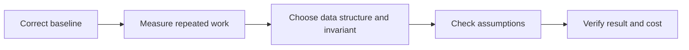

# How programming algorithms solve increasingly demanding problems

[Subject home](../README.md) · [Foundation course](README.md) · [Practicals](../02-practicals/README.md)

Python is a language, so its algorithm story is about data structures, invariants and cost rather than a chain of Python releases. Start with a correct baseline, identify what makes it slow or invalid, then change the algorithm under explicit assumptions.

## Read the motivation, mechanism and trade-off together

| Family / transition | Limitation or question | How the method works | What remains / why another branch matters | Read |
|---|---|---|---|---|
| Linear scan → hashing | Repeatedly scanning n items for each lookup can cost quadratic time. | A hash table maps keys to buckets under hashing/equality, giving typical average constant-time membership. | Hashable keys and memory matter; hashing does not supply sorted order. | [Lesson](lesson-03-collections-and-mutation.md) |
| Selection/insertion/bubble → merge/quick/heap families | Simple quadratic sorts become expensive as n grows. | Merge sort combines sorted halves; quicksort partitions; heapsort repeatedly extracts a heap extremum. | Stability, worst case, memory and nearly sorted data differ. Python sorting uses a stable adaptive run-based strategy, not a request to implement every sort in production. | [Lesson](lesson-10-modules-packaging-and-quality.md) |
| Linear search → binary search | Sorted data allows discarding many candidates per comparison. | Maintain a half-open ordered candidate interval, choosing the side consistent with the target. | Requires compatible sorted order; insertion into an array is not made logarithmic by logarithmic search. | [Lesson](lesson-04-decisions-and-loops.md) |
| Nested range scans → prefix sums / sliding windows | Repeatedly summing overlapping ranges repeats work. | Prefix differences answer sums; fixed windows add entering/subtract leaving values. | Variable-window rules need valid monotonic assumptions; negative numbers can break naive sum logic. | [Lesson](lesson-04-decisions-and-loops.md) |
| Unstructured matching → stack / queue | Nesting and nearest-first processing need an ordering invariant. | A stack resolves last-opened brackets; a queue processes arrivals or BFS layers. | Choose operations and costs deliberately; popping index 0 of a list shifts elements. | [Lesson](lesson-03-collections-and-mutation.md) |
| Naive recursion → memoization / dynamic programming | Overlapping subproblems repeat the same computation. | Cache subproblem results or fill an ordered table with a recurrence. | State size can explode; a recurrence must preserve the true problem and boundary cases. | [Lesson](lesson-05-functions-and-scope.md) |
| Greedy choice versus dynamic programming | The locally best step is not always globally best. | Greedy needs an exchange/structure argument; DP compares subproblem alternatives. | Coin denominations can defeat largest-first. Do not assume an optimization pattern without proof/counterexamples. | [Lesson](lesson-10-modules-packaging-and-quality.md) |
| DFS / BFS → weighted shortest paths | Unweighted reachability does not solve every minimum-cost route. | DFS explores depth; BFS layers by edge count; Dijkstra expands smallest tentative distance with nonnegative weights. | Negative edges require another suitable method, such as Bellman–Ford; cycles and unreachable nodes need handling. | [Lesson](lesson-03-collections-and-mutation.md) |
| Full materialization → generators / bounded streams | Large intermediate lists can exceed memory. | Yield items incrementally while retaining only necessary state. | Sorting/global joins may still need materialization or external storage; a consumed iterator does not restart. | [Lesson](lesson-06-iteration-and-generators.md) |
| Single task → threads/processes/async | Waiting or independent work can waste resources. | Overlap supported I/O, distribute suitable CPU work or coordinate awaited tasks. | Overhead, cancellation, shared state and runtime/GIL details matter; concurrency is not automatic speedup. | [Lesson](lesson-11-advanced-functions.md) |

## How to compare alternatives

Use the same task, eligible data, split/horizon and compute budget. State the objective, assumptions, training/update procedure, important settings and failure cases. A newer publication can address one bottleneck while being worse on another. A survey row identifies a family; it does not pretend to derive every research variant.

For a method you study, complete this sentence: “I would consider it because ___; it works by ___; I would compare it with ___ using ___; I would avoid or investigate it when ___.” Recalculate the worked examples before selecting by a method name.
