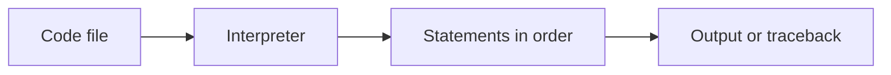

# 01 — Run Python, read syntax and write clear names

[Course map](README.md) · [Practicals](../02-practicals/README.md) · [Questions](../03-questions-and-answers/worked-questions.md#lesson-01)



## On this page

- [The idea](#the-idea)
- [Work through it](#work-through-it)
- [Common mistakes and practical limits](#common-mistakes-and-practical-limits)

## The idea

**Analogy:** A program is a recipe: the interpreter follows instructions, but cannot guess missing steps.

A Python file contains statements. The interpreter runs top-level statements in order. A notebook runs cells in the order you execute them, which can differ from their visible order. Restart and run all cells before treating a notebook as reproducible. Use a dedicated virtual environment for a project so its packages do not unexpectedly change another project.

Indentation defines blocks. A colon starts a suite after constructs such as `if`, `for`, `def` and `class`. Use consistent four-space indentation. Comments begin with `#`; a function's first string can serve as a docstring. Names are case-sensitive. `=` binds a name, `==` compares values and keywords cannot be used as variable names.

Python is dynamically typed: objects have types, while a name can later refer to an object of another type. Clear names and small functions keep that flexibility understandable. `print` displays; `return` sends a result to a caller. A traceback identifies the exception and the call path; read the last line for the error type, then inspect your relevant frame.

## Work through it

```python
name = "Subhash"
lessons = 3
message = f"{name} completed {lessons} lessons"
assert message == "Subhash completed 3 lessons"
print(message)
```

## Common mistakes and practical limits

Do not name a file `json.py` when you intend to import the standard `json` module. Avoid names such as `list` or `str` that hide built-ins. A notebook cell working after many hidden earlier cells is not proof that the saved notebook works from a clean start.

---

[Subject home](../README.md) · [Numbers, strings, booleans and operators →](lesson-02-values-and-operators.md)
