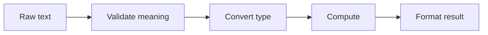

# 02 — Numbers, strings, booleans and operators

[Course map](README.md) · [Practicals](../02-practicals/README.md) · [Questions](../03-questions-and-answers/worked-questions.md#lesson-02)



## On this page

- [The idea](#the-idea)
- [Work through it](#work-through-it)
- [Common mistakes and practical limits](#common-mistakes-and-practical-limits)

## The idea

**Analogy:** Types are containers with rules: a text label and a measured amount need different operations.

Use `int` for integers, `float` for binary floating-point quantities, `bool` for truth values, `str` for text and `None` for absence. `input()` returns text; convert and validate it before numeric calculation. `int("12")` succeeds, while `int("twelve")` raises `ValueError`. A missing value is not automatically zero.

`/` performs true division; `//` floor division; `%` gives the corresponding remainder; `**` exponentiation. Floor division rounds toward negative infinity, so `-7 // 3` is−3. Parentheses make precedence clear. Comparisons can be chained, as in `0 <= age < 120`. `and` and `or` short-circuit and return operands; they do not always return booleans.

Strings are immutable Unicode text. Indexing selects a character, slicing selects a range with an exclusive stop, and methods return new strings. Use f-strings for readable formatting. `is` compares identity, not general equality; use `is None` for a missing sentinel. Binary floating point cannot represent every decimal exactly. For approximate numeric comparison use `math.isclose`; for exact decimal arithmetic with a stated rounding rule consider `decimal.Decimal`.

## Work through it

```python
import math
from decimal import Decimal
assert -7 // 3 == -3 and -7 % 3 == 2
assert "Python"[1:4] == "yth"
assert math.isclose(0.1 + 0.2, 0.3)
assert Decimal("0.1") + Decimal("0.2") == Decimal("0.3")
assert ("" or "unknown") == "unknown"
```

## Common mistakes and practical limits

Do not compare floats blindly with exact equality after arithmetic. `bool("False")` is True because the string is nonempty. A broad truthiness test can conflate an empty list, zero and None when the distinction matters.

---

[← Run Python, read syntax and write clear names](lesson-01-first-program.md) · [Lists, tuples, sets, dictionaries and mutation →](lesson-03-collections-and-mutation.md)
