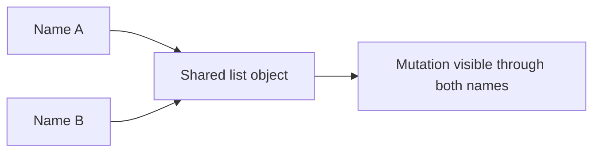
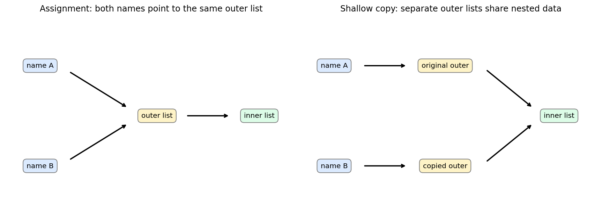

# 03 — Lists, tuples, sets, dictionaries and mutation

[Course map](README.md) · [Practicals](../02-practicals/README.md) · [Questions](../03-questions-and-answers/worked-questions.md#lesson-03)





Names can share an object; shallow copying does not copy nested objects. See the worked example for its assumptions.

## On this page

- [The idea](#the-idea)
- [Work through it](#work-through-it)
- [Common mistakes and practical limits](#common-mistakes-and-practical-limits)

## The idea

**Analogy:** A list is an ordered tray, a dictionary is a labelled cabinet, and a set tracks membership.

Lists are ordered mutable sequences; tuples are immutable sequences; dictionaries map hashable keys to values and preserve insertion order; sets store distinct hashable elements without a sequence-order contract. Choose by the operations you need. Use a dictionary for lookup by ID rather than repeatedly scanning a list. List membership is linear in its length; hash-table membership is typically average constant time, with caveats about hashing and worst cases.

Assignment does not copy. If two names refer to one list, modifying it through either name changes that shared object. A shallow copy creates a new outer container but still shares nested objects. A deep copy recursively copies many nested structures, but is not always the right modelling choice. Prefer clear ownership over copying everything automatically.

Dictionary keys need stable hashing/equality. A tuple containing a list is not hashable merely because its outer type is tuple. Set operations include union, intersection and difference; they are useful for checking missing and extra IDs. Use `collections.Counter` for frequencies and `defaultdict` for controlled grouped accumulation.

## Work through it

```python
from collections import Counter
original = [[1], [2]]
shallow = original.copy()
shallow[0].append(9)
assert original == [[1, 9], [2]]
assert Counter("banana")["a"] == 3
assert {1, 2, 3} - {2, 4} == {1, 3}
prices = {"tea": 20, "coffee": 40}
assert prices.get("water", 0) == 0
```

## Common mistakes and practical limits

`[[0]*3]*2` repeats references to the same inner list. Use a comprehension for independent rows. Do not mutate the size of a collection while iterating over it without a deliberate strategy. Dictionary lookup with [] raises KeyError for a missing key.

---

[← Numbers, strings, booleans and operators](lesson-02-values-and-operators.md) · [Decisions, loops, comprehensions and pattern matching →](lesson-04-decisions-and-loops.md)
