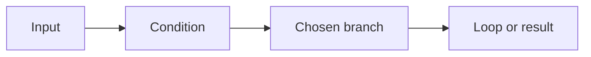

# 04 — Decisions, loops, comprehensions and pattern matching

[Course map](README.md) · [Practicals](../02-practicals/README.md) · [Questions](../03-questions-and-answers/worked-questions.md#lesson-04)



## On this page

- [The idea](#the-idea)
- [Work through it](#work-through-it)
- [Common mistakes and practical limits](#common-mistakes-and-practical-limits)

## The idea

**Analogy:** Control flow is a junction map: a condition selects a road and a loop repeats a route.

`if`/`elif`/`else` choose a block using truth values. A `for` loop consumes an iterable; a `while` loop repeats while its condition remains true. `break` exits the nearest loop, `continue` skips to its next iteration, and a loop's `else` runs only if the loop ends without break. `range` excludes its stop value.

Use `enumerate` for indices and values, `zip` for paired iteration and sorted keys for a deliberate ordering. Ordinary zip stops at the shortest input; validate equal lengths when silent truncation would hide a data error. A comprehension expresses a transformation/filter concisely, but deeply nested comprehensions can obscure the problem. Generator expressions produce items lazily.

Structural pattern matching, available from Python 3.10, matches shapes as well as values. A bare name in a pattern usually captures a value rather than comparing with a variable. Use literal patterns or qualified constants and keep the version requirement visible. For ordinary binary conditions, if/else is often clearer.

## Work through it

```python
values = [3, -1, 4, 0]
positive_squares = [x*x for x in values if x > 0]
assert positive_squares == [9, 16]
for index, value in enumerate(values):
    if value == 0:
        found = index
        break
else:
    found = None
assert found == 3
```

## Common mistakes and practical limits

An unmodified while-loop condition can run forever. Do not use a list comprehension only for side effects. Check inclusive/exclusive boundaries and empty input, not merely one typical example.

---

[← Lists, tuples, sets, dictionaries and mutation](lesson-03-collections-and-mutation.md) · [Functions, arguments, scope and docstrings →](lesson-05-functions-and-scope.md)
