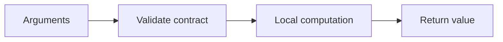

# 05 — Functions, arguments, scope and docstrings

[Course map](README.md) · [Practicals](../02-practicals/README.md) · [Questions](../03-questions-and-answers/worked-questions.md#lesson-05)



## On this page

- [The idea](#the-idea)
- [Work through it](#work-through-it)
- [Common mistakes and practical limits](#common-mistakes-and-practical-limits)

## The idea

**Analogy:** A function is a small machine with an input contract, a result and a defined failure mode.

Use `def` to package a repeated idea. A function should make its inputs, outputs and side effects clear. Positional and keyword arguments serve different calling styles; `*args` collects positional arguments and `**kwargs` collects keyword arguments. Keyword-only parameters make ambiguous options explicit. A function without an explicit return returns None.

Default argument expressions are evaluated when the function is defined, not each time it is called. Use None as a sentinel when a new mutable object is needed per call. Python resolves names through local, enclosing, global and built-in scopes. Assignment inside a function normally creates a local name; `global` and `nonlocal` change the binding target but often signal a need to reconsider hidden state.

Type hints document expected types and support static tooling; they do not ordinarily enforce values at runtime. A docstring explains purpose, parameters, return value and important exceptions. Pure functions, whose results depend on inputs without hidden mutation, are easier to test. Separate computation from printing, file access and network effects.

## Work through it

```python
def add_tag(tag, tags=None):
    """Return a new collection when tags is omitted."""
    if tags is None:
        tags = []
    tags.append(tag)
    return tags
assert add_tag("python") == ["python"]
assert add_tag("sql") == ["sql"]

def ratio(part: float, total: float) -> float:
    if total <= 0:
        raise ValueError("total must be positive")
    return part / total
assert ratio(2, 4) == 0.5
```

## Common mistakes and practical limits

A mutable default can accidentally carry results between calls. Rebinding an argument name differs from mutating its object. Catching every error and returning 0 can conceal a failed calculation as a valid result.

---

[← Decisions, loops, comprehensions and pattern matching](lesson-04-decisions-and-loops.md) · [Iterables, iterators, generators and lazy pipelines →](lesson-06-iteration-and-generators.md)
