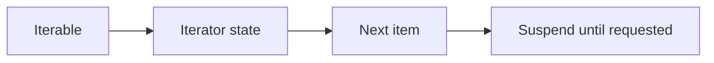
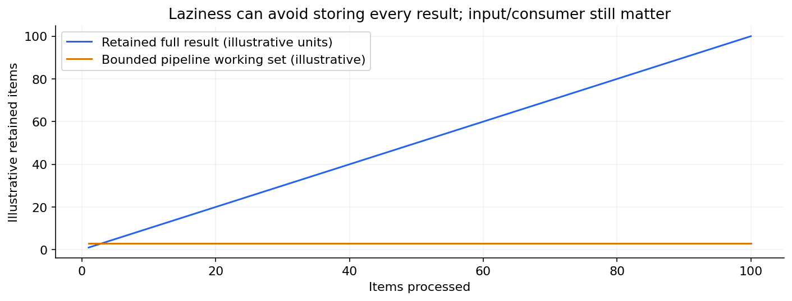
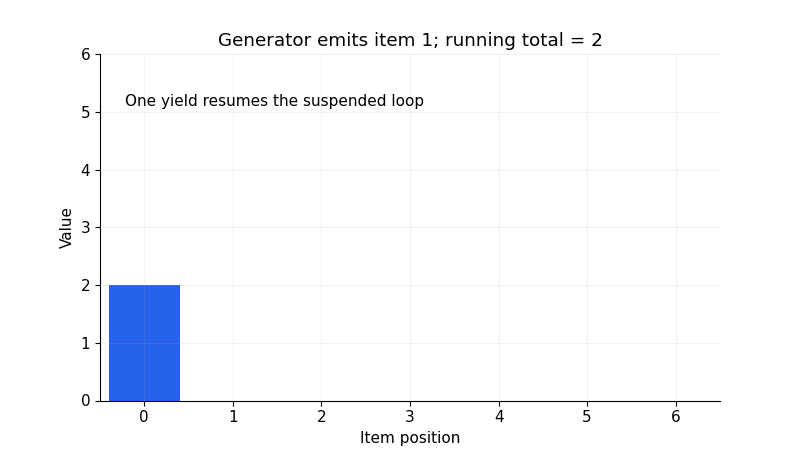

# 06 — Iterables, iterators, generators and lazy pipelines

[Course map](README.md) · [Practicals](../02-practicals/README.md) · [Questions](../03-questions-and-answers/worked-questions.md#lesson-06)





A lazy consumer retains a small working set rather than a complete result. See the worked example for its assumptions.

## On this page

- [The idea](#the-idea)
- [Work through it](#work-through-it)
- [Common mistakes and practical limits](#common-mistakes-and-practical-limits)

## The idea

**Analogy:** A generator is a tap that supplies the next item on demand rather than filling the whole tank.

An iterable can produce an iterator using `iter`. An iterator advances with `next` and signals exhaustion with StopIteration. Lists are re-iterable; a particular generator object is typically consumed once. A generator function contains `yield`, suspending its local state between outputs.

Laziness reduces peak memory for long pipelines, but does not make all computation free. Sorting a complete stream still needs access to its values. A delayed error may appear only when a generator is consumed. File-backed iteration also needs a resource lifetime long enough to finish consuming the data.

Use generator expressions for simple transformations, `itertools` for combinations and stream operations, and explicit loops when state or error handling is complicated. Avoid materializing an enormous list just to sum its elements. On the other hand, materialize deliberately if you need random access, repeated passes or a stable snapshot.



A generator resumes to emit the next value; state persists between yields.

## Work through it

```python
def running_total(values):
    total = 0
    for value in values:
        total += value
        yield total
stream = running_total([2, 3, 4])
assert next(stream) == 2
assert list(stream) == [5, 9]
assert list(stream) == []
assert sum(x*x for x in range(5)) == 30
```

## Common mistakes and practical limits

Testing a generator's truthiness does not tell you whether it contains items. Consuming it for logging changes what downstream code receives. Reusing a consumed generator silently produces no more items.

---

[← Functions, arguments, scope and docstrings](lesson-05-functions-and-scope.md) · [Files, paths, CSV, JSON, dates and regular expressions →](lesson-07-files-and-formats.md)
