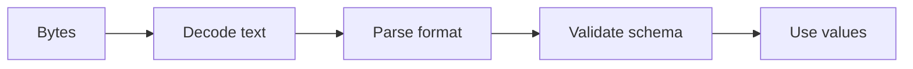

# 07 — Files, paths, CSV, JSON, dates and regular expressions

[Course map](README.md) · [Practicals](../02-practicals/README.md) · [Questions](../03-questions-and-answers/worked-questions.md#lesson-07)



## On this page

- [The idea](#the-idea)
- [Work through it](#work-through-it)
- [Common mistakes and practical limits](#common-mistakes-and-practical-limits)

## The idea

**Analogy:** Data formats are agreements: values are useful only when both writer and reader agree on their meaning.

Use `pathlib.Path` to construct paths, and a `with` block to close files even when an exception occurs. Specify text encoding, usually UTF-8, rather than relying on the machine default. A relative path resolves against the process's current working directory, not automatically against the script location.

Use `csv` for CSV quoting and delimiters instead of splitting every line on commas. Use JSON for nested interoperable values; JSON does not represent every Python object, tuple or arbitrary date natively. Validate required fields and types after parsing: syntactically valid JSON is not necessarily a valid order. Never use eval to parse external data.

Use timezone-aware datetime values for actual instants and distinguish them from local calendar dates. Define a business timezone for day grouping and daylight-saving transitions. Regular expressions describe text patterns; use raw strings to avoid double escaping. Prefer explicit parsers for complex formats rather than one enormous regex.

## Work through it

```python
import csv, io, json
from datetime import datetime, timezone
text = 'name,amount\n"Dixit, Subhash",20\n'
rows = list(csv.DictReader(io.StringIO(text)))
assert rows[0]["name"] == "Dixit, Subhash"
record = json.loads('{"amount":20}')
assert isinstance(record["amount"], int)
stamp = datetime(2026, 1, 1, tzinfo=timezone.utc)
assert stamp.utcoffset().total_seconds() == 0
```

## Common mistakes and practical limits

CSV amounts arrive as text until converted. JSON duplicate-key handling may hide malformed inputs unless you check it. Avoid mixing naive and aware timestamps or treating local midnight as a universal instant.

---

[← Iterables, iterators, generators and lazy pipelines](lesson-06-iteration-and-generators.md) · [Exceptions, context managers, logging and debugging →](lesson-08-errors-and-logging.md)
