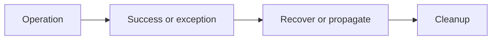

# 08 — Exceptions, context managers, logging and debugging

[Course map](README.md) · [Practicals](../02-practicals/README.md) · [Questions](../03-questions-and-answers/worked-questions.md#lesson-08)



## On this page

- [The idea](#the-idea)
- [Work through it](#work-through-it)
- [Common mistakes and practical limits](#common-mistakes-and-practical-limits)

## The idea

**Analogy:** Exceptions are a labelled emergency exit; a useful label tells the caller what failed.

Python raises an exception when an operation cannot complete. Catch the narrow errors you can handle meaningfully. Use `try`/`except` for recovery, `else` for work after a successful try, and `finally` for cleanup regardless of success. Context managers normally express resource cleanup more clearly.

Raise ValueError for an invalid value under a valid type, TypeError for an inappropriate type when that is the contract, or a domain-specific exception when callers need to distinguish a meaningful failure. Use exception chaining to retain the original cause. Do not return an apparently valid zero when a data file was unreadable.

Logging records events with levels and context. Include a job identifier, relevant counts and the failing operation, but exclude secrets and unnecessary personal data. Use parameterized logging rather than eagerly formatting expensive strings. Debug by reproducing a minimal failing input, checking assumptions and inspecting a traceback; changing random lines until a test passes is not diagnosis.

## Work through it

```python
def parse_positive(raw):
    try:
        value = int(raw)
    except ValueError as exc:
        raise ValueError("expected an integer") from exc
    if value <= 0:
        raise ValueError("expected a positive value")
    return value
assert parse_positive("12") == 12
try:
    parse_positive("bad")
except ValueError as exc:
    assert "integer" in str(exc)
```

## Common mistakes and practical limits

A bare except catches errors you probably did not intend to suppress. A return inside finally can override an earlier return or exception. Assertions are development checks and may be disabled; do not use them as the sole validation of untrusted input.

---

[← Files, paths, CSV, JSON, dates and regular expressions](lesson-07-files-and-formats.md) · [Classes, dataclasses, composition and protocols →](lesson-09-classes-and-dataclasses.md)
