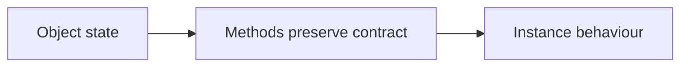

# 09 — Classes, dataclasses, composition and protocols

[Course map](README.md) · [Practicals](../02-practicals/README.md) · [Questions](../03-questions-and-answers/worked-questions.md#lesson-09)



## On this page

- [The idea](#the-idea)
- [Work through it](#work-through-it)
- [Common mistakes and practical limits](#common-mistakes-and-practical-limits)

## The idea

**Analogy:** An object bundles state with the operations that keep that state meaningful.

A class defines behaviour and instances carry state. `__init__` initializes an instance after creation; `self` refers to that instance. Instance attributes belong to one object; mutable class attributes are shared and can surprise you. Methods express operations related to the object; not every two-line function needs a class.

A dataclass generates common methods for record-like classes. Use `default_factory` for a new mutable value per instance. Frozen dataclasses prevent ordinary field assignment but do not recursively freeze nested objects. Properties can enforce controlled access, while naming conventions and clear APIs are usually more useful than pretending Python attributes are perfectly private.

Composition gives an object another object to delegate to; inheritance models a substitutable relationship and can create tight coupling when overused. Duck typing focuses on supported operations. Protocols can describe those operations for static tools without requiring inheritance. Special methods such as `__len__`, `__iter__` and `__repr__` connect classes to Python conventions.

## Work through it

```python
from dataclasses import dataclass, field
@dataclass
class Basket:
    prices: list = field(default_factory=list)
    def total(self):
        return sum(self.prices)
a, b = Basket(), Basket()
a.prices.append(20)
assert a.total() == 20 and b.total() == 0
```

## Common mistakes and practical limits

A subclass should satisfy the contract expected of the base type, not merely share a convenient method name. Avoid deeply nested inheritance for a simple transformation pipeline. Dataclasses do not automatically validate field values.

---

[← Exceptions, context managers, logging and debugging](lesson-08-errors-and-logging.md) · [Modules, packages, environments, typing and tests →](lesson-10-modules-packaging-and-quality.md)
