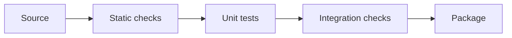

# 10 — Modules, packages, environments, typing and tests

[Course map](README.md) · [Practicals](../02-practicals/README.md) · [Questions](../03-questions-and-answers/worked-questions.md#lesson-10)



## On this page

- [The idea](#the-idea)
- [Work through it](#work-through-it)
- [Common mistakes and practical limits](#common-mistakes-and-practical-limits)

## The idea

**Analogy:** A package is a labelled toolbox; tests check that its tools still meet their promises.

A module is an importable Python file; a package organizes modules. Imports execute a module's top-level code on its first normal import in a process. Keep expensive work and side effects inside functions. Use `if __name__ == "__main__"` for script-only entry behaviour. Avoid circular imports by separating shared interfaces and keeping dependencies directional.

A virtual environment isolates installed dependencies. Record requirements or project metadata and a supported Python version; a lock strategy helps reproducibility. Do not commit environment directories or credentials. Package metadata, command entry points and automated checks help a small script become a maintainable project.

Tests should verify meaningful contracts, including empty, invalid and boundary inputs. Unit tests isolate a function; integration tests exercise components together. Static type checks and linters catch different mistakes from runtime tests. Type annotations using Optional/union types describe missingness explicitly, but runtime validation is still needed at external boundaries. Profile before optimizing: asymptotic cost, I/O and unnecessary copying often matter more than tiny syntax changes.

## Work through it

```python
def average(values):
    if not values:
        raise ValueError("need at least one value")
    return sum(values) / len(values)
assert average([2, 4]) == 3
try:
    average([])
except ValueError:
    pass
else:
    raise AssertionError("empty input should fail")
```

## Common mistakes and practical limits

Do not use a passing test suite as proof of correct requirements. Tests that copy the implementation can repeat the same bug. Keep dependency installation separate from application execution and avoid executing network calls merely by importing a module.

---

[← Classes, dataclasses, composition and protocols](lesson-09-classes-and-dataclasses.md) · [Closures, decorators, context managers and concurrency →](lesson-11-advanced-functions.md)
