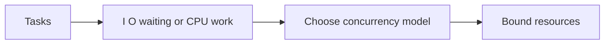

# 11 — Closures, decorators, context managers and concurrency

[Course map](README.md) · [Practicals](../02-practicals/README.md) · [Questions](../03-questions-and-answers/worked-questions.md#lesson-11)



## On this page

- [The idea](#the-idea)
- [Work through it](#work-through-it)
- [Common mistakes and practical limits](#common-mistakes-and-practical-limits)

## The idea

**Analogy:** A decorator wraps a tool with another behaviour; concurrency coordinates several tasks sharing time or resources.

Functions are objects that can be passed and returned. A closure retains access to enclosing bindings. A decorator replaces a function with a wrapper; use functools.wraps to preserve useful metadata. A context manager establishes and reliably cleans up a resource scope, commonly through `with` or contextlib.contextmanager.

Threads can overlap I/O and some work in native libraries; CPU-heavy pure-Python work in common GIL-enabled CPython builds does not generally gain linear thread speedup. Processes can run independent CPU work with serialization and memory overhead. Python runtime/build details matter, so avoid treating the GIL as a universal rule about every implementation or version.

`async`/`await` coordinates cooperative tasks, especially waiting on supported I/O. It is not automatic parallel execution and blocking calls inside an event loop can stall other tasks. Use cancellation, timeouts and bounded concurrency. Shared mutable state needs synchronization or an ownership strategy regardless of how elegant the syntax looks.

## Work through it

```python
from functools import wraps
def nonnegative_result(fn):
    @wraps(fn)
    def wrapped(*args, **kwargs):
        result = fn(*args, **kwargs)
        if result < 0:
            raise ValueError("negative result")
        return result
    return wrapped
@nonnegative_result
def total(values):
    return sum(values)
assert total([2, 3]) == 5
assert total.__name__ == "total"
```

## Common mistakes and practical limits

Loop-created closures can share a late-bound variable; bind intentionally. A cache can retain large objects or stale results. Async functions do not run to completion merely because you called them; a coroutine needs an appropriate awaiting/execution context.

---

[← Modules, packages, environments, typing and tests](lesson-10-modules-packaging-and-quality.md) · [NumPy, pandas, vectorization and data cleaning →](lesson-12-arrays-and-dataframes.md)
