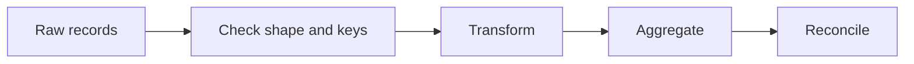

# 12 — NumPy, pandas, vectorization and data cleaning

[Course map](README.md) · [Practicals](../02-practicals/README.md) · [Questions](../03-questions-and-answers/worked-questions.md#lesson-12)



## On this page

- [The idea](#the-idea)
- [Work through it](#work-through-it)
- [Common mistakes and practical limits](#common-mistakes-and-practical-limits)

## The idea

**Analogy:** An array is a regular grid; a DataFrame adds labelled columns and row alignment.

NumPy arrays have a shape, dtype and often shared storage. Vectorized operations apply efficient array kernels; broadcasting aligns dimensions from the right, accepting equal lengths or a dimension of 1. A matrix product uses `@`; `*` is normally elementwise. Slices can be views, so modifications may affect the original. Explicit copies clarify ownership when necessary.

pandas Series/DataFrames add labels and alignment. Select using clear label-based `.loc` or position-based `.iloc` rules. Missing values have dtype-specific behaviour; do not compare NaN with == to detect missingness. Groupby aggregates at a chosen grain, and merge joins records by keys. Validate cardinality and row counts so a many-to-many join does not silently multiply revenue.

For data work, profile schema, nulls, duplicates, units, ranges and key uniqueness before transformation. Keep raw inputs immutable. Use vectorized expressions where they improve clarity, but avoid giant intermediate arrays that exceed memory. Library behaviour, including copy semantics, evolves: use explicit assignment and read the guide for the installed pandas version rather than relying on chained-assignment folklore.

## Work through it

For a matrix of shape(100,3), adding a vector of shape(3,) broadcasts a value per column. Adding shape(100,) does not mean a value per row: use shape(100,1). For an order table, grouping by customer gives one row per customer; joining it back to order lines repeats the customer total on each line. Summing that repeated total is a double-counting error.

```python
# A dependency-free analogue of grouping before a pandas groupby.
from collections import defaultdict
by_customer = defaultdict(int)
for customer, amount in [("a", 20), ("a", 30), ("b", 10)]:
    by_customer[customer] += amount
assert dict(by_customer) == {"a": 50, "b": 10}
```

## Common mistakes and practical limits

Vectorization is not permission to ignore shapes. Labels can align unexpectedly if indices differ. Do not fill all missing values with 0 without considering meaning, and fit modelling transformations only on training data.

---

[← Closures, decorators, context managers and concurrency](lesson-11-advanced-functions.md) · [Continue with practicals](../02-practicals/README.md)
