# Linear Algebra and Matrices

A visual guide to the maths behind data, machine learning, and AI. Read the picture first, follow the small calculation, then connect it to a practical task.

[Mathematics and Statistics](../README.md) · [Original handwritten PDF](archive/Linear%20Algebra%20%26%20Matrices.pdf)

**How to read:** Start with vectors and matrices. Then study projection, rank, and linear systems. Finally, use those ideas in PCA, compression, neural networks, attention, and model training. You do not need to memorize every derivation on the first pass.

## The big picture

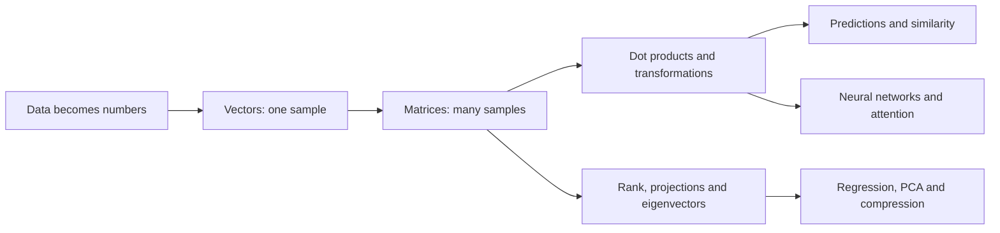

| Your question | Linear algebra helps with |
|---|---|
| How do I represent a customer, document, or image? | Vectors and matrices |
| Which items point in a similar direction? | Dot product and cosine similarity |
| How can I fit predictions to observed targets? | Least squares and gradients |
| Which feature directions are redundant? | Rank and null space |
| Can I keep fewer dimensions? | Projection, eigenvectors, PCA, and SVD |
| What happens inside an AI model? | Matrix multiplication, weighted sums, and nonlinearities |

## Contents

1. [Scalars, vectors and vector types](#1-scalars-vectors-and-vector-types)
2. [Vector addition and subtraction](#2-vector-addition-and-subtraction)
3. [Coordinates, magnitude and direction](#3-coordinates-magnitude-and-direction)
4. [Dot product and projection](#4-dot-product-and-projection)
5. [Vector norms](#5-vector-norms)
6. [Changing coordinates](#6-changing-coordinates)
7. [Linear dependence, independence and basis](#7-linear-dependence-independence-and-basis)
8. [Matrices and linear transformations](#8-matrices-and-linear-transformations)
9. [Matrix operations and types](#9-matrix-operations-and-types)
10. [Rank, null space and nullity](#10-rank-null-space-and-nullity)
11. [Solving linear equations](#11-solving-linear-equations)
12. [Least squares and minimum-norm solutions](#12-least-squares-and-minimum-norm-solutions)
13. [Projection onto a subspace](#13-projection-onto-a-subspace)
14. [Lines, planes, hyperplanes and halfspaces](#14-lines-planes-hyperplanes-and-halfspaces)
15. [Eigenvalues and eigenvectors](#15-eigenvalues-and-eigenvectors)
16. [PCA: keep the directions that vary most](#16-pca-keep-the-directions-that-vary-most)
17. [SVD: separate a matrix into reusable patterns](#17-svd-separate-a-matrix-into-reusable-patterns)
18. [The same operations inside AI systems](#18-the-same-operations-inside-ai-systems)
19. [Gradients: how model coefficients are learned](#19-gradients-how-model-coefficients-are-learned)
20. [Quick revision](#20-quick-revision)

## 1. Scalars, vectors and vector types

A **scalar** tells us only the amount, or magnitude. Examples: height, mass, and speed of 40 km/h.

A **vector** tells us the amount **and** the direction. Example: velocity of 40 km/h towards the south.

We draw a vector as an arrow. The start is its **tail**, the end is its **head**, and the arrow's length represents its magnitude. We write it as $\vec a$ or $\overrightarrow{AB}$.

| Type | Simple meaning |
|---|---|
| Zero vector | All components are zero; magnitude is zero. |
| Unit vector | Magnitude is 1. |
| Co-initial vectors | Start at the same point. |
| Collinear vectors | Lie along the same line or parallel lines. |
| Equal vectors | Same magnitude and same direction, even if drawn at different positions. |
| Negative/opposite vectors | Same magnitude, opposite direction: $\vec a$ and $-\vec a$. |
| Like vectors | Point in the same direction; lengths can differ. |
| Unlike vectors | Point in opposite directions; lengths can differ. |

**Clarification:** A zero vector does not have a unique direction. The statement “a vector has magnitude and direction” needs this exception.

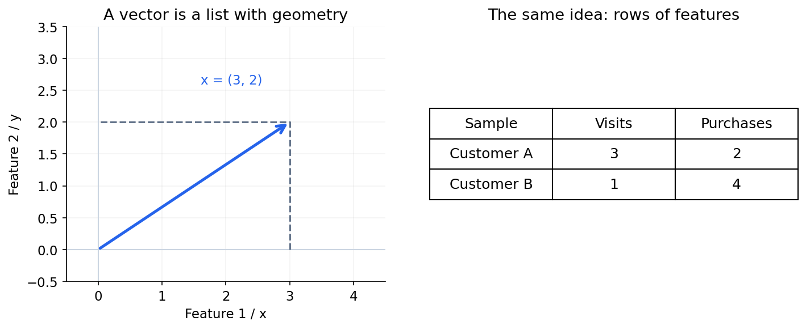

### Why vectors matter in data science

A row such as `(age, income, purchases)` is a feature vector for one customer. Each coordinate is one feature. A model receives these coordinates together, rather than treating the customer as one number. Features have different units, so their raw vector length may not be meaningful until we choose suitable scaling.

## 2. Vector addition and subtraction

### 2.1 Head-to-tail method

To add $\vec u$ and $\vec v$:

1. Draw $\vec u$.
2. Place the tail of $\vec v$ at the head of $\vec u$.
3. Draw an arrow from the first tail to the final head. This is $\vec u+\vec v$.

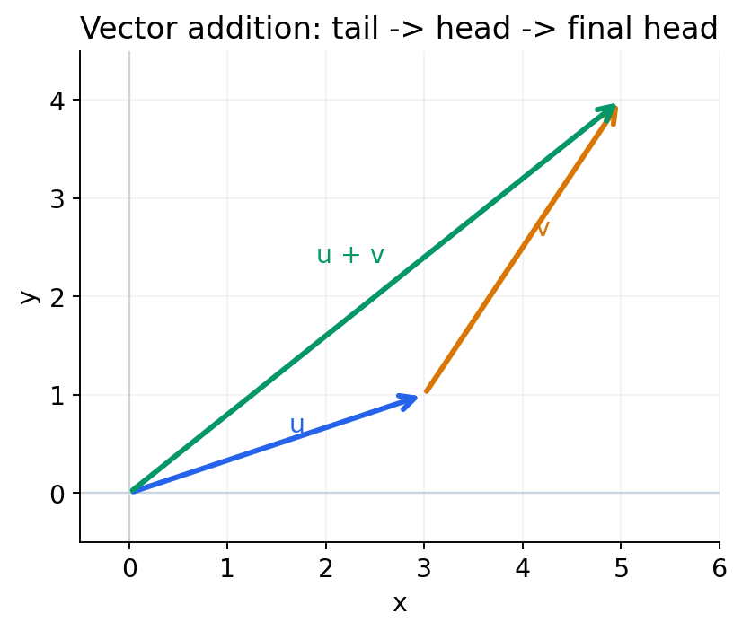

### 2.2 Parallelogram method

Draw both vectors from the same starting point. Complete the parallelogram. Its diagonal from the common starting point is the resultant.

### 2.3 Subtraction

Subtracting a vector means adding its negative:

$$
\vec u-\vec v=\vec u+(-\vec v).
$$

Reverse the direction of $\vec v$, then use head-to-tail addition.

### 2.4 Addition properties

$$
\begin{aligned}
\vec u+\vec v&=\vec v+\vec u &&\text{commutative}\\
(\vec u+\vec v)+\vec w&=\vec u+(\vec v+\vec w) &&\text{associative}\\
\vec v+\vec 0&=\vec v &&\text{identity}\\
\vec v+(-\vec v)&=\vec 0 &&\text{additive inverse}.
\end{aligned}
$$

### 2.5 Resultant magnitude and direction

Suppose two vectors have magnitudes $A$ and $B$, with angle $\theta$ between them. Place the first along the horizontal axis.

The second vector has horizontal component $B\cos\theta$ and vertical component $B\sin\theta$. So:

$$
R_x=A+B\cos\theta,\qquad R_y=B\sin\theta.
$$

Using Pythagoras:

$$
\begin{aligned}
R^2&=(A+B\cos\theta)^2+(B\sin\theta)^2\\
&=A^2+B^2+2AB\cos\theta,\\
R&=\sqrt{A^2+B^2+2AB\cos\theta}.
\end{aligned}
$$

The direction $\phi$ measured from the first vector satisfies:

$$
\tan\phi=\frac{B\sin\theta}{A+B\cos\theta}.
$$

**In simple words:** In code, `atan2(R_y, R_x)` handles the quadrant correctly. The zero resultant has no unique direction.

> **Remember:** Take the square root to obtain magnitude $R$. The expression without the square root gives $R^2$.

## 3. Coordinates, magnitude and direction

The standard unit vectors are $\hat i$ in the x-direction, $\hat j$ in the y-direction, and $\hat k$ in the z-direction.

The same vector can be written in different forms:

$$
\vec a=2\hat i+3\hat j+4\hat k
=\begin{bmatrix}2\\3\\4\end{bmatrix}.
$$

The column contains the vector's coordinates. In data science, a sample with $n$ numerical features can be represented in $n$ dimensions, even when we cannot draw those dimensions.

### Magnitude

$$
\|\vec a\|_2=\sqrt{a_1^2+a_2^2+\cdots+a_n^2}.
$$

Examples from the notes:

- $3\hat i+4\hat j$ has magnitude $\sqrt{9+16}=5$.
- $4\hat i+3\hat j$ also has magnitude 5, but points in a different direction.
- $7\hat i+2\hat j$ has magnitude $\sqrt{53}$.

### Unit direction

For a nonzero vector:

$$
\hat a=\frac{\vec a}{\|\vec a\|_2}.
$$

In simple words: divide by the length to keep only the direction. The resulting vector still has a magnitude - exactly 1.

### Distance between two points

Distance is the length of their difference:

$$
d(A,B)=\|B-A\|_2.
$$

For $A=(2,7)$ and $B=(5,3)$:

$$
d(A,B)=\sqrt{(5-2)^2+(3-7)^2}=\sqrt{25}=5.
$$

Their unit directions from the origin are $(2,7)/\sqrt{53}$ and $(5,3)/\sqrt{34}$. These are different from the direction of the displacement $B-A$.

### Use in data science: distance and scaling

Distance helps us compare samples in clustering and nearest-neighbour methods. A feature measured in thousands can dominate one measured between 0 and 1. Scaling changes that comparison. **Standardizing features** and **normalizing each vector to unit length** are different operations; choose according to the task.

## 4. Dot product and projection

### 4.1 Dot product

The dot product combines two vectors into a **scalar**:

$$
\vec a\cdot\vec b=\vec a^T\vec b
=\sum_{i=1}^{n}a_i b_i
=\|\vec a\|_2\|\vec b\|_2\cos\theta.
$$

For example:

$$
\vec a=\begin{bmatrix}2\\3\\4\end{bmatrix},\qquad
\vec b=\begin{bmatrix}1\\7\\8\end{bmatrix},
$$

$$
\vec a^T\vec b=2(1)+3(7)+4(8)=55.
$$

Remember:

- $\theta=0^\circ$: dot product equals the product of the magnitudes.
- $\theta=90^\circ$: dot product is zero; the vectors are **orthogonal**.
- The dot product can be negative when the vectors point more against each other than along each other.

The resultant formula also becomes:

$$
\|\vec a+\vec b\|_2^2
=\|\vec a\|_2^2+\|\vec b\|_2^2+2\vec a^T\vec b.
$$

> **Do not mix them up:** The dot product is not the projection length. Divide by the length of the target vector to obtain the scalar projection.

### 4.2 Scalar and vector projection

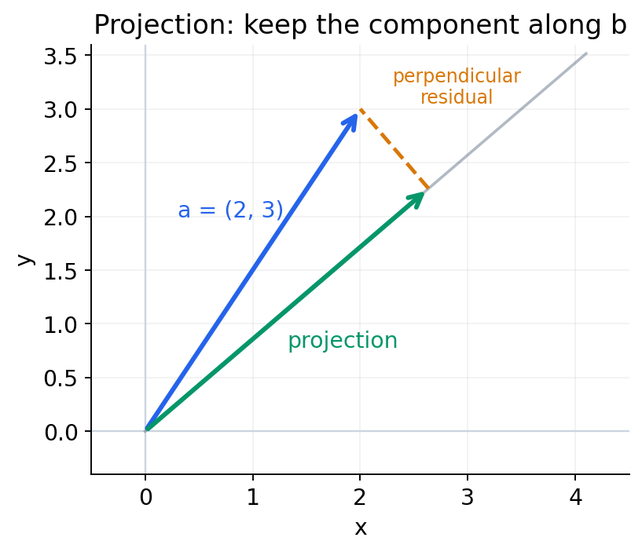

Projection asks: **how much of $\vec a$ lies along $\vec b$?** Assume $\vec b\ne0$.

The signed scalar projection is:

$$
p=\frac{\vec a^T\vec b}{\|\vec b\|_2}.
$$

To turn this into a vector, multiply by the unit direction of $\vec b$:

$$
\operatorname{proj}_{\vec b}(\vec a)
=p\frac{\vec b}{\|\vec b\|_2}
=\frac{\vec a^T\vec b}{\vec b^T\vec b}\vec b.
$$

For $\vec a=(2,3)$ and $\vec b=(7,6)$:

$$
\vec a^T\vec b=14+18=32,\qquad \|\vec b\|_2=\sqrt{85}.
$$

So:

$$
p=\frac{32}{\sqrt{85}},\qquad
\operatorname{proj}_{\vec b}(\vec a)
=\frac{32}{85}\begin{bmatrix}7\\6\end{bmatrix}
=\begin{bmatrix}224/85\\192/85\end{bmatrix}.
$$

**In simple words:** $p$ is signed. The magnitude of the projection is $|p|$. The residual $\vec a-\operatorname{proj}_{\vec b}(\vec a)$ is perpendicular to $\vec b$.

### 4.3 Check the angle before using it

Suppose $\vec a=(3,4,7)$ and $\vec b=(7,0,3)$. Compute the angle from the components; do not assume it is $30^\circ$.

The dot product is 42, so $\cos\theta=42/(\sqrt{74}\sqrt{58})$ and $\theta\approx50.13^\circ$. For these vectors, $\|\vec a+\vec b\|=\sqrt{216}=6\sqrt6$. The components determine the answer.

### Use in data science: weighted scores and similarity

A linear model calculates a score using a dot product: $s=\vec w^T\vec x+b$. Features with larger matching weights contribute more to the score. For nonzero vectors, dividing the dot product by both lengths gives **cosine similarity**: it compares direction rather than overall size, which is useful for text embeddings.

## 5. Vector norms

A norm is a way of measuring vector size.

| Norm | Formula | Example for $\vec a=(-3,4)$ |
|---|---|---|
| L1 | $\|\vec a\|_1=\sum_i\lvert a_i\rvert$ | $3+4=7$ |
| L2 | $\|\vec a\|_2=\sqrt{\sum_i a_i^2}$ | $\sqrt{9+16}=5$ |
| Infinity/max | $\|\vec a\|_\infty=\max_i\lvert a_i\rvert$ | $4$ |

The general p-norm, for $p\ge1$, is:

$$
\|\vec a\|_p=\left(\sum_{i=1}^{n}\lvert a_i\rvert^p\right)^{1/p}.
$$

These norms also appear in regularization:

- **Lasso:** uses an L1 penalty on model coefficients.
- **Ridge:** uses a squared L2 penalty on model coefficients.

**In simple words:** The L2 norm is a square root; the usual ridge penalty is its square. They are closely related but are not the same expression.

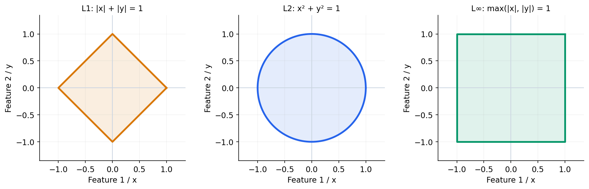

**Read the picture:** Each boundary contains vectors with norm 1 under that norm. “Same size” depends on the rule we choose.

### Why the penalty matters

Very large model coefficients can make predictions sensitive to small input changes. Regularization discourages large coefficients. L1 can make some coefficients exactly zero; L2 usually shrinks coefficients without making them exactly zero. The penalty strength balances fitting the training data against keeping coefficients small.

## 6. Changing coordinates

The vector stays the same. We describe it using different reference directions.

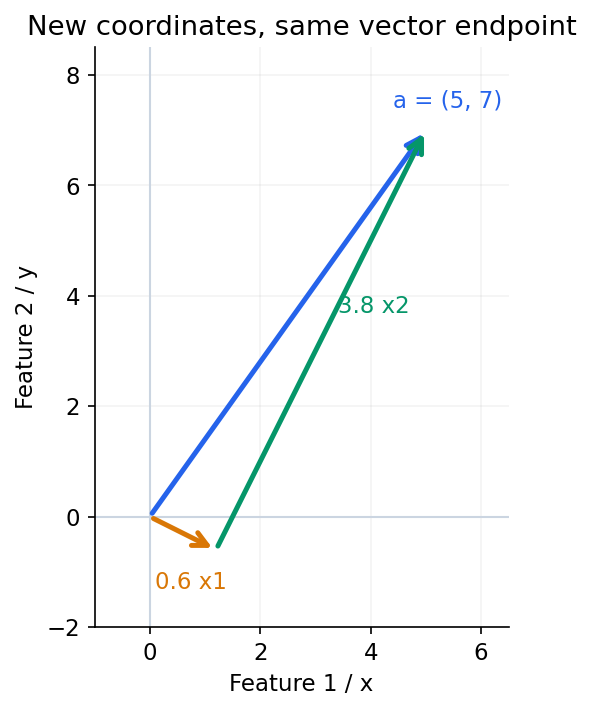


Take this example:

$$
\vec a=\begin{bmatrix}5\\7\end{bmatrix},\quad
\vec x_1=\begin{bmatrix}2\\-1\end{bmatrix},\quad
\vec x_2=\begin{bmatrix}1\\2\end{bmatrix}.
$$

First check that the new directions are perpendicular:

$$
\vec x_1^T\vec x_2=2(1)+(-1)(2)=0.
$$

Both have length $\sqrt5$. Since they are orthogonal, their coefficients can be found separately:

$$
\lambda_1=\frac{\vec a^T\vec x_1}{\vec x_1^T\vec x_1}
=\frac{10-7}{5}=\frac35,
$$

$$
\lambda_2=\frac{\vec a^T\vec x_2}{\vec x_2^T\vec x_2}
=\frac{5+14}{5}=\frac{19}{5}.
$$

So:

$$
\vec a=\frac35\vec x_1+\frac{19}{5}\vec x_2
=\begin{bmatrix}5\\7\end{bmatrix}.
$$

The scalar projection lengths are $3/\sqrt5$ and $19/\sqrt5$; the coordinates in the **non-unit** basis are $3/5$ and $19/5$. Do not mix these up.

> **Remember:** These new axes are orthogonal but not unit length. The coefficients in this basis are different from scalar projection lengths.

## 7. Linear dependence, independence and basis

### 7.1 Linear combination

A linear combination means multiply vectors by scalars and add them:

$$
\vec v=c_1\vec v_1+c_2\vec v_2+\cdots+c_k\vec v_k.
$$

Example:

$$
\vec v_1=\begin{bmatrix}1\\2\\3\end{bmatrix},\quad
\vec v_2=\begin{bmatrix}2\\4\\6\end{bmatrix}=2\vec v_1,\quad
\vec v_3=\begin{bmatrix}0.5\\1\\1.5\end{bmatrix}=\frac12\vec v_1.
$$

They all lie along one direction. The set is **linearly dependent**.

### 7.2 Test for independence

Consider:

$$
c_1\vec v_1+\cdots+c_k\vec v_k=\vec0.
$$

- If the **only** solution is $c_1=\cdots=c_k=0$, the vectors are independent.
- If a solution exists with **at least one** nonzero coefficient, they are dependent.

It is not necessary for every coefficient in a dependence relation to be nonzero.

The standard vectors $(1,0,0)$, $(0,1,0)$ and $(0,0,1)$ are independent.

For example:

$$
\vec a_1=\begin{bmatrix}1\\2\\3\end{bmatrix},\quad
\vec a_2=\begin{bmatrix}0\\0\\1\end{bmatrix},\quad
\vec a_3=\begin{bmatrix}0\\0\\2\end{bmatrix},
$$

$$
0\vec a_1+2\vec a_2-\vec a_3=\vec0.
$$

Therefore the set is dependent, even though its first vector points outside the direction shared by the other two.

### 7.3 Basis vectors

A **basis** is a set that:

1. Is linearly independent.
2. Can generate every vector in the space using linear combinations. This is called **spanning** the space.

In $\mathbb R^2$, the standard basis is:

$$
\vec e_1=\begin{bmatrix}1\\0\end{bmatrix},\qquad
\vec e_2=\begin{bmatrix}0\\1\end{bmatrix}.
$$

For example:

$$
\begin{bmatrix}2\\1\end{bmatrix}=2\vec e_1+\vec e_2,
\qquad
\begin{bmatrix}1\\3\end{bmatrix}=\vec e_1+3\vec e_2.
$$

Basis vectors are **not unique**. A basis for $\mathbb R^n$ contains $n$ vectors, but they do not have to be the standard unit vectors.

### 7.4 Find a basis: a small calculation

Take three columns:

$$
v_1=(1,2,3)^T,\qquad v_2=(2,4,6)^T,\qquad v_3=(0,0,1)^T.
$$

Since $v_2=2v_1$, the second vector adds no new direction. The third is not a multiple of the first. So $\{v_1,v_3\}$ is a basis for their span, and the column rank is 2. This span is a plane inside $\mathbb R^3$, not all of $\mathbb R^3$.

For larger problems, place vectors into matrix columns, identify pivot columns by row reduction, and take the corresponding **original** columns. The number of basis vectors comes from the rank; it is not always 2.

### Use in data science: redundant information

If `distance_metres = 1000 × distance_kilometres`, those two feature columns are dependent: the second does not add a new linear direction. Dependence can make regression coefficients non-unique. A basis keeps enough independent directions to describe the same span. This is linear independence, not statistical independence.

## 8. Matrices and linear transformations

A matrix is a rectangular arrangement of numbers. It can store data or transform a vector.

A car can be described by attributes such as engine capacity, number of doors, and colour. Numerical features can enter a matrix directly; categories such as colour need an appropriate numerical encoding.

### 8.1 Equations as a matrix

$$
x-y=1,\qquad 2x+y=5
$$

can be written as:

$$
\underbrace{\begin{bmatrix}1&-1\\2&1\end{bmatrix}}_A
\underbrace{\begin{bmatrix}x\\y\end{bmatrix}}_{\text{input}}
=\underbrace{\begin{bmatrix}1\\5\end{bmatrix}}_{\text{output}}.
$$

The solution is $x=2$, $y=1$.

### 8.2 What do matrix columns mean?

Applying $A$ to the standard basis gives:

$$
A\begin{bmatrix}1\\0\end{bmatrix}=\begin{bmatrix}1\\2\end{bmatrix},
\qquad
A\begin{bmatrix}0\\1\end{bmatrix}=\begin{bmatrix}-1\\1\end{bmatrix}.
$$

These are exactly the columns of $A$. **Each column tells us where a standard basis vector goes.**

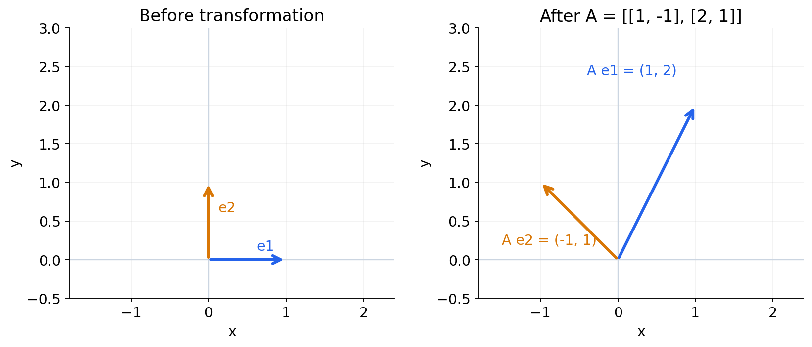

A linear transformation keeps the origin fixed. Straight lines remain straight or can collapse to a point. A general matrix can rotate, stretch, shear, reflect, or collapse directions; it need not be a pure rotation.

### 8.3 Data as a matrix

The convention used in these notes is:

- Rows = samples or observations.
- Columns = features or attributes.

For three example observations:

$$
X=\begin{bmatrix}
150&45&12\\
155&60&24\\
170&65&6
\end{bmatrix}.
$$

The attributes are height, weight, and hair length. A sample is a vector such as $(150,45,12)$.

The same dataset could contain two further observations, $(185,90,8)$ and $(173,75,9)$. Each is another row, with the same three feature positions.

Images are another example: a grayscale image can be represented by a matrix of pixel values. Colour images typically have multiple channels. Models can use numerical image representations for recognition tasks.

## 9. Matrix operations and types

### 9.1 Shape

A matrix of shape $m\times n$ has $m$ rows and $n$ columns.

### 9.2 Addition, subtraction and scalar multiplication

Addition and subtraction require the same shape. Work element by element:

$$
\begin{bmatrix}1&2\\3&4\end{bmatrix}
+\begin{bmatrix}5&6\\7&8\end{bmatrix}
=\begin{bmatrix}6&8\\10&12\end{bmatrix}.
$$

Negation changes every sign:

$$
-\begin{bmatrix}1&3\\2&4\end{bmatrix}
=\begin{bmatrix}-1&-3\\-2&-4\end{bmatrix}.
$$

Scalar multiplication multiplies every entry:

$$
2\begin{bmatrix}1&3\\2&4\end{bmatrix}
=\begin{bmatrix}2&6\\4&8\end{bmatrix}.
$$

### 9.3 Matrix multiplication

The inner dimensions must match:

$$
(m\times n)(n\times p)\longrightarrow(m\times p).
$$

Each output entry is a row-column dot product. For example:

$$
\begin{bmatrix}1&2\\4&5\\1&1\end{bmatrix}
\begin{bmatrix}1&2&3\\6&7&8\end{bmatrix}
=\begin{bmatrix}13&16&19\\34&43&52\\7&9&11\end{bmatrix}.
$$

For example, the top-left entry is $1(1)+2(6)=13$. The second row is $(4(1)+5(6),\;4(2)+5(7),\;4(3)+5(8))=(34,43,52)$.

> **Check one entry yourself:** The bottom-right entry is $1(3)+1(8)=11$. Checking a single row-column product is a useful debugging habit.

### 9.4 Matrix types

| Type | Meaning | Example |
|---|---|---|
| Square | Same number of rows and columns | Any $3\times3$ matrix |
| Symmetric | $A=A^T$ | Entries mirror across the main diagonal |
| Upper triangular | Entries below the main diagonal are zero | See $U$ below |
| Lower triangular | Entries above the main diagonal are zero | See $L$ below |
| Diagonal | Off-diagonal entries are zero | $\operatorname{diag}(1,2,3)$ |
| Identity | Diagonal entries 1, all others 0 | $I$ |

$$
U=\begin{bmatrix}1&2&3\\0&4&5\\0&0&6\end{bmatrix},\quad
L=\begin{bmatrix}1&0&0\\2&4&0\\3&5&6\end{bmatrix},\quad
I=\begin{bmatrix}1&0&0\\0&1&0\\0&0&1\end{bmatrix}.
$$

> **Remember:** Square means equal row and column counts. Symmetric means $a_{ij}=a_{ji}$. A square matrix is not automatically symmetric.

### 9.5 Useful properties

For compatible dimensions:

$$
\begin{aligned}
A+B&=B+A,\\
A+(B+C)&=(A+B)+C,\\
A(BC)&=(AB)C,\\
(A+B)C&=AC+BC,\\
A(B+C)&=AB+AC,\\
I_mA&=AI_n=A\quad\text{for }A\in\mathbb R^{m\times n}.
\end{aligned}
$$

In general, $AB\ne BA$; sometimes one product is not even defined.

> **Remember:** In $A(B+C)$, multiply both terms by $A$: the result is $AB+AC$.

### 9.6 Transpose

Transpose means interchange rows and columns:

$$
\begin{bmatrix}1&2&3\\4&5&6\end{bmatrix}^T
=\begin{bmatrix}1&4\\2&5\\3&6\end{bmatrix}.
$$

$$
(A^T)^T=A,\quad (A+B)^T=A^T+B^T,\quad
(AB)^T=B^TA^T,\quad (kA)^T=kA^T.
$$

Remember to **reverse the order** when transposing a product.

### Use in data science: many predictions at once

With samples in the rows of $X$ and feature weights in $\vec w$, $X\vec w$ calculates a score for every sample in one operation. For $X$ of shape $100\times3$ and $\vec w$ of shape $3\times1$, the result is $100\times1$. Checking shapes is a simple way to catch model-code mistakes.

## 10. Rank, null space and nullity

### 10.1 Why do we need rank?

When exploring a dataset, ask:

1. Are all features important?
2. Can we reduce the data matrix by removing unnecessary features?
3. How do we find correlation and linear relationships?

For a car dataset, features might include speed, engine power, engine capacity, mileage, fuel type, and number of doors. Domain knowledge helps us interpret relationships; for instance, mechanical power is torque × angular velocity.

**Clarification:** Rank measures **exact linear dependence** in the represented matrix. It does not automatically establish feature importance, statistical independence, causation, or every nonlinear relationship. A relationship such as mileage = a function of engine characteristics need not be linear.

### 10.2 Rank

Rank is the number of linearly independent columns. It is also the number of linearly independent rows.

For:

$$
A=\begin{bmatrix}1&2&1\\3&6&0\\5&10&1\end{bmatrix},
$$

column 2 is twice column 1. Column 3 contributes a different direction, so $\operatorname{rank}(A)=2$.

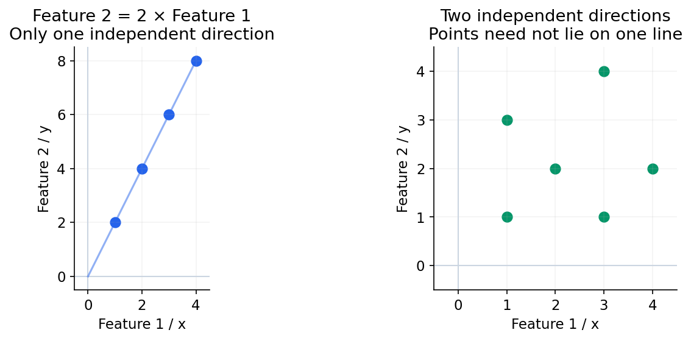

### 10.3 Null space

The null space contains all coefficient vectors that become zero when multiplied by $A$:

$$
\operatorname{Null}(A)=\{\vec z:A\vec z=\vec0\}.
$$

If the columns of $A$ are features, a null-space vector gives coefficients of a linear relationship between those features.

**Nullity** is the **dimension** of the null space - the number of vectors in a basis for it.

> **Remember:** The zero vector belongs to the null space. Nullity counts independent null-space directions, not all the vectors in that space.

### 10.4 Rank-nullity theorem

For an $m\times n$ matrix:

$$
\operatorname{rank}(A)+\operatorname{nullity}(A)=n.
$$

The right side is the **number of columns**, not the number of rows.

### 10.5 Worked examples

**Example 1 - independent columns**

$$
A=\begin{bmatrix}1&2\\2&7\\5&6\end{bmatrix}.
$$

There are two independent columns: rank = 2, nullity = $2-2=0$. Only $\vec z=0$ solves $A\vec z=0$.

**Example 2 - dependent columns**

$$
A=\begin{bmatrix}1&2&1\\2&4&0\\4&8&1\end{bmatrix}.
$$

Column 2 = twice column 1, so rank = 2 and nullity = 1.

To find the null space, solve:

$$
\begin{aligned}
z_1+2z_2+z_3&=0,\\
2z_1+4z_2&=0,\\
4z_1+8z_2+z_3&=0.
\end{aligned}
$$

From the second equation, $z_1=-2z_2$. Substitution gives $z_3=0$. Therefore:

$$
\vec z=t\begin{bmatrix}-2\\1\\0\end{bmatrix},\qquad t\in\mathbb R.
$$

This says $-2\times\text{column 1}+\text{column 2}=0$.

A second matrix with rows $(1,2,3)$, $(2,3,4)$, and $(5,6,7)$ illustrates the same idea: it has the dependence “column 1 - 2 column 2 + column 3 = 0”, rank 2, and nullity 1.

**In simple words:** Numerical rank depends on tolerance when columns are nearly dependent. In NumPy, `np.linalg.matrix_rank(A)` estimates rank using singular values.

### What low rank tells us

Low rank means some columns can be reconstructed from others. Near-dependence can also make fitted coefficients unstable: small data changes may cause large coefficient changes. It is a reason to inspect redundant features or consider regularization, not a rule to delete every correlated feature automatically.

## 11. Solving linear equations

Write the system as:

$$
A\vec x=\vec b,\qquad
A\in\mathbb R^{m\times n},\quad
\vec x\in\mathbb R^n,\quad \vec b\in\mathbb R^m.
$$

### 11.1 Determinant and inverse

For a $2\times2$ matrix:

$$
A=\begin{bmatrix}a&b\\c&d\end{bmatrix},\qquad
\det(A)=ad-bc.
$$

If $\det(A)\ne0$:

$$
A^{-1}=\frac1{ad-bc}\begin{bmatrix}d&-b\\-c&a\end{bmatrix}.
$$

The determinant measures **signed area scaling** in 2D. Its absolute value is the area scaling. In higher dimensions it gives signed volume scaling. For the identity matrix, the determinant is 1.

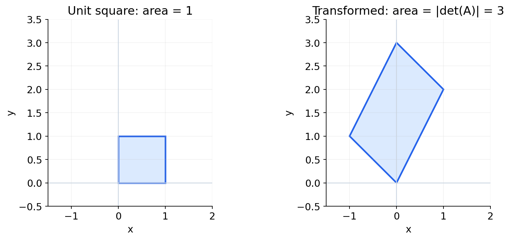

### 11.2 Cofactors and adjugate

For a square matrix, delete row $i$ and column $j$ to obtain the minor matrix $M_{ij}$. Its cofactor is:

$$
C_{ij}=(-1)^{i+j}\det(M_{ij}).
$$

For $A=\begin{bmatrix}a&b&c\\d&e&f\\g&h&i\end{bmatrix}$, the first-row cofactors are:

$$
C_{11}=ei-fh,\quad C_{12}=-(di-fg),\quad C_{13}=dh-eg.
$$

The **adjugate** is the transpose of the complete cofactor matrix:

$$
\operatorname{adj}(A)=C^T,\qquad
A^{-1}=\frac{\operatorname{adj}(A)}{\det(A)}.
$$

> **Remember:** The adjugate is the **transpose** of the cofactor matrix. An inverse exists only for a nonsingular square matrix.

### 11.3 A complete two-equation example

Consider:

$$
3x+2y=10,\qquad 2x+5y=12.
$$

Here $\det(A)=15-4=11$, so:

$$
\begin{bmatrix}x\\y\end{bmatrix}
=\frac1{11}\begin{bmatrix}5&-2\\-2&3\end{bmatrix}
\begin{bmatrix}10\\12\end{bmatrix}
=\begin{bmatrix}26/11\\16/11\end{bmatrix}.
$$

### 11.4 Square, full-rank system

Consider this full-rank system:

$$
\begin{bmatrix}1&3\\2&4\end{bmatrix}
\begin{bmatrix}x_1\\x_2\end{bmatrix}
=\begin{bmatrix}7\\10\end{bmatrix}.
$$

The determinant is $4-6=-2$. The inverse is:

$$
A^{-1}=\begin{bmatrix}-2&1.5\\1&-0.5\end{bmatrix}.
$$

Therefore $\vec x=(1,2)^T$. This solution is unique.

### 11.5 Singular and inconsistent system

Now consider:

$$
\begin{bmatrix}1&2\\3&6\end{bmatrix}\vec x
=\begin{bmatrix}10\\19\end{bmatrix}.
$$

The second left side is three times the first, so its right side would need to be 30, not 19. There is **no exact solution**.

If the right side were $(10,30)^T$, the system would instead have infinitely many solutions.

The single equation $2x+3y=0$ also has infinitely many solutions, for example $(x,y)=t(-3,2)$.

> **Remember:** One scalar equation is different from the vector equation $c_1(1,0)+c_2(0,1)=0$. That vector equation contains two scalar equations and forces both coefficients to zero.

## 12. Least squares and minimum-norm solutions

Systems come in three shapes. Shape helps us choose a method, but **rank and consistency also matter**.

| Shape | Typical situation | What to check |
|---|---|---|
| $m=n$ | Same number of equations and unknowns | Full rank gives a unique exact solution. |
| $m>n$ | More equations than unknowns | Exact fit may or may not exist; least squares finds the best residual fit. |
| $m<n$ | More unknowns than equations | If consistent, there are infinitely many exact solutions; choose one by an extra criterion. |

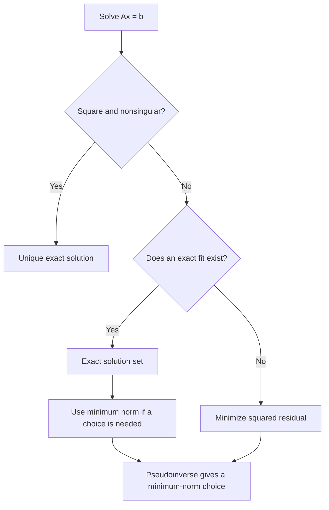

### 12.1 Least squares: minimize the residual

Let $\vec e=A\vec x-\vec b$. Minimize the sum of squared errors:

$$
f(\vec x)=\|A\vec x-\vec b\|_2^2
=(A\vec x-\vec b)^T(A\vec x-\vec b).
$$

Expand:

$$
f(\vec x)=\vec x^TA^TA\vec x-2\vec b^TA\vec x+\vec b^T\vec b.
$$

Differentiate and set the gradient to zero:

$$
\nabla f(\vec x)=2A^TA\vec x-2A^T\vec b=0,
$$

giving the **normal equations**:

$$
A^TA\vec x=A^T\vec b.
$$

If the columns of $A$ are independent:

$$
\vec x=(A^TA)^{-1}A^T\vec b.
$$

> **Remember:** $(A\vec x-\vec b)^T=\vec x^TA^T-\vec b^T$. Preserve the subtraction order when expanding.

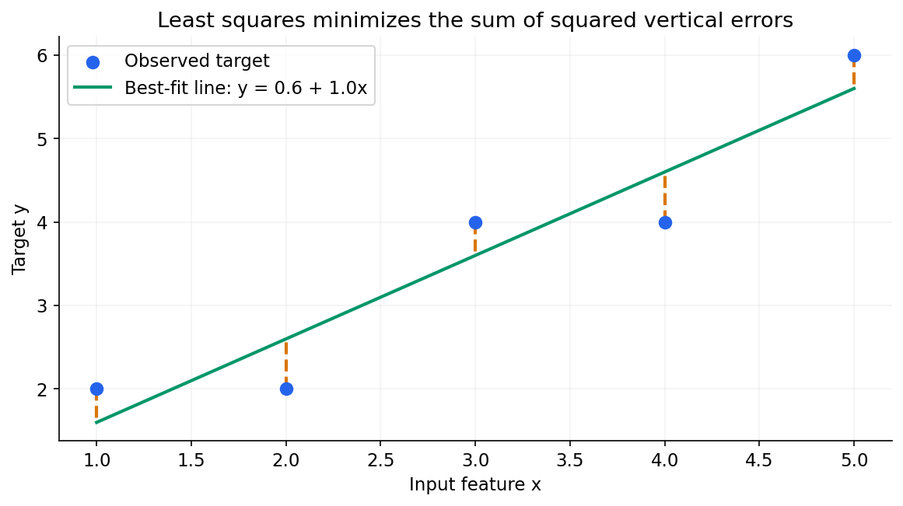

**Read the picture:** The orange segments are errors. Squaring prevents positive and negative errors from cancelling; large errors receive a larger penalty.

### 12.2 An example with residual error

Take:

$$
A=\begin{bmatrix}1&0\\2&0\\3&1\end{bmatrix},\qquad
\vec b=\begin{bmatrix}1\\-0.5\\5\end{bmatrix}.
$$

The least-squares answer is $\vec x=(0,5)^T$, giving:

$$
A\vec x=\begin{bmatrix}0\\0\\5\end{bmatrix},\qquad
\vec e=\begin{bmatrix}-1\\0.5\\0\end{bmatrix},\qquad
\|\vec e\|^2=1.25.
$$

We cannot make every equation true, but we can minimize the total squared error.

### 12.3 An overdetermined system can still fit exactly

Use the same $A$ with $\vec b=(1,2,5)^T$. Then $\vec x=(1,2)^T$ satisfies all three equations exactly. “More equations than unknowns” does not automatically mean nonzero error.

### 12.4 Minimum-norm solution

When several vectors satisfy $A\vec x=\vec b$, choose the one with the smallest length:

$$
\min_{\vec x}\frac12\vec x^T\vec x
\quad\text{subject to}\quad A\vec x=\vec b.
$$

Use the Lagrangian:

$$
L(\vec x,\lambda)=\frac12\vec x^T\vec x+\lambda^T(A\vec x-\vec b).
$$

Differentiate with respect to $\vec x$:

$$
\vec x+A^T\lambda=0\quad\Rightarrow\quad\vec x=-A^T\lambda.
$$

Substitution gives $-AA^T\lambda=\vec b$. If the rows are independent:

$$
\lambda=-(AA^T)^{-1}\vec b,\qquad
\vec x=A^T(AA^T)^{-1}\vec b.
$$

> **Remember:** The final formula has a positive sign because the two negative signs cancel.

For example:

$$
A=\begin{bmatrix}1&2&3\\0&0&1\end{bmatrix},\qquad
\vec b=\begin{bmatrix}2\\1\end{bmatrix},
$$

the minimum-norm answer is:

$$
\vec x=\begin{bmatrix}-0.2\\-0.4\\1\end{bmatrix}.
$$

Check: $-0.2+2(-0.4)+3=2$ and $x_3=1$. It fits **exactly**. Minimum-norm selection chooses among exact fits; it does not itself introduce residual error.

### 12.5 Moore-Penrose pseudoinverse

The pseudoinverse $A^+$ provides a general expression:

$$
\vec x=A^+\vec b.
$$

It gives the minimum-norm least-squares solution, including rank-deficient cases. Singular value decomposition (SVD) can be used to calculate it.

**Practical Python:** Use `np.linalg.solve` for a suitable square system, `np.linalg.lstsq` for least squares, or `np.linalg.pinv` for a pseudoinverse. Explicitly forming $(A^TA)^{-1}$ is useful for understanding the derivation but is usually not the best numerical implementation.

### Connection to linear regression

In regression, $A$ is the design matrix, $\vec x$ contains fitted coefficients, and $\vec b$ contains observed targets. Least squares chooses coefficients that minimize squared prediction errors on the supplied data. A smaller training error does not by itself mean better predictions on new data; evaluate on held-out data too.

## 13. Projection onto a subspace

Suppose a plane through the origin is spanned by $\vec v_1$ and $\vec v_2$. We want to project a vector $\vec x$ onto that plane:

$$
\hat{\vec x}=c_1\vec v_1+c_2\vec v_2.
$$

Write the original vector as:

$$
\vec x=\hat{\vec x}+\vec r.
$$

The residual $\vec r$ is perpendicular to the plane. Therefore:

$$
\vec v_1^T\vec r=0,\qquad \vec v_2^T\vec r=0.
$$

If the two spanning vectors are orthogonal:

$$
c_1=\frac{\vec v_1^T\vec x}{\vec v_1^T\vec v_1},\qquad
c_2=\frac{\vec v_2^T\vec x}{\vec v_2^T\vec v_2}.
$$

**Important:** Independence alone does not justify these separate coefficient formulas. They require an orthogonal basis.

### Worked example

$$
\vec x=\begin{bmatrix}1\\2\\3\end{bmatrix},\quad
\vec v_1=\begin{bmatrix}1\\-1\\-2\end{bmatrix},\quad
\vec v_2=\begin{bmatrix}2\\0\\1\end{bmatrix}.
$$

Check $\vec v_1^T\vec v_2=2-2=0$. Then:

$$
c_1=\frac{1-2-6}{1+1+4}=-\frac76,\qquad
c_2=\frac{2+3}{4+1}=1.
$$

So:

$$
\hat{\vec x}=-\frac76\begin{bmatrix}1\\-1\\-2\end{bmatrix}
+\begin{bmatrix}2\\0\\1\end{bmatrix}
=\begin{bmatrix}5/6\\7/6\\20/6\end{bmatrix}.
$$

> **Remember:** Multiply the coefficients by the **basis vectors**, not by the original input vector.

The projected vector still has **three coordinates**, but lies in a **two-dimensional subspace**. Its coordinates relative to that plane's basis are the two numbers $(-7/6,1)$.

**In simple words:** For a full-column-rank, possibly non-orthogonal basis matrix $V$:

$$
\hat{\vec x}=V(V^TV)^{-1}V^T\vec x.
$$

### Why projection is useful

Projection keeps the part of a vector explained by a chosen subspace; the residual is the part left out. In least-squares regression, the fitted target vector is the projection of the observed targets onto the design matrix's column space. In dimensionality reduction, the chosen subspace provides a shorter description of each sample.

## 14. Lines, planes, hyperplanes and halfspaces

### 14.1 Equation of a line

The familiar form is:

$$
y=mx+c,\qquad m=\tan\theta.
$$

It can also be written:

$$
ax+by+c=0.
$$

Using $\vec x=(x,y)^T$ and normal vector $\vec w=(a,b)^T$:

$$
\vec w^T\vec x+c=0.
$$

The normal is perpendicular to the line. To see why, let $\vec x_1$ and $\vec x_2$ lie on the line. Subtract their equations:

$$
\vec w^T(\vec x_2-\vec x_1)=0.
$$

The displacement along the line has zero dot product with the normal.

### 14.2 Hyperplanes

In $\mathbb R^n$, a hyperplane has dimension $n-1$ and can be written as:

$$
\vec w^T\vec x+b=0,\qquad \vec w\ne0.
$$

- In 2D: a line.
- In 3D: a plane.
- In higher dimensions: the same idea, with more coordinates.

> **Remember:** “Hyperplane” includes a line in 2D and a plane in 3D; it is not restricted to higher dimensions.

### 14.3 Positive and negative halfspaces

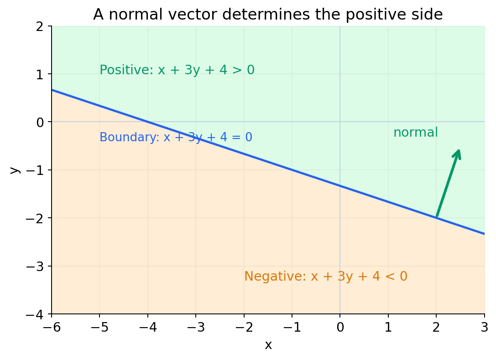

The sign tells us which side a point lies on:

$$
s(\vec x)=\vec w^T\vec x+b.
$$

| Value | Position |
|---|---|
| $s(\vec x)=0$ | On the boundary |
| $s(\vec x)>0$ | Positive side, towards the normal |
| $s(\vec x)<0$ | Negative side, opposite the normal |

Take $\vec w=(1,3)^T$ and $b=4$:

$$
x_1+3x_2+4=0.
$$

For example, $(0,0)$ gives 4, so it lies on the positive side. $(0,-2)$ gives -2, so it lies on the negative side.

### 14.4 Why does the sign work?

Take a point $\vec x_0$ on the boundary and write another point as $\vec x=\vec x_0+\vec d$:

$$
\begin{aligned}
\vec w^T\vec x+b
&=\vec w^T\vec x_0+b+\vec w^T\vec d\\
&=\vec w^T\vec d\\
&=\|\vec w\|\|\vec d\|\cos\theta.
\end{aligned}
$$

So the sign comes from the angle between the normal and the **displacement from the boundary**, not necessarily the point's position vector from the origin.

The angle between two vectors is conventionally in $[0^\circ,180^\circ]$: acute gives positive cosine, obtuse gives negative cosine. The sign tells us whether the displacement points along or against the normal.

**Clarification:** We may reverse the normal, but must also reverse $b$: $(\vec w,b)$ and $(-\vec w,-b)$ describe the same boundary and swap positive/negative side labels. A normal cannot point in an arbitrary direction; it must remain perpendicular to the boundary.

### Use in data science: decision boundaries

A linear classifier uses the sign of a score such as $\vec w^T\vec x+b$ to separate two sides of a boundary. The weights control its orientation and the intercept shifts it. For example, changing $b$ moves the boundary without changing its normal direction. The score itself is not automatically a probability.

## 15. Eigenvalues and eigenvectors

### 15.1 The idea

Usually, multiplying by a matrix changes a vector's direction. Are there special directions that stay on the same line?

Yes. A nonzero vector $\vec v$ is an eigenvector when:

$$
A\vec v=\lambda\vec v.
$$

$\lambda$ is its eigenvalue. The transformation only scales that vector:

- $0<\lambda<1$: shrinks it.
- $\lambda>1$: stretches it.
- $\lambda=1$: leaves it unchanged.
- $\lambda<0$: also reverses its orientation.
- $\lambda=0$: sends it to zero.

The distinction is between preserving a line and preserving an arrow orientation. Eigenvectors preserve their **line**, but a negative eigenvalue reverses the arrow, and zero collapses it.

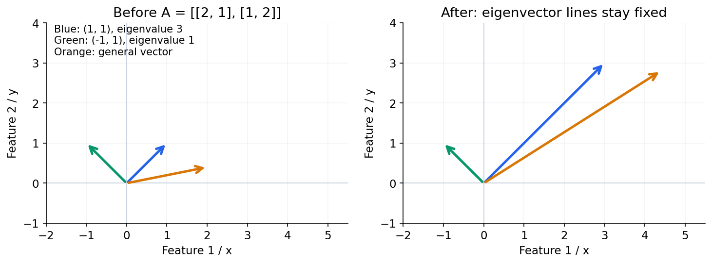

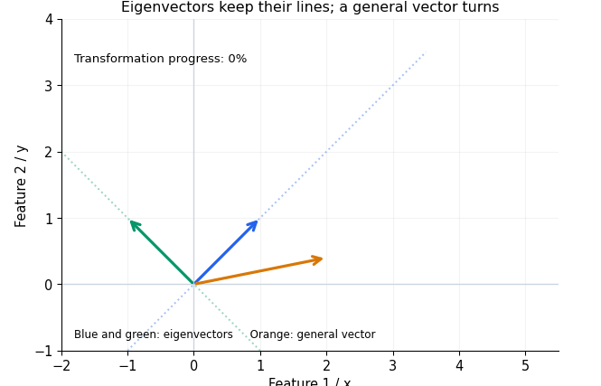

**Watch the arrows:** The blue vector stretches along its original line. The green vector is unchanged. The orange vector is not an eigenvector and turns. This example uses $A=\begin{bmatrix}2&1\\1&2\end{bmatrix}$. Its eigenvectors $(1,1)^T$ and $(-1,1)^T$ have eigenvalues 3 and 1.

The static diagram above shows the same idea if animation is inconvenient.

### 15.2 Finding eigenvalues

Rearrange:

$$
(A-\lambda I)\vec v=0.
$$

For a nonzero $\vec v$ to exist, $A-\lambda I$ must be singular:

$$
\det(A-\lambda I)=0.
$$

At an eigenvalue, the nullity of $A-\lambda I$ is at least 1. It is **not** correct to say the “rank of the null space” must be at least 1.

### 15.3 Worked example

Take:

$$
A=\begin{bmatrix}8&7\\2&3\end{bmatrix}.
$$

Its characteristic equation is:

$$
\begin{aligned}
\det(A-\lambda I)
&=(8-\lambda)(3-\lambda)-14\\
&=\lambda^2-11\lambda+10\\
&=(\lambda-1)(\lambda-10)=0.
\end{aligned}
$$

So the eigenvalues are **1 and 10**.

**For $\lambda=1$:**

$$
(A-I)\vec v=0\quad\Rightarrow\quad v_1+v_2=0.
$$

Choose $\vec v=(1,-1)^T$. A unit version is:

$$
\hat{\vec v}=\frac1{\sqrt2}\begin{bmatrix}1\\-1\end{bmatrix}.
$$

**For $\lambda=10$:**

$$
-2v_1+7v_2=0.
$$

Choose $\vec v=(7,2)^T$. A unit version is:

$$
\hat{\vec v}=\frac1{\sqrt{53}}\begin{bmatrix}7\\2\end{bmatrix}.
$$

Check:

$$
A\begin{bmatrix}1\\-1\end{bmatrix}=\begin{bmatrix}1\\-1\end{bmatrix},\qquad
A\begin{bmatrix}7\\2\end{bmatrix}=\begin{bmatrix}70\\20\end{bmatrix}.
$$

> **Remember:** Eigenvectors must be nonzero, but need not be unit length. In this example, the eigenvector for $\lambda=1$ has opposite component signs: $(1,-1)$, not $(1,1)$.

### 15.4 Symmetric matrices

For a **real symmetric** $n\times n$ matrix:

- All eigenvalues are real.
- We can choose $n$ real orthonormal eigenvectors.
- Eigenvectors with zero eigenvalue span the null space.
- Eigenvectors with nonzero eigenvalues span the column space.

A useful symmetric example is:

$$
A=\begin{bmatrix}
0.36&0.48&0\\
0.48&0.64&0\\
0&0&2
\end{bmatrix}.
$$

Its eigenpairs are:

| Eigenvalue | Unit eigenvector |
|---|---|
| $0$ | $(-0.8,0.6,0)^T$ |
| $1$ | $(0.6,0.8,0)^T$ |
| $2$ | $(0,0,1)^T$ |

For example:

$$
A\begin{bmatrix}-0.8\\0.6\\0\end{bmatrix}
=\begin{bmatrix}-0.288+0.288\\-0.384+0.384\\0\end{bmatrix}
=\vec0.
$$

There is one zero eigenvalue: nullity = 1 and rank = 2. The last two eigenvectors span the **column space**, not all of $\mathbb R^3$.

**In simple words:** Symmetric matrices matter in data science because covariance matrices are symmetric. Their eigenvectors describe principal directions; this connects to PCA.

## 16. PCA: keep the directions that vary most

### 16.1 Why do we need it?

Imagine two measurements that mostly move together. Keeping both may repeat information. **Principal component analysis (PCA)** finds new perpendicular directions, orders them by variance, and lets us keep fewer coordinates.

It does not simply delete an original column. A principal component is a weighted combination of the original features.


### 16.2 A complete example with four samples

We have two features for each sample:

| Sample | Feature 1 | Feature 2 |
|---|---:|---:|
| A | -2 | -1 |
| B | -1 | -2 |
| C | 1 | 2 |
| D | 2 | 1 |

Both column means are zero, so this data is already centered:

$$
X=\begin{bmatrix}-2&-1\\-1&-2\\1&2\\2&1\end{bmatrix}.
$$

For $m=4$ samples, the sample covariance is:

$$
C=\frac{X^TX}{m-1}
=\frac13\begin{bmatrix}10&8\\8&10\end{bmatrix}.
$$

**What do these entries tell us?** Each diagonal entry is a feature's variance, $10/3$. The positive off-diagonal entry, $8/3$, means the two centered features tend to move in the same direction. Covariance is not a unit-free correlation coefficient.

The eigenpairs are easy to check:

$$
u_1=\frac1{\sqrt2}\begin{bmatrix}1\\1\end{bmatrix},\quad\lambda_1=6,
\qquad
u_2=\frac1{\sqrt2}\begin{bmatrix}-1\\1\end{bmatrix},\quad\lambda_2=\frac23.
$$

For example:

$$
C\begin{bmatrix}1\\1\end{bmatrix}
=\frac13\begin{bmatrix}18\\18\end{bmatrix}
=6\begin{bmatrix}1\\1\end{bmatrix}.
$$

So the first eigenvector points along the direction with variance 6. Its eigenvalue tells us **how much variation lies along it**.

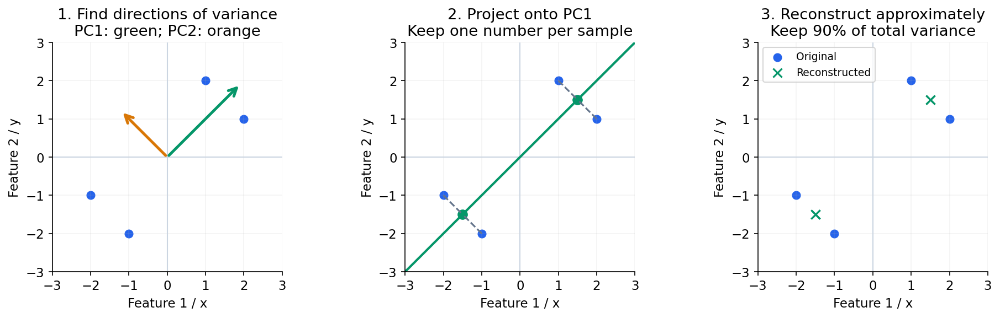

### 16.3 Turn two features into one number

Keep only $u_1$. Each sample's new coordinate is its dot product with $u_1$:

$$
Z=Xu_1
=\begin{bmatrix}-3/\sqrt2\\-3/\sqrt2\\3/\sqrt2\\3/\sqrt2\end{bmatrix}.
$$

For sample A:

$$
z_A=(-2,-1)\cdot(1,1)/\sqrt2=-3/\sqrt2\approx-2.121.
$$

We now store **one coordinate instead of two**. A and B have the same coordinate because their difference lies entirely in the direction we discarded.

### 16.4 How much information did we keep?

The explained variance ratio for PC1 is:

$$
\frac{\lambda_1}{\lambda_1+\lambda_2}
=\frac6{6+2/3}=0.9=90\%.
$$

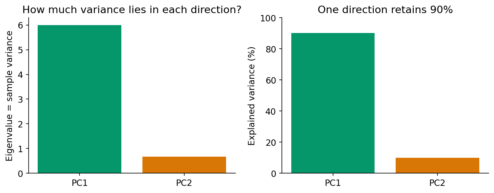

Here “90%” means **90% of total sample variance**, not 90% accuracy, 90% of the raw values, or guaranteed preservation of target-relevant information.

### 16.5 What was lost?

Reconstruct from the retained coordinate:

$$
\hat x_A=z_Au_1=(-1.5,-1.5)^T.
$$

The original was $(-2,-1)^T$, leaving residual $(-0.5,0.5)^T$. Its squared error is $0.25+0.25=0.5$. Across all four samples, the squared reconstruction error is 2.

**Practical uses:** visualizing high-dimensional data, reducing correlated input dimensions, and removing low-variance directions when that is appropriate. Center the data; consider standardizing when units differ substantially. Fit the transformation on training data, then apply that fitted transformation to validation/test data.

**Important:** PCA maximizes retained variance, not prediction quality. A low-variance feature can still be important for the target. Eigenvector signs can flip between implementations without changing the principal direction.

## 17. SVD: separate a matrix into reusable patterns

### 17.1 The intuition

**Singular value decomposition (SVD)** describes a matrix using pairs of directions and strengths:

$$
X=U\Sigma V^T.
$$

- Columns of $V$ describe directions in feature space.
- Nonnegative singular values in $\Sigma$ give their strengths.
- Columns of $U$ describe the matching directions in sample space.

Unlike an ordinary eigenvalue decomposition, SVD works for rectangular matrices too. Every real matrix has an SVD.

Another way to read it is:

$$
X=\sigma_1u_1v_1^T+\sigma_2u_2v_2^T+\cdots.
$$

Each term is one rank-1 pattern. Keeping the first $k$ terms gives a rank-at-most-$k$ approximation.

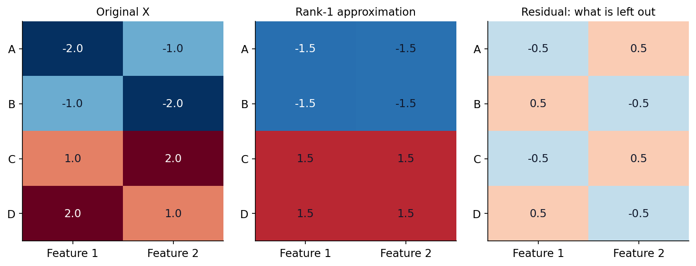

### 17.2 Use the same PCA example

For the centered matrix $X$ in Section 16, the singular values are:

$$
\sigma_1=\sqrt{18},\qquad\sigma_2=\sqrt2.
$$

Their squares add to the total squared size of the matrix: $18+2=20$. Keeping the first term retains $18/20=90\%$ of that squared size and leaves squared error 2.

The rank-1 approximation is:

$$
X_1=\begin{bmatrix}-1.5&-1.5\\-1.5&-1.5\\1.5&1.5\\1.5&1.5\end{bmatrix}.
$$

This is the same reconstruction we obtained by keeping PC1. The connection is:

$$
\lambda_i\left(\frac{X^TX}{m-1}\right)=\frac{\sigma_i^2}{m-1}.
$$

### 17.3 Why use it in data science and AI?

| Task | What SVD contributes |
|---|---|
| PCA | Find principal directions directly from centered data |
| Compression | Approximate a large matrix with fewer rank-1 patterns |
| Numerical rank | Identify strong versus nearly-zero singular directions |
| Pseudoinverse | Solve systems without requiring a square inverse |
| Low-rank model updates | Represent an update using smaller matrix factors |

For the pseudoinverse, invert nonzero singular values and transpose the direction factors:

$$
X^+=V\Sigma^+U^T.
$$

Very small singular values can amplify noise when inverted; numerical implementations use a tolerance. Low-rank methods exploit useful approximate structure, not a promise that every dataset can be compressed without losing something important.

## 18. The same operations inside AI systems

### 18.1 Embedding similarity

An embedding is a numerical vector representing an item such as a text passage. Once the vector exists, retrieval can compare its geometry with a query vector.


Take a toy query $q=(1,1)$ and three document vectors:

| Document vector | Dot product with $q$ | Cosine similarity |
|---|---:|---:|
| $(1,1)$ | 2 | 1 |
| $(5,5)$ | 10 | 1 |
| $(1,-1)$ | 0 | 0 |

The second vector is longer but points in exactly the same direction as the first. Cosine similarity removes that length effect:

$$
\operatorname{cosine}(q,d)=\frac{q^Td}{\|q\|_2\|d\|_2}.
$$

The score is a geometric measure, not a probability that a document is correct. Its usefulness depends on the embedding model and the retrieval task. Cosine is undefined for a zero vector.

### 18.2 A neural-network layer

The linear part of a dense layer is:

$$
Z=XW+b.
$$

For a batch of two samples with two features:

$$
X=\begin{bmatrix}1&2\\3&1\end{bmatrix},\quad
W=\begin{bmatrix}0.5&-1\\1&0.5\end{bmatrix},\quad
b=(0.1,0.2).
$$

Add $b$ to each output row:

$$
Z=\begin{bmatrix}2.6&0.2\\2.6&-2.3\end{bmatrix}.
$$

The first output is $1(0.5)+2(1)+0.1=2.6$. Each neuron is a weighted feature sum plus an offset.

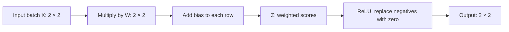

Applying ReLU gives:

$$
\operatorname{ReLU}(Z)=\begin{bmatrix}2.6&0.2\\2.6&0\end{bmatrix}.
$$

**Why add a nonlinearity?** Stacking matrix multiplications alone still gives one linear transformation. Biases make it affine, but stacking only affine layers still gives one affine transformation. Nonlinear activations let the network represent more complex relationships.

### 18.3 Attention is scores followed by a weighted sum

A simplified attention calculation is:

$$
\operatorname{Attention}(Q,K,V)
=\operatorname{softmax}\left(\frac{QK^T}{\sqrt{d_k}}\right)V.
$$

Read it as four steps:

1. Compare a **query** with **keys** using dot products.
2. Scale the scores by $\sqrt{d_k}$, where $d_k$ is the key/query dimension.
3. Use softmax to turn scores into positive weights that add to 1.
4. Use those weights to combine the **value** vectors.

Take one query and three keys:

$$
q=(1,0),\quad
K=\begin{bmatrix}1&0\\0&1\\1&1\end{bmatrix}.
$$

The scaled scores are $(1,0,1)/\sqrt2\approx(0.707,0,0.707)$. Softmax gives approximately $(0.4011,0.1978,0.4011)$.

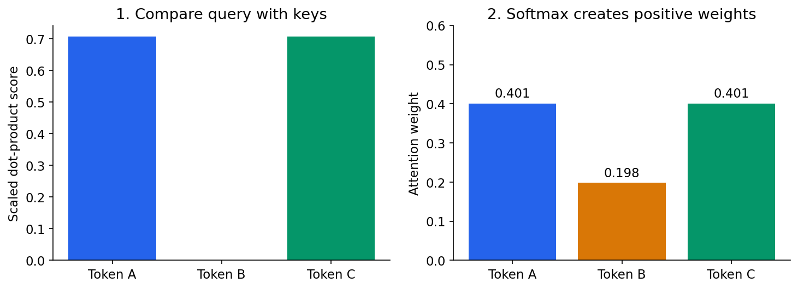

With value vectors $v_A=(1,0)$, $v_B=(0,2)$ and $v_C=(1,1)$:

$$
\text{output}
\approx0.4011(1,0)+0.1978(0,2)+0.4011(1,1)
\approx(0.8022,0.7967).
$$

This is a tiny, unmasked example with chosen numbers. Real models learn the projections producing queries, keys and values, and may use masking and multiple heads. The weights here illustrate a mixing operation, not a complete explanation of a model's reasoning.

## 19. Gradients: how model coefficients are learned

### 19.1 From a loss to an update

Linear algebra also describes the direction in which to change model weights.

For linear regression, use the loss:

$$
J(w)=\frac1{2m}\|Xw-y\|_2^2.
$$

Its gradient is a vector with one entry per coefficient:

$$
\nabla J(w)=\frac1mX^T(Xw-y).
$$

Update in the opposite direction:

$$
w_{\text{new}}=w-\eta\nabla J(w),
$$

where $\eta$ is the learning rate. In simple words: find the local uphill direction, then take a small step downhill.

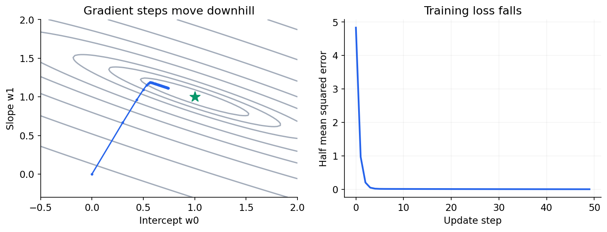

### 19.2 One update by hand

Fit an intercept and slope to the points $(1,2)$, $(2,3)$ and $(3,4)$:

$$
X=\begin{bmatrix}1&1\\1&2\\1&3\end{bmatrix},\quad
y=\begin{bmatrix}2\\3\\4\end{bmatrix},\quad
w=\begin{bmatrix}0\\0\end{bmatrix}.
$$

The first column of ones handles the intercept. Starting predictions are zero, so:

$$
\nabla J(0)=\frac13
\begin{bmatrix}1&1&1\\1&2&3\end{bmatrix}
\begin{bmatrix}-2\\-3\\-4\end{bmatrix}
=\begin{bmatrix}-3\\-20/3\end{bmatrix}.
$$

With $\eta=0.1$:

$$
w_{\text{new}}=\begin{bmatrix}0.3\\2/3\end{bmatrix}.
$$

This moves towards the exact coefficients $(1,1)^T$. The loss falls from $29/6\approx4.833$ to about 0.9709 after the first step.

The size of the step matters: a learning rate that is too large can overshoot or diverge. Neural networks use related vector/matrix gradients with the chain rule and backpropagation; their losses are generally more complicated than this quadratic example.

### 19.3 A small NumPy practice

```python
import numpy as np

# PCA on the centered data used above.
X = np.array([[-2., -1.], [-1., -2.], [1., 2.], [2., 1.]])
mean = X.mean(axis=0)
X_centered = X - mean
covariance = X_centered.T @ X_centered / (len(X) - 1)

# eigh is suited to real symmetric matrices.
values, directions = np.linalg.eigh(covariance)
order = np.argsort(values)[::-1]
values, directions = values[order], directions[:, order]
W = directions[:, :1]
scores = X_centered @ W
reconstructed = scores @ W.T + mean

print(values)                         # [6.0, 0.66666667]
print(values[0] / values.sum())       # 0.9
print(np.sum((X - reconstructed)**2)) # approximately 2.0

# SVD gives the same rank-1 reconstruction, up to direction signs.
U, singular_values, Vt = np.linalg.svd(X_centered, full_matrices=False)
rank_one = (U[:, :1] * singular_values[:1]) @ Vt[:1, :] + mean
assert np.allclose(reconstructed, rank_one)
```

Try changing one sample, then recompute. Watch how the covariance, directions, explained variance, and reconstruction change together. That is more useful than memorizing the eigenvalue formula alone.

## 20. Quick revision

| Concept | Remember it this way |
|---|---|
| Vector | Amount plus direction; coordinates encode it. |
| Unit vector | Divide a nonzero vector by its length. |
| Dot product | Multiply matching coordinates and add. |
| Orthogonal | Dot product is zero. |
| Projection | The part of one vector along another direction/subspace. |
| Basis | Independent directions that span the space. |
| Matrix columns | Where the standard basis vectors go. |
| Rank | Number of independent column directions. |
| Null space | Coefficients that make $A\vec z=0$. |
| Nullity | Dimension of the null space. |
| Least squares | Make the total squared residual as small as possible. |
| Minimum norm | Choose the shortest solution among exact solutions. |
| Hyperplane | A boundary described by $\vec w^T\vec x+b=0$. |
| Eigenvector | A nonzero direction scaled by a matrix. |
| PCA | Keep directions with the largest variance. |
| SVD | Build a matrix from direction pairs and strengths. |
| Attention | Compare queries and keys, then mix values. |
| Gradient | Local uphill direction of the loss with respect to weights. |

### Small self-check

1. What is the difference between a dot product and a scalar projection?
2. If a matrix has 5 columns and rank 3, what is its nullity?
3. Can a system with more equations than unknowns fit exactly?
4. Is a square matrix always symmetric?
5. Must an eigenvector have length 1?

<details>
<summary>Show answers</summary>

1. The scalar projection onto $\vec b$ is $(\vec a^T\vec b)/\|\vec b\|$; the dot product has not yet been divided by that length.
2. $5-3=2$.
3. Yes, if the right-hand side lies in the column space.
4. No; symmetry requires $A=A^T$.
5. No. It must be nonzero; normalization is optional.

</details>
