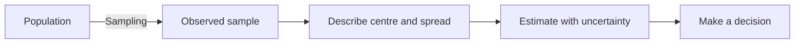
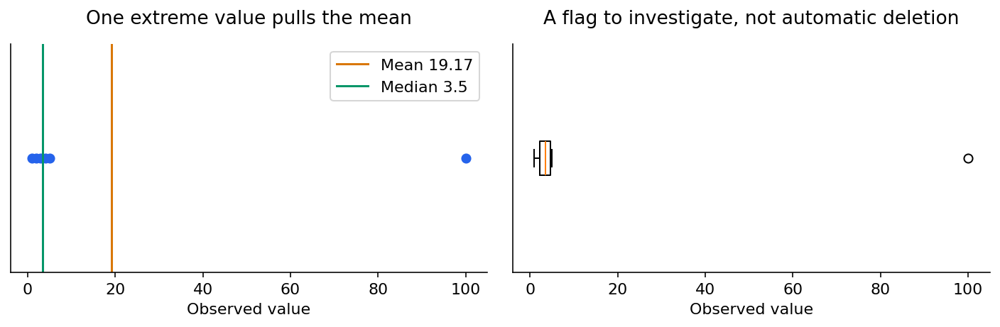
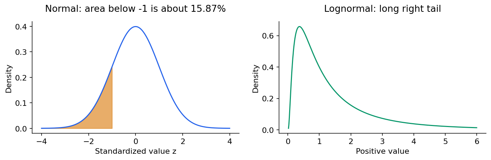
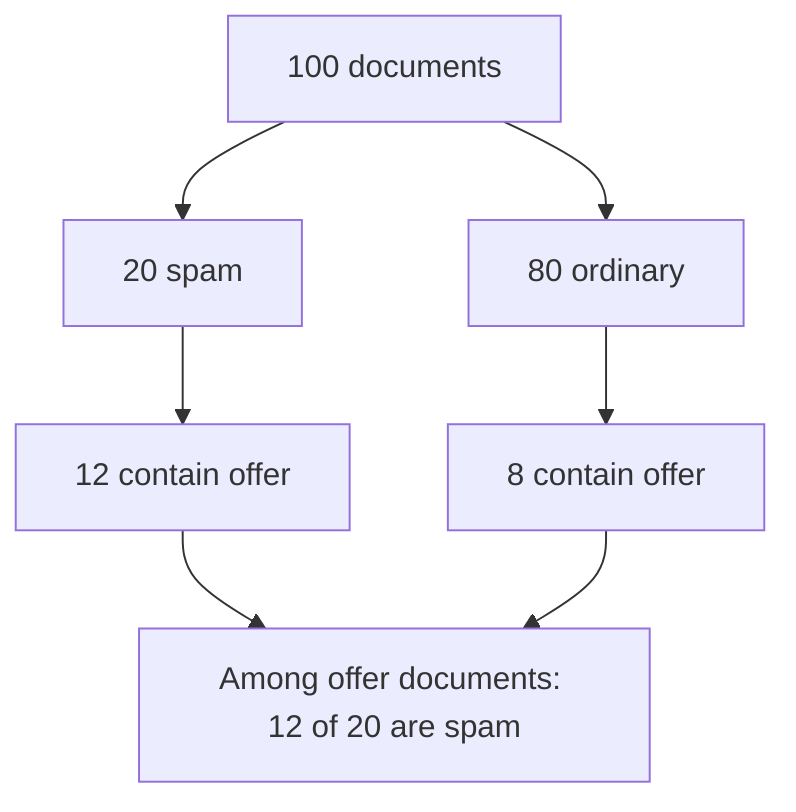
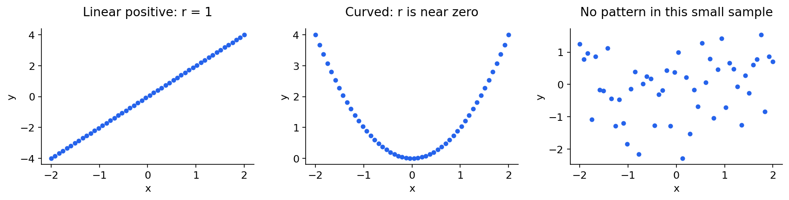

# Statistics 1: describe data and understand probability

[Subject home](../README.md) · [Theory index](README.md)

Statistics turns a collection of observations into a description, an estimate and a statement of uncertainty. The same ideas support EDA, experiment design, feature engineering and model evaluation.

## On this page

- [1. Population, sample and variable types](#1-population-sample-and-variable-types)
- [2. Mean, median and mode](#2-mean-median-and-mode)
- [3. Variance and standard deviation](#3-variance-and-standard-deviation)
- [4. Percentiles, quartiles, histograms and box plots](#4-percentiles-quartiles-histograms-and-box-plots)
- [5. Normal, skewed and lognormal distributions](#5-normal-skewed-and-lognormal-distributions)
- [6. Probability rules](#6-probability-rules)
- [7. Bayes: update a belief with evidence](#7-bayes-update-a-belief-with-evidence)
- [8. Covariance and correlation](#8-covariance-and-correlation)

## 1. Population, sample and variable types

A population is the group your question concerns. A sample is the part you observe. The mean of one classroom describes that classroom; estimating the mean of the whole university also requires a defensible sampling design. A large biased sample does not become representative just because it is large.

Descriptive statistics summarize observed data. Inferential statistics use a sampling/model assumption to say something beyond those observations. A **parameter** describes the population; a **statistic** is computed from a sample.

| Sampling method | How it works | Watch for |
|---|---|---|
| Simple random | Randomly choose from the population frame | Missing groups in the frame |
| Stratified | Sample within meaningful groups | Correct weighting when sampling fractions differ |
| Systematic | Random start, then every kth record | Periodicity matching the sampling interval |
| Convenience | Use easily available respondents | Selection and nonresponse bias |

Qualitative variables are categories: nominal has no inherent order, ordinal does. Quantitative variables are counts or measurements. A PIN code is a nominal identifier; having many distinct values does not turn it into a quantitative count. Age may be continuous in principle and recorded as integer years in a dataset.

## 2. Mean, median and mode

For $x=(1,2,3,4,5)$, the mean is $\bar x=15/5=3$. It is the balance point. Add 100: the mean becomes $115/6\approx19.17$, although most values remain small. The median is the middle sorted value; for six values it is the average of the middle two, $(3+4)/2=3.5$. The mode is the most frequent value and can also describe categories.

Use a mean when total amount per observation is the question. Use a median when the typical observation should be less affected by extremes. Do not choose purely from a mechanical “outlier present” rule: the business question matters.

## 3. Variance and standard deviation

Variance averages squared distances from the mean. For the five values above, squared deviations are $4,1,0,1,4$.

$$\sigma^2=\frac{\sum(x_i-\mu)^2}{N}=\frac{10}{5}=2,\qquad \sigma=\sqrt2\approx1.414.$$

If those five values are a sample used to estimate a population variance, use $s^2=10/(5-1)=2.5$. Estimating the mean from the same sample uses one degree of freedom; dividing by $n-1$ makes sample variance unbiased under independent, identically distributed sampling with finite variance. It does not repair a biased sampling design.

Variance has squared units; standard deviation returns to the original units. Standard deviation describes the spread of observations. Standard error describes the uncertainty of an estimator; they are different quantities.

## 4. Percentiles, quartiles, histograms and box plots

A percentile is a position in a distribution, not the percentage of marks scored. The 90th percentile is a value at or below which roughly 90% of observations lie. Finite-sample definitions differ, especially with ties; say which method your software uses. The five-number summary is minimum, $Q_1$, median, $Q_3$, maximum. A box plot normally draws whiskers to non-outlier observations rather than automatically to the absolute minimum and maximum.

$IQR=Q_3-Q_1$. Flag observations beyond $Q_1-1.5IQR$ or $Q_3+1.5IQR$ for investigation. Flagging is not proof of an error. A histogram groups observations into bins. Equal-width bins spanning the observations have width $(max-min)/k$; boundaries need a consistent inclusion rule. The number of bins can change the apparent pattern.

## 5. Normal, skewed and lognormal distributions

A normal distribution is symmetric and specified by mean $\mu$ and standard deviation $\sigma$. Its total density area is one. Approximately 68%, 95% and 99.7% lies within one, two and three standard deviations. Apply that rule to approximately normal distributions, not to every dataset.

A continuous density's height is not a point probability: $P(X=x)=0$ in a continuous model; probabilities come from areas over intervals. A discrete probability mass function assigns probabilities to outcomes, such as a die face. A KDE estimates a smooth density from observations; it does not prove normality.

Right skew means a long right tail; a mean often exceeds the median in a simple unimodal right-skewed distribution, but the familiar mean/median/mode ordering is a heuristic. A positive variable is lognormal if its logarithm is normal. Taking logs of an arbitrary positive variable does not guarantee normality.

Standardization uses $z=(x-\mu)/\sigma$. For a normal variable with mean 100 and SD 15, $x=85$ gives $z=-1$: approximately 15.87% falls below 85 and 84.13% above. The area between 85 and 100 is about 34.13%. Scaling alone does not alter the shape into a normal distribution.

## 6. Probability rules

An event is a set of outcomes. Mutually exclusive events cannot occur together. Independent events do not change each other's probability. Nonzero mutually exclusive events are not independent.

$$P(A\cup B)=P(A)+P(B)-P(A\cap B)$$
$$P(A\cap B)=P(A)P(B\mid A)$$

For one card, heart **or** queen is $13/52+4/52-1/52=16/52$. For two independent die rolls, first 5 and then 3 is $(1/6)(1/6)=1/36$. For a bag of 4 red and 3 green balls, red then green without replacement is $(4/7)(3/6)=2/7$. The second draw is conditional on the first.

Permutations count ordered selections: $P(n,r)=n!/(n-r)!$. Combinations count unordered selections: $C(n,r)=n!/[r!(n-r)!]$. Choosing 3 of 5 gives 10 groups but 60 ordered arrangements when repetition is not allowed.

## 7. Bayes: update a belief with evidence

$$P(A\mid B)=\frac{P(B\mid A)P(A)}{P(B)}.$$

Imagine 100 documents: 20 are spam. The word “offer” occurs in 12 spam documents and 8 ordinary documents. Among the 20 documents with that word, 12 are spam: $P(spam\mid offer)=12/20=0.6$. That differs from $P(offer\mid spam)=12/20$ here only by numerical coincidence; the conditioning groups differ. If the corpus proportions change, these quantities need not remain equal.

The prior is the initial prevalence; the likelihood describes evidence within a class; the posterior is the updated probability. This connects directly to Naive Bayes and probabilistic reasoning in AI.

## 8. Covariance and correlation

Sample covariance is $\sum(x_i-\bar x)(y_i-\bar y)/(n-1)$. Positive means they tend to move together; negative means opposite movement. Units affect its magnitude. Pearson correlation divides by the two standard deviations and lies between -1 and 1 when both spreads are nonzero.

For $x=(1,2,3)$ and $y=(2,4,6)$, sample covariance is 2, $s_x=1$, $s_y=2$, hence $r=1$. Spearman correlation is Pearson correlation of ranks; it measures monotonic association and uses average ranks for ties.

Zero correlation does not imply no relationship: $y=x^2$ with symmetric $x$ is a counterexample. Correlation does not establish causation. Strongly correlated inputs may be redundant for some models, but removing every weakly correlated feature can lose nonlinear or interaction effects. Choose using the model and validation task.

[← Linear algebra: the visual guide](01-linear-algebra/linear-algebra-notes.md) · [Estimation, uncertainty and hypothesis tests →](03-statistical-inference.md) · [Try the practicals](../02-practicals/README.md)
