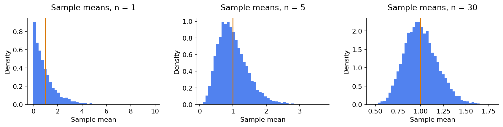
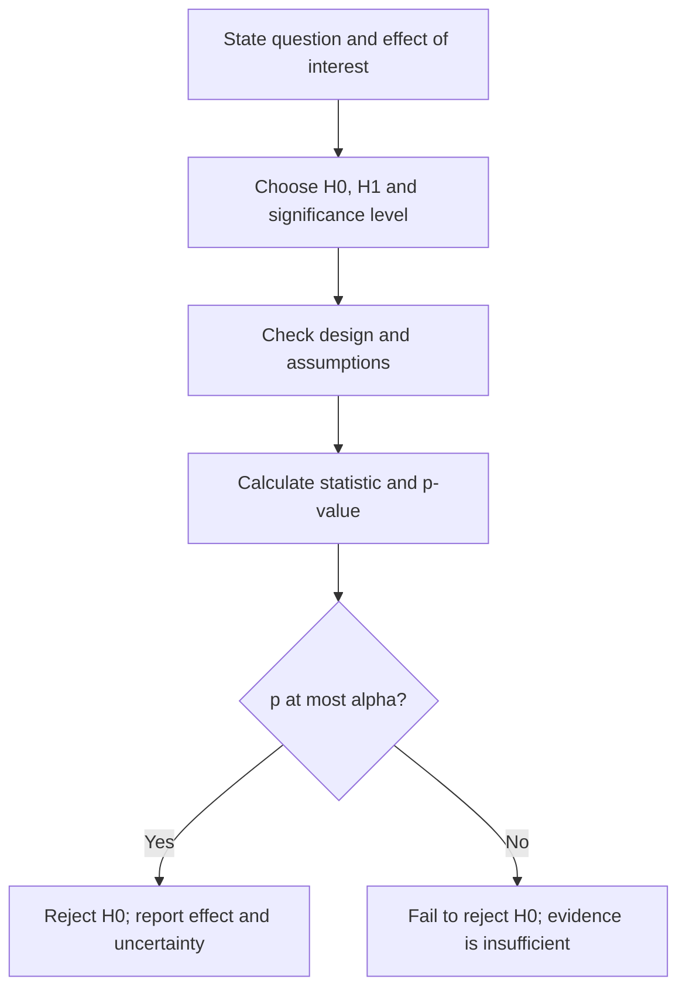

# Statistics 2: estimation, uncertainty and hypothesis tests

[Subject home](../README.md) · [Theory index](README.md)

The practical question is not just “Did the averages differ?” It is “How large is the difference, how uncertain is it, and is the study design suitable?”

## On this page

- [1. Sampling distributions and the central limit theorem](#1-sampling-distributions-and-the-central-limit-theorem)
- [2. Point estimates and confidence intervals](#2-point-estimates-and-confidence-intervals)
- [3. A test is a rule agreed before looking at the result](#3-a-test-is-a-rule-agreed-before-looking-at-the-result)
- [4. Choose the test by design, not just by n](#4-choose-the-test-by-design-not-just-by-n)
- [5. Worked one-sample mean test](#5-worked-one-sample-mean-test)
- [6. Worked one-sided t test](#6-worked-one-sided-t-test)
- [7. Worked proportion test](#7-worked-proportion-test)
- [8. Errors, power and experimentation](#8-errors-power-and-experimentation)

## 1. Sampling distributions and the central limit theorem

Repeat a sampling process and compute a mean each time. Those means form a sampling distribution. Under suitable conditions, the standardized mean approaches a normal distribution as sample size increases, even when individual observations are skewed. A common version assumes independent, identically distributed observations with finite variance.

The CLT concerns the **distribution of the mean**, not a transformation of the raw observations into normal data. “n ≥ 30” is a rough classroom guideline, not a theorem or universal guarantee. Heavy tails, strong dependence and extreme skew can require more care. For independent observations, $SE(\bar x)=\sigma/\sqrt n$, estimated with $s/\sqrt n$ when $\sigma$ is unknown. Quadrupling the sample size halves this standard error.

## 2. Point estimates and confidence intervals

A point estimate is one number, such as the sample mean. An interval adds uncertainty:

$$\bar x\pm z_{1-\alpha/2}\frac{\sigma}{\sqrt n}$$

when population SD is known and the normal/approximation conditions hold. If $\bar x=520$, $\sigma=100$ and $n=25$, a 95% interval is $520\pm1.96(20)=[480.8,559.2]$.

With unknown population SD, a one-sample t interval uses

$$\bar x\pm t_{1-\alpha/2,n-1}\frac{s}{\sqrt n}.$$

For $s=80$, $n=25$, the 95% critical value is about 2.064, giving $520\pm33.02=[486.98,553.02]$. Exact small-sample t inference assumes normally distributed independent observations; assess robustness when that assumption is doubtful.

A 95% confidence procedure covers the fixed population parameter in 95% of repeated samples under its assumptions. It does not mean that 95% of individual observations fall inside this interval, or assign a frequentist 95% probability to the already computed interval containing the parameter.

## 3. A test is a rule agreed before looking at the result

$H_0$ states the reference claim; $H_1$ states the alternative. A two-sided alternative asks whether a value differs; a one-sided alternative asks whether it is larger or smaller. Choose the direction before seeing the data. The significance level $\alpha$ controls a test's Type I error rate under its assumptions.

A p-value is the probability, **assuming $H_0$ and the statistical model**, of a test statistic at least as incompatible with $H_0$ as the observed statistic. It is not the probability that $H_0$ is true. If $p>\alpha$, say **fail to reject**, not “prove/accept the null”.

A small p-value does not imply a useful effect, and a large p-value does not establish equivalence. Report an effect size and interval. Testing many hypotheses creates more opportunities for false discoveries; plan comparisons and use a suitable multiplicity correction.

## 4. Choose the test by design, not just by n

| Question | Common starting point | Conditions to examine |
|---|---|---|
| One mean, population SD known | z statistic | Independence and distribution/approximation |
| One mean, population SD unknown | One-sample t | Sampling, extreme values and normality for small n |
| Two unrelated means | Welch t | Independent groups; distribution/robustness |
| Before/after on the same people | Paired t on differences | Pairing and distribution of differences |
| One proportion | Proportion z or exact binomial | Independent binary trials; expected counts |
| Category frequencies | Chi-square | Expected counts and independent observations |
| Several means | ANOVA or suitable alternative | Residual behaviour and design |

A large sample does not magically make a population SD known. Use a t method for an unknown SD rather than mechanically selecting z only because $n>30$.

## 5. Worked one-sample mean test

A filling machine is claimed to dispense 80 ml. A sample of 40 bottles has mean 78 and sample SD 2.5. Use $H_0:\mu=80$, $H_1:\mu\ne80$.

$$t=\frac{78-80}{2.5/\sqrt{40}}\approx-5.060,\qquad df=39.$$

Its magnitude exceeds the two-sided 5% t critical value (about 2.023), so reject $H_0$ under the model assumptions. The estimated difference is -2 ml. Investigate calibration and sampling; a test does not identify the physical cause. The bottles must not be treated as independent if, for example, a production-batch pattern dominates their values.

For a different sample with $n=25$, claimed mean 32, sample mean 29.5 and **known population** SD 9, the z statistic is $(29.5-32)/(9/5)=-1.389$. A two-sided 5% z test fails to reject; that does not prove the mean is 32.

## 6. Worked one-sided t test

A battery-life example has $n=10$, mean 1.8 years and sample SD 0.15. Test $H_0:\mu\ge2$ against $H_1:\mu<2$, using the boundary value 2 for the statistic:

$$t=\frac{1.8-2}{0.15/\sqrt{10}}\approx-4.216.$$

With 9 degrees of freedom, the 1% lower-tail critical value is about -2.821. Reject the boundary null. This conclusion depends on the observations being suitable for the one-sample t model, especially with only ten values.

## 7. Worked proportion test

A reference ownership rate is 70%. In a sample of 200, 130 answer yes. Then $\hat p=0.65$ and

$$z=\frac{0.65-0.70}{\sqrt{0.70(0.30)/200}}\approx-1.543.$$

The two-sided normal-approximation p-value is about 0.123. Fail to reject at 5%. Do not conclude that exactly 70% of the population owns the item. For small expected success/failure counts, use an appropriate exact or better small-sample procedure.

A second example tests whether ownership exceeds 60%: $170/250=0.68$, giving $z\approx2.582$. The right-tail p-value is about 0.0049, so there is evidence above 60%. The alternative is **greater than**, not “different from”, when that is the prespecified question.

## 8. Errors, power and experimentation

Type I error rejects a true null. Type II error fails to reject a false null. Power is $1-\beta$: the chance of detecting a specified effect under an alternative. It depends on effect size, variability, sample size, test and significance level. Avoid interpreting a small underpowered study as evidence of no effect.

For an A/B test, define an experimental unit, randomize assignment, choose a primary metric and observation period, and check guardrail metrics. Repeated unplanned peeking changes error rates. A difference seen in observational data may come from confounding rather than the treatment. Statistical evidence and the decision's cost both matter.

[← Statistics: data, probability and relationships](02-statistics-foundations.md) · [Chi-square and ANOVA with worked calculations →](04-anova-and-chi-square.md) · [Try the practicals](../02-practicals/README.md)
