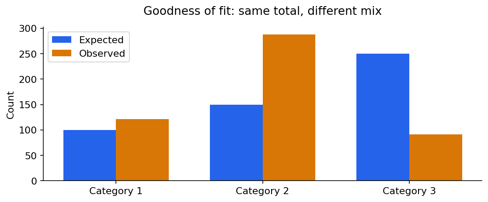
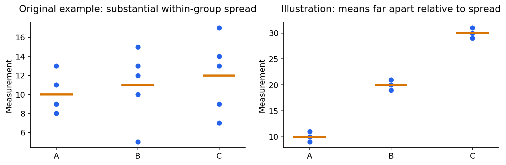
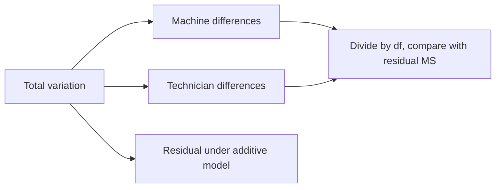

# Statistics 3: chi-square and ANOVA with calculations

[Subject home](../README.md) · [Theory index](README.md)

Use category counts for chi-square questions and measurements grouped by factors for ANOVA questions. Both compare observed variation with a reference model; they answer different questions.

## On this page

- [1. Chi-square goodness of fit](#1-chi-square-goodness-of-fit)
- [2. Chi-square independence](#2-chi-square-independence)
- [3. One-way ANOVA: compare several population means](#3-one-way-anova-compare-several-population-means)
- [4. Two factors: machines and technicians](#4-two-factors-machines-and-technicians)
- [5. How this is used in data science](#5-how-this-is-used-in-data-science)

## 1. Chi-square goodness of fit

Suppose a reference age distribution is 20%, 30%, 50%. For 500 independent observations the expected counts are 100, 150, 250. The observed counts in the notes are 121, 288, 91, which also sum to 500.

$$\chi^2=\sum\frac{(O-E)^2}{E}
=\frac{21^2}{100}+\frac{138^2}{150}+\frac{(-159)^2}{250}
=232.494.$$

There are $k-1=2$ degrees of freedom when the reference probabilities are specified rather than estimated from these counts. The 5% critical value is about 5.991. Reject the reference distribution; the data do not identify why it differs. Expected counts must be adequate for the approximation, observations must be independent, and categories must not overlap.

## 2. Chi-square independence

For a contingency table of region by purchase/no purchase, the null is independence between the two categorical variables. Under independence,

$$E_{ij}=\frac{rowTotal_i\,columnTotal_j}{grandTotal}.$$

Compute the same $\sum(O-E)^2/E$ over cells. Degrees of freedom are $(r-1)(c-1)$ under the standard model. A significant result suggests an association, not causation. For sparse tables, an exact or other appropriate method may be preferable. Standard chi-square count tests use an upper-tail statistic because large discrepancies increase the statistic.

## 3. One-way ANOVA: compare several population means

The null is $\mu_1=\mu_2=\cdots=\mu_k$. The alternative is **at least one mean differs**, not that every pair differs. One-way refers to one grouping factor. ANOVA compares the variability between group means with the variability inside groups.

For the three groups in the notes:

| Group | Values | Mean |
|---|---|---|
| A | 9, 11, 13, 9, 8 | 10 |
| B | 13, 12, 10, 15, 5 | 11 |
| C | 14, 13, 17, 7, 9 | 12 |

The grand mean is 11. Unequal group sizes require a weighted grand mean, not an unweighted average of group means.

$$SS_{between}=\sum n_j(\bar x_j-\bar x)^2=5(10-11)^2+5(11-11)^2+5(12-11)^2=10.$$

Within-group squared deviations sum to 16, 58 and 64:

$$SS_{within}=138,\quad df_{between}=2,\quad df_{within}=15-3=12.$$

$$F=\frac{10/2}{138/12}=\frac5{11.5}\approx0.435.$$

The 5% critical value for $(2,12)$ degrees of freedom is about 3.885. Fail to reject equal means. This is not proof of identical performance. The total sum of squares is $10+138=148$.

Classical one-way ANOVA assumes independent observations, normal residuals within groups for exact inference, and a common residual variance. Consider Welch ANOVA when variances differ; a rank-based procedure answers a different distributional question. A significant omnibus test is followed by planned or multiplicity-adjusted comparisons to identify supported differences.

## 4. Two factors: machines and technicians

A two-way model studies two factors and, with replication, their interaction. Interaction means the effect of one factor changes with the level of the other. With one observation per cell, the usual no-replication calculation cannot separately estimate an interaction and residual error; an additive model is an assumption.

The original example records five technicians and four machines:

| Technician | A | B | C | D |
|---|---|---|---|---|
| P | 54 | 48 | 57 | 46 |
| Q | 56 | 50 | 62 | 53 |
| R | 44 | 46 | 54 | 42 |
| S | 53 | 48 | 56 | 44 |
| T | 48 | 52 | 59 | 48 |

Subtracting 50 from every entry simplifies arithmetic without changing sums of squared deviations. The resulting grand total is 20; correction factor is $20^2/20=20$. Column totals are $(5,-6,38,-17)$ and row totals $(5,21,-14,1,7)$.

| Source | SS | df | MS | F |
|---|---|---|---|---|
| Machines/columns | 338.8 | 3 | 112.9333 | 20.1667 |
| Technicians/rows | 158 | 4 | 39.5 | 7.0536 |
| Residual | 67.2 | 12 | 5.6 | |
| Total | 564 | 19 | | |

Here $SS_{residual}=564-338.8-158=67.2$. At 5%, the machine F critical value is about 3.490 and the technician value about 3.259; both nulls are rejected under the additive no-interaction model. Thus the example supports differences among machine means and technician means; it does not prove every pair differs.

## 5. How this is used in data science

Chi-square can check category associations or whether observed counts depart from a reference mix. ANOVA supports group comparisons and connects to linear regression with category indicators. Neither should become an automatic feature filter without considering the prediction task and validation. Business decisions also need the size of the differences, uncertainty, data quality and practical cost.

[← Estimation, uncertainty and hypothesis tests](03-statistical-inference.md) · [Try the practicals](../02-practicals/README.md)
