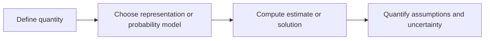

# From arithmetic summaries to uncertainty-aware mathematical methods

[Subject home](../README.md) · [Foundation course](README.md) · [Practicals](../02-practicals/README.md)

Mathematical tools branch by the question. A mean, a matrix decomposition and a hypothesis test do not replace one another; each adds a way to reason about a different limitation.

## Read the motivation, mechanism and trade-off together

| Family / transition | Limitation or question | How the method works | What remains / why another branch matters | Read |
|---|---|---|---|---|
| Mean → median / trimmed and robust summaries | Extreme observations can dominate an arithmetic mean. | Rank values or limit selected extreme influence under a defined estimator. | Different summaries target different quantities; deleting valid extremes can bias the analysis. | [Lesson](lesson-04-descriptive-statistics.md) |
| Descriptive spread → sampling uncertainty | Observation SD does not tell how uncertain an estimated mean is. | Use the sampling distribution and an appropriate standard error/interval procedure. | Dependence, selection and model assumptions determine coverage; more rows do not fix bias. | [Lesson](lesson-07-estimation-and-inference.md) |
| Marginal probability → conditioning / Bayes | Ignoring base rates or evidence changes the denominator incorrectly. | Combine prior rates and evidence likelihoods using the conditional-probability rules. | Posterior results still depend on the probability model and evidence quality. | [Lesson](lesson-05-probability-and-bayes.md) |
| Inverse formula → QR / SVD / least squares | Rank deficiency and conditioning make naive inversion unstable. | Factor the matrix or use singular values to solve/projection problems. | Numerically stable solving does not make redundant coefficients scientifically identifiable. | [Lesson](lesson-02-vectors-and-transformations.md) |
| One-variable slope → gradient / Hessian / constrained optimization | Many coordinates and constraints need more than a visual slope. | Use partial derivatives, curvature, Lagrange/KKT reasoning under conditions and a suitable numerical solver. | A stationary point or KKT candidate is not universally a global optimum. | [Lesson](lesson-03-calculus-and-optimization.md) |
| Fixed step descent → momentum / Newton / adaptive methods | Poor curvature/scale can make fixed steps oscillate or progress slowly. | Use historical directions, curvature solves or running gradient moments. | Each changes computation and assumptions; adaptive steps do not guarantee generalization. | [Lesson](lesson-03-calculus-and-optimization.md) |
| Parametric tests → rank / permutation / bootstrap procedures | A selected reference distribution may not fit the design. | Use rank structure, randomization under an exchangeability design or resampling to approximate a target distribution. | These are not assumption-free; dependent samples need appropriate designs/resampling. | [Lesson](lesson-08-tests-and-experiment-design.md) |
| One test → multiple / sequential inference | Searching or repeatedly peeking changes error rates. | Control a defined family-wise/FDR criterion or use a valid sequential protocol. | No correction retroactively repairs undefined exploratory selection or poor measurement. | [Lesson](lesson-07-estimation-and-inference.md) |
| Classical point estimate → likelihood / Bayesian / simulation inference | Analytic solutions or a single number can hide uncertainty. | Optimize likelihood, combine prior and likelihood, or use justified numerical integration/MCMC. | Convergence diagnostics, identifiability and model misspecification remain; a posterior is conditional on assumptions. | [Lesson](lesson-06-random-variables-and-distributions.md) |

## How to compare alternatives

Use the same task, eligible data, split/horizon and compute budget. State the objective, assumptions, training/update procedure, important settings and failure cases. A newer publication can address one bottleneck while being worse on another. A survey row identifies a family; it does not pretend to derive every research variant.

For a method you study, complete this sentence: “I would consider it because ___; it works by ___; I would compare it with ___ using ___; I would avoid or investigate it when ___.” Recalculate the worked examples before selecting by a method name.
