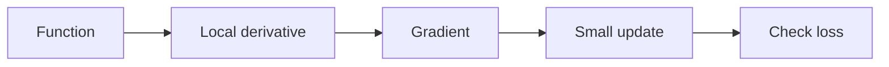
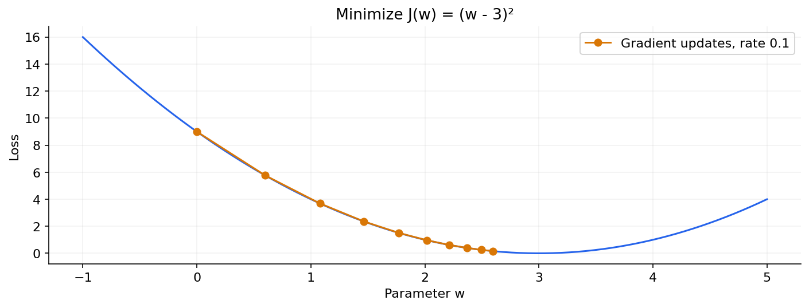
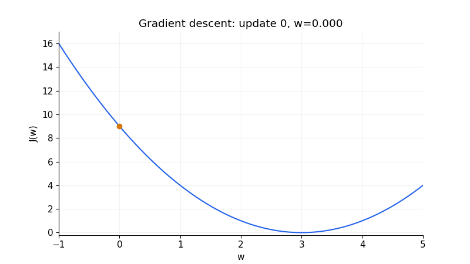

# 03 — Derivatives, partial derivatives, chain rule and integration

[Course map](README.md) · [Practicals](../02-practicals/README.md) · [Questions](../03-questions-and-answers/worked-questions.md#lesson-03)

Gradient steps move downhill on this quadratic objective. See the worked example for its assumptions.

## On this page

- [The idea](#the-idea)
- [Work through it](#work-through-it)
- [Common mistakes and practical limits](#common-mistakes-and-practical-limits)

## The idea

**Analogy:** A derivative is the local slope of a road; a gradient points uphill through several coordinates.

The derivative measures a local rate of change. For $f(x)=x^2$, $f'(x)=2x$. A partial derivative changes one input while holding others fixed. The gradient collects partial derivatives, and a Hessian collects second derivatives describing curvature. Differentiability is a local smoothness condition; a sharp absolute-value corner needs subgradient or another suitable treatment.

The chain rule differentiates composed functions. If $z=wx+b$ and $p=\sigma(z)$, then $\partial p/\partial w=p(1-p)x$. Combining sigmoid with binary log loss simplifies the score derivative to $p-y$. Backpropagation repeatedly applies this chain rule through a computational graph.

An integral accumulates a rate or area under a function. A continuous density integrates to 1; probability over an interval is its integral there. The fundamental theorem connects integration and differentiation under suitable conditions. Optimization uses derivatives to seek minima, but a zero gradient alone can indicate a maximum, minimum or saddle; inspect curvature and the problem domain.

A sequence of small gradient steps approaches the minimum for this quadratic.

## Work through it

Minimize $J(w)=(w-3)^2$. Its gradient is $2(w-3)$. At $w=0$, gradient−6. Step size 0.1 gives $w_{new}=0-0.1(-6)=0.6$, reducing loss from 9 to 5.76.

For $J(a,b)=a^2+3b^2$, gradient $(2a,6b)$ shows greater curvature in the second direction. An overly large step can diverge along $b$ even if updates along $a$ seem reasonable.

## Common mistakes and practical limits

A derivative is not a global change formula for arbitrarily large steps. A stationary point need not be a minimum. Numerical finite differences require a sensible step: too large creates approximation error, too small amplifies rounding.

---

[← Vectors, matrices, projections, eigenvectors and SVD](lesson-02-vectors-and-transformations.md) · [Data types, summaries, spread and relationships →](lesson-04-descriptive-statistics.md)
