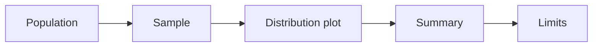
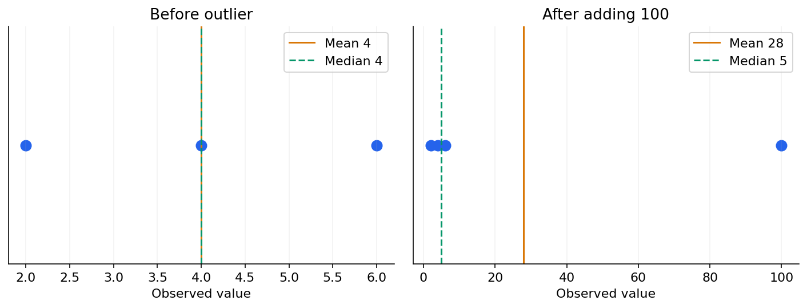

# 04 — Data types, summaries, spread and relationships

[Course map](README.md) · [Practicals](../02-practicals/README.md) · [Questions](../03-questions-and-answers/worked-questions.md#lesson-04)

An extreme observation moves the mean more than the median. See the worked example for its assumptions.

## On this page

- [The idea](#the-idea)
- [Work through it](#work-through-it)
- [Common mistakes and practical limits](#common-mistakes-and-practical-limits)

## The idea

**Analogy:** A summary is a compressed photograph: useful, but it can hide the part of the scene you care about.

Classify variables before calculating: nominal categories have labels, ordinal categories have order, numeric measurements can be discrete or continuous. A numeric-looking identifier is not automatically quantitative. Define population, sampling unit and observation grain so a customer is not confused with a transaction.

The mean adds values and divides by count; the median is a middle ordered value; the mode is the most frequent. Mean is sensitive to extreme values. Sample variance $s^2=\sum(x_i-\bar x)^2/(n-1)$ estimates population variance under the usual independent sampling setup. Standard deviation is in original units; variance is in squared units. Quantiles, IQR and robust summaries complement them.

Pearson correlation measures standardized linear association and requires nonzero variances. Spearman correlation uses ranks for monotonic association. Neither proves causality. Plot distributions, scatterplots and group-specific patterns: pooled relationships can reverse after grouping, as in Simpson's paradox. Outliers may be errors or valid important observations, so investigate rather than deleting them automatically.

## Work through it

For $[2,4,6]$, mean 4, squared deviations 4,0,4 and sample variance $8/2=4$, so sample SD2. Add 100: the mean becomes 28 while median 5, illustrating sensitivity.

Two groups may have different baseline risks and treatment rates. A pooled success rate can favour one option while both within-group comparisons favour another. Report the actual denominators and investigate the grouping mechanism rather than announcing a universal paradoxical rule.

## Common mistakes and practical limits

Do not average percentages with unequal denominators without considering the intended weighting. SD describes individual spread; standard error describes uncertainty of an estimator. Missingness patterns can invalidate a summary of only complete records.

---

[← Derivatives, partial derivatives, chain rule and integration](lesson-03-calculus-and-optimization.md) · [Probability, conditioning, independence and Bayes →](lesson-05-probability-and-bayes.md)
