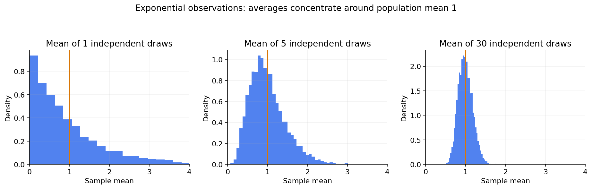

# 06 — Random variables, distributions, likelihood and the CLT

[Course map](README.md) · [Practicals](../02-practicals/README.md) · [Questions](../03-questions-and-answers/worked-questions.md#lesson-06)

Averages of independent exponential samples become more concentrated. See the worked example for its assumptions.

## On this page

- [The idea](#the-idea)
- [Work through it](#work-through-it)
- [Common mistakes and practical limits](#common-mistakes-and-practical-limits)

## The idea

**Analogy:** A distribution is a map of possible outcomes and how much probability belongs to each.

A discrete random variable has a probability mass function; a continuous one has a density whose integral gives interval probabilities. A density value is not itself a point probability and can exceed 1. A CDF $F(x)=P(X\le x)$ works for either type.

Bernoulli models one binary trial; binomial counts successes in a fixed number of independent equal-probability trials; Poisson describes counts under a particular rate model; normal models symmetric continuous variation; exponential models waiting times with a memoryless constant-hazard assumption. Real data need not match these assumptions. Overdispersion can make Poisson variance assumptions unsuitable.

The law of large numbers concerns convergence of averages under conditions. The central limit theorem concerns the limiting distribution of suitably standardized sums/means, not a claim that raw data become normal. Independence, variance and dependence conditions matter. Likelihood treats observed data as fixed and varies parameters; it is not a probability distribution over parameters until combined with a prior and normalization.

## Work through it

For 3 independent Bernoulli trials with $p=0.2$, probability of exactly 1 success is $\binom31(0.2)(0.8)^2=0.384$. Mean count is $np=0.6$ and variance $np(1-p)=0.48$.

For an independent sample mean with finite variance $\sigma^2$, variance is $\sigma^2/n$ and standard error is $\sigma/\sqrt n$. Quadrupling sample size halves SE, rather than reducing it by a factor of 4.

## Common mistakes and practical limits

Do not use a binomial model when trial probabilities/dependence violate its intended assumptions without justification. A histogram resembling a bell is not proof of independence or a correctly specified likelihood.

---

[← Probability, conditioning, independence and Bayes](lesson-05-probability-and-bayes.md) · [Estimation, intervals, hypothesis tests and multiple comparisons →](lesson-07-estimation-and-inference.md)
