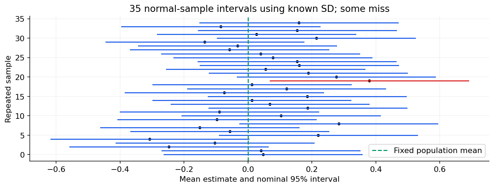

# 07 — Estimation, intervals, hypothesis tests and multiple comparisons

[Course map](README.md) · [Practicals](../02-practicals/README.md) · [Questions](../03-questions-and-answers/worked-questions.md#lesson-07)

Intervals from repeated independent samples sometimes miss the fixed mean. See the worked example for its assumptions.

## On this page

- [The idea](#the-idea)
- [Work through it](#work-through-it)
- [Common mistakes and practical limits](#common-mistakes-and-practical-limits)

## The idea

**Analogy:** An estimate is a measurement with a ruler that has uncertainty; a test asks whether data are surprising under a specified model.

A point estimate summarizes an unknown parameter. Bias is systematic expectation error; variance is sampling variability. A confidence interval is generated by a procedure with a stated repeated-sampling coverage under assumptions; it is not ordinarily a posterior probability for the fixed parameter after observing the data.

A hypothesis test specifies a null, alternative, statistic, reference distribution and significance rule. A p-value is the probability under the null model of a statistic at least as extreme under the chosen definition. It is not the probability that the null is true or the chance that a result is “just random”. Report effect size and uncertainty, not merely whether a threshold was crossed.

TypeI error rejects a true null; TypeII error fails to reject a false null; power is 1−TypeII probability for a specified effect/design. Sample size, variance, effect size and test rule determine power. Testing many hypotheses increases false discoveries; family-wise procedures and false-discovery-rate control answer different error questions. Repeatedly peeking and stopping requires a valid sequential design.

## Work through it

For a large independent sample with mean 50, estimated SD10 and $n=100$, estimated SE is 1. An approximate normal 95% interval is $50\pm1.96$, or[48.04,51.96]. For small samples with estimated SD and suitable normal-error assumptions, use a t reference rather than automatically 1.96.

If 20 independent true-null tests each use 0.05, the chance of at least one false rejection is $1-0.95^{20}\approx0.642$, not 0.05.

## Common mistakes and practical limits

Failure to reject is not proof of equivalence. Statistical significance does not imply practical importance. A narrow interval around a biased estimate can be precisely wrong.

---

[← Random variables, distributions, likelihood and the CLT](lesson-06-random-variables-and-distributions.md) · [t-tests, ANOVA, chi-square, nonparametric tests and experiments →](lesson-08-tests-and-experiment-design.md)
