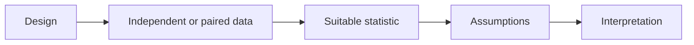

# 08 — t-tests, ANOVA, chi-square, nonparametric tests and experiments

[Course map](README.md) · [Practicals](../02-practicals/README.md) · [Questions](../03-questions-and-answers/worked-questions.md#lesson-08)

## On this page

- [The idea](#the-idea)
- [Work through it](#work-through-it)
- [Common mistakes and practical limits](#common-mistakes-and-practical-limits)

## The idea

**Analogy:** Choose a statistical tool the way you choose a measuring tool: by the question, units and sampling design.

A one-sample t-test compares a mean with a reference. Paired tests analyse within-pair differences; independent-sample tests compare separate groups, with Welch's method allowing unequal variances. ANOVA compares group means via between/within variation under its model. A significant omnibus result does not identify every differing pair.

Chi-square goodness-of-fit compares categorical counts with a specified distribution; a contingency-table independence test compares observed counts with expected counts from marginal totals. Sparse counts may need an exact or other appropriate method. Mann–Whitney, signed-rank and Kruskal–Wallis procedures target distributional/rank questions under their assumptions; they are not universal assumption-free median tests.

Random assignment supports causal comparisons under a suitable experiment. Define the randomization unit, primary metric, minimum relevant effect, duration, sample size and stopping rule before launch. Cluster-randomized users/branches require analysis reflecting that design. Missing outcomes, noncompliance, interference and novelty effects can undermine naive interpretations.

## Work through it

A2×2 table has rows[30,20]and[20,30]. Every expected count is 25. The statistic is $\sum(O-E)^2/E=4\times25/25=4$, with 1 degree of freedom under the standard test.

For an A/B conversion experiment,100/1000 versus 120/1000 gives rates 10% and 12%: an absolute 2 percentage-point lift and relative 20% lift. Those descriptions are different; uncertainty still needs to be estimated under the experiment design.

## Common mistakes and practical limits

Do not switch between paired and independent tests based only on which p-value is smaller. Check expected counts and design assumptions. Avoid interpreting an observational group comparison as a randomized intervention.

---

[← Estimation, intervals, hypothesis tests and multiple comparisons](lesson-07-estimation-and-inference.md) · [Continue with practicals](../02-practicals/README.md)
