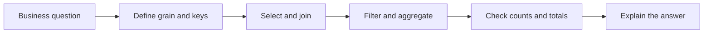
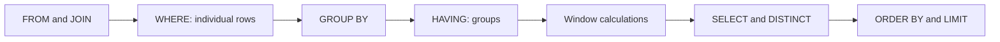
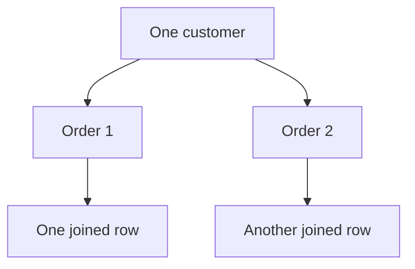

# SQL: from rows to trustworthy answers

[Subject home](../README.md) · [Theory index](README.md)

SQL describes the result we want from relational data. Before writing a query, state the **grain**: what does one row represent? An order line, an order, a customer, or a monthly total? Many incorrect answers come from mixing grains rather than from bad syntax.




## On this page

- [1. Tables, types and keys](#1-tables-types-and-keys)
- [2. Select, filter and sort](#2-select-filter-and-sort)
- [3. Aggregation and the logical query order](#3-aggregation-and-the-logical-query-order)
- [4. Joins: understand what each match does](#4-joins-understand-what-each-match-does)
- [5. Subqueries and CTEs](#5-subqueries-and-ctes)
- [6. Window functions keep the original rows](#6-window-functions-keep-the-original-rows)
- [7. Transactions, updates and indexes](#7-transactions-updates-and-indexes)
- [8. Real analysis patterns](#8-real-analysis-patterns)

## 1. Tables, types and keys

A table has rows and columns; SQL tables have no guaranteed display order until `ORDER BY` is used. A primary key identifies a row. A foreign key connects a row to a referenced table. `NOT NULL`, `UNIQUE` and `CHECK` constraints express rules that should not depend on an analyst remembering them.

```sql
CREATE TABLE orders (
    order_id INTEGER PRIMARY KEY,
    customer_id INTEGER NOT NULL,
    region TEXT NOT NULL,
    order_date TEXT NOT NULL,
    amount NUMERIC NOT NULL CHECK (amount >= 0)
);
INSERT INTO orders VALUES
(1, 101, 'East', '2025-01-01', 100),
(2, 101, 'East', '2025-01-02', 200),
(3, 102, 'West', '2025-01-02', 80),
(4, 103, 'East', '2025-02-01', 150);
```

These self-contained examples run in SQLite. Dates use ISO text here; use a native date type in systems that support one. The existing class scripts include other SQL dialects; date functions, collations and row limits can differ.

## 2. Select, filter and sort

```sql
SELECT order_id, amount, amount * 0.9 AS discounted_amount
FROM orders
WHERE region = 'East' AND amount >= 150
ORDER BY amount DESC, order_id;
```

The result contains orders 2 and 4. The second sort key makes ties deterministic. `BETWEEN` includes both endpoints. `IN` tests a list; `LIKE` matches patterns (`%` for any sequence, `_` for one character). Case sensitivity depends on the database and collation, not on a universal SQL rule.

`NULL` means missing or unknown. Use `IS NULL`, not `= NULL`. An equality comparison with `NULL` is unknown, and `WHERE` retains only true conditions. `COALESCE(value, default)` supplies a fallback, but replacing missing prices with zero changes their meaning; justify it.

## 3. Aggregation and the logical query order



This is a learning model of logical processing, not a promise about the optimizer's physical execution order.

```sql
SELECT region, COUNT(*) AS orders, SUM(amount) AS revenue
FROM orders
GROUP BY region
HAVING SUM(amount) >= 200
ORDER BY revenue DESC;
```

East has 3 orders and revenue 450; West has 1 order and revenue 80, so only East passes. `WHERE` filters rows before grouping; `HAVING` filters groups afterwards. `COUNT(*)` counts rows; `COUNT(column)` excludes nulls. `AVG` excludes nulls too. Do not assume an average of regional averages equals the overall average: use the group sizes or aggregate the underlying rows.

Conditional aggregation counts categories without several separate queries:

```sql
SELECT SUM(CASE WHEN amount >= 150 THEN 1 ELSE 0 END) AS large_orders,
       SUM(amount) AS total_revenue
FROM orders;
```

There are 2 large orders; total revenue is 530. A conversion rate must use the intended denominator and decimal arithmetic: `1.0 * conversions / NULLIF(visitors, 0)`.

## 4. Joins: understand what each match does



An inner join keeps matches. A left join keeps every left row and supplies nulls where no right match exists. A cross join returns all combinations. A self join relates rows of one table, such as employee and manager. `UNION ALL` stacks rows and retains duplicates; `UNION` removes duplicate result rows.

If one order matches three payment rows and two return rows, joining both raw tables can create six rows for that order. Aggregate payments and returns to order grain before joining them. Check row counts and totals before and after each join.

A right-table condition placed in `WHERE` can remove the null rows from a left join. Put a condition in `ON` when it should restrict matches while preserving unmatched left rows. To find customers with no orders, use `NOT EXISTS`; it avoids the null pitfalls of `NOT IN`.

## 5. Subqueries and CTEs

A subquery gives another query an intermediate result. A CTE names that result, making multi-step logic readable:

```sql
WITH customer_revenue AS (
    SELECT customer_id, SUM(amount) AS revenue
    FROM orders
    GROUP BY customer_id
)
SELECT customer_id, revenue
FROM customer_revenue
WHERE revenue > 200;
```

Customer 101 has revenue 300. A CTE improves organization; it is not automatically a performance improvement. Explain each step's grain in a short comment.

## 6. Window functions keep the original rows

`GROUP BY` collapses rows; a window calculation adds information while retaining rows. `PARTITION BY` separates independent groups; the window's `ORDER BY` controls calculation order.

```sql
SELECT order_id, region, amount,
       ROW_NUMBER() OVER (
           PARTITION BY region ORDER BY amount DESC, order_id
       ) AS position,
       SUM(amount) OVER (
           PARTITION BY region ORDER BY order_date, order_id
           ROWS BETWEEN UNBOUNDED PRECEDING AND CURRENT ROW
       ) AS running_revenue
FROM orders
ORDER BY region, order_date, order_id;
```

East's running revenues are 100, 300, 450. Explicit `ROWS` and a tie-breaker make the intended cumulative calculation clear. `ROW_NUMBER` gives one sequence; `RANK` gives ties with gaps; `DENSE_RANK` gives ties without gaps. Use `LAG` for the preceding row and `LEAD` for the following row. A preceding row is not necessarily the preceding calendar day; fill a date calendar when missing days matter.

Filter a window result in an outer query or CTE:

```sql
WITH ranked AS (
    SELECT *, ROW_NUMBER() OVER (
        PARTITION BY region ORDER BY amount DESC, order_id
    ) AS position
    FROM orders
)
SELECT order_id, region, amount FROM ranked WHERE position = 1;
```

Orders 2 and 3 are the largest in their regions. For all customers tied in first place, change the business rule and use a rank based only on amount.

## 7. Transactions, updates and indexes

`INSERT`, `UPDATE` and `DELETE` change data. A transaction groups changes into a unit that can be committed or rolled back. Preview a mutation with a `SELECT` using the same filter. A foreign key prevents some inconsistent relationships; it does not verify a business definition like “active customer”.

An index speeds some lookups by maintaining an additional search structure. It uses storage and adds write work. Look at an execution plan, filter selectivity and join keys before adding one. A function wrapped around an indexed column can affect whether the index is useful. Parameterized queries keep data values separate from executable SQL; do not concatenate user input into queries.

## 8. Real analysis patterns

| Question | Start by defining | Technique |
|---|---|---|
| Monthly growth | Calendar, currency, gross/net sales | Aggregate months, then `LAG` |
| Repeat customers | Time window and qualifying order | Group customer, count orders |
| Retention | Signup cohort and return event | Cohort join with explicit date periods |
| Top products | Units, revenue or margin | Aggregate product, then rank |
| Funnel conversion | Unique user and event sequence | Stage-level counts; verify ordering |
| Duplicate records | True business key and keeper rule | `ROW_NUMBER` with deterministic ordering |

For monthly growth, calculate `(current - previous) / previous`, handle a zero or missing previous value, and say whether incomplete months are excluded. For retention, distinguish customers who could have returned from customers whose observation period has not finished. The practical-question folder contains runnable data and solutions.

Reference for window behaviour: [PostgreSQL window functions](https://www.postgresql.org/docs/current/tutorial-window.html).


[Data analysis, EDA and feature engineering →](02-eda.md) · [Try the practicals](../02-practicals/README.md)
