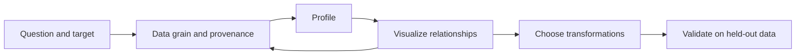
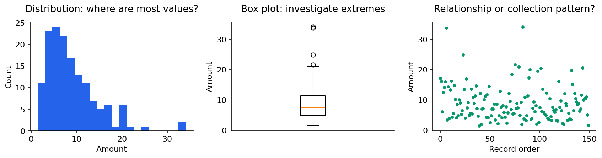
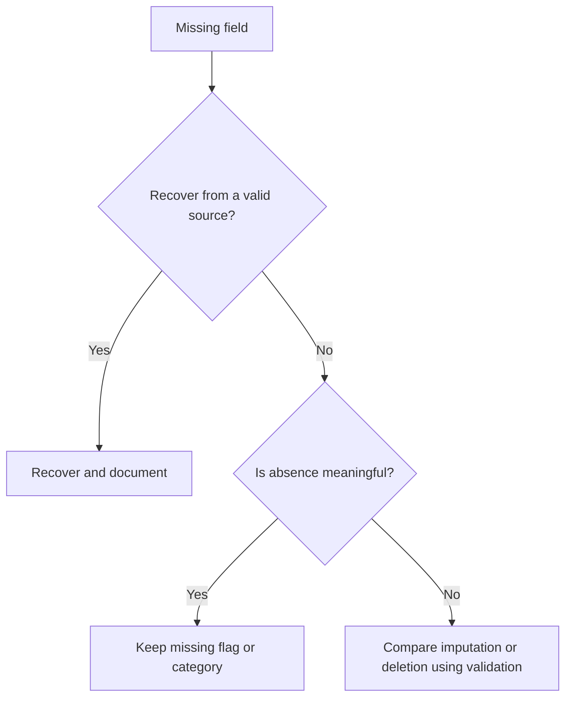

# Data analysis, EDA and feature engineering

[Subject home](../README.md) · [Theory index](README.md)

Exploratory data analysis asks, **“What is in the data, and what might make our conclusion wrong?”** Feature engineering asks, **“How should we represent that information for the model?”** They are related but not identical. A good analysis starts with the decision, not with drawing every available chart.




## On this page

- [1. Understand the table](#1-understand-the-table)
- [2. Profile before changing values](#2-profile-before-changing-values)
- [3. Match the chart to the question](#3-match-the-chart-to-the-question)
- [4. Missing values: choose a rule for a reason](#4-missing-values-choose-a-rule-for-a-reason)
- [5. Outliers and transformations](#5-outliers-and-transformations)
- [6. Encoding, selection and imbalance](#6-encoding-selection-and-imbalance)
- [7. Finish with an auditable conclusion](#7-finish-with-an-auditable-conclusion)

## 1. Understand the table

Record what one row represents, when the information became available, the target, the keys and the allowed values. An “independent feature” means a model input; it does not mean the input is statistically independent of all other inputs. A numeric-looking ID is often categorical.

| Kind | Example | Useful summary |
|---|---|---|
| Continuous | Height, duration | Quantiles, spread, histogram |
| Discrete count | Purchases | Counts, zeros, range |
| Nominal category | City | Frequencies, missing/rare labels |
| Ordered category | Education level | Frequencies and meaningful ordering |
| Date/time | Purchase timestamp | Coverage, gaps, timezone |

Data can be structured tables, semistructured JSON, or unstructured documents and images. Batch versus streaming describes arrival and processing, not whether a variable is discrete or continuous. All need quality checks.

## 2. Profile before changing values

Check shape, types, missingness, unique counts, duplicated rows and duplicated business keys. Inspect minimums, maximums, memory use and category spellings. Compare totals to a trusted source. A duplicate customer ID can be valid in an order table but invalid in a customer dimension.

```python
# df is the DataFrame loaded in an existing practical notebook.
# Inspect these before choosing cleaning rules:
# df.shape
# df.dtypes
# df.isna().mean().sort_values(ascending=False)
# df.duplicated().sum()
# df.describe(include="all")
```

A profile is a diagnosis. It does not justify deleting every unusual value. Preserve raw inputs so a cleaning decision can be reconsidered.

## 3. Match the chart to the question



Univariate analysis examines one variable: histogram for a numeric distribution, box plot for median and spread, count plot for category frequency. Bivariate analysis compares two: scatter plot for two measurements, grouped boxes for a measurement by category, or a contingency table for two categories. Multivariate analysis studies several together, using group comparisons or a correlation heatmap.

A histogram depends on its bins; a density estimate depends on bandwidth. Neither proves a particular distribution. A Q-Q plot compares ordered values to a reference distribution. For a box plot, $IQR=Q_3-Q_1$; values outside $Q_1-1.5IQR$ and $Q_3+1.5IQR$ are flagged, not automatically invalid. Use the statistics guide for the underlying calculations.

Look at the Student Data practical in this subject: exam scores can be compared by preparation, lunch category and education. An observed difference is an association; it does not establish that changing the category causes the score difference. Report sample sizes and missingness alongside group means.

## 4. Missing values: choose a rule for a reason



Mean imputation is simple for roughly symmetric numeric data; median is less affected by extremes; mode supplies a common category. Constant, model-based or KNN imputation are alternatives, not guaranteed improvements. Imputation reduces or changes variability and can create misleading relationships. A missingness flag can capture useful information.

Forward fill uses previous observations; backward fill uses later ones. A forecast must not fill past features using future values. A column with 90% missing values is not automatically useless: availability, meaning and performance decide. Fit the imputer on training data only and apply that learned rule to validation/test data.

## 5. Outliers and transformations

Check unusual values against units, data-entry rules and the domain. A purchase of 100,000 can be a genuine wholesale order. Options include keeping it, correcting a verified error, robust modelling, clipping to justified bounds, or excluding an out-of-scope record. Explain the effect on the target and sample size.

A log transformation compresses positive skew: 10, 100 and 1,000 become equally spaced on a base-10 log scale. It changes interpretation. Box-Cox requires positive values; Yeo-Johnson can handle zero and negative values. Squaring or taking roots changes relationships too; pick a transformation to solve a specific problem and validate it.

Standardization is $(x-\mu)/s$; min-max scaling is $(x-x_{min})/(x_{max}-x_{min})$. Scaling does not make a skewed distribution normal. It matters for distance methods and many optimizers; ordinary threshold-based trees generally do not need it. Fit scaling only on training data.

## 6. Encoding, selection and imbalance

One-hot encoding represents unordered categories with separate indicators. Ordinal encoding should reflect genuine order. Frequency encoding uses counts; target encoding uses target statistics and must be learned within training folds to avoid leakage. Hashing bounds the feature space but permits collisions. Decide how unseen categories will be handled.

Feature selection retains original columns. PCA makes new combinations of columns; it is dimensionality reduction. LDA can mean linear discriminant analysis in supervised reduction or latent Dirichlet allocation in topic modelling: state which meaning you intend. t-SNE is useful for exploratory visualization; a pretty map alone is not a validated production feature pipeline.

For imbalance, begin with a meaningful metric and class counts. Compare class weights, collecting examples and resampling. Resample inside each training fold; leave validation/test prevalence representative of deployment. More synthetic minority rows do not necessarily add new information.

## 7. Finish with an auditable conclusion

Write the question, the data period, the filtering rules, a few relevant visuals, the result and its limitations. For a model, save the preprocessing and predictor together. Automated reports help find issues, but they do not decide whether a pattern is real or actionable. Recheck the data after transformations.

**Practice:** For the student-score or visa dataset, list three quality checks, two useful visual comparisons, one leakage risk and one conclusion the data cannot support. Then run the corresponding notebook and compare your reasoning.


[← SQL: theory and code](01-sql.md) · [Try the practicals](../02-practicals/README.md)
