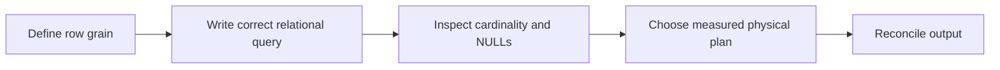

# From readable SQL to scalable and trustworthy query algorithms

[Subject home](../README.md) · [Foundation course](README.md) · [Practicals](../02-practicals/README.md)

Logical SQL describes the answer; physical algorithms determine how an engine obtains it. Learn correctness and grain first, then indexes/plans. The engine can choose a different strategy as sizes and statistics change.

## Read the motivation, mechanism and trade-off together

| Family / transition | Limitation or question | How the method works | What remains / why another branch matters | Read |
|---|---|---|---|---|
| Row filters → grouped aggregation | A list of rows does not directly answer per-customer totals. | GROUP BY creates group states; hash aggregation or sorted aggregation can implement them. | Memory, sort order, skew and NULL semantics affect execution/correctness. | [Lesson](lesson-03-aggregation-and-grain.md) |
| Nested-loop → hash / merge joins | Comparing every pair becomes expensive for large relations. | Hash join builds/probes keyed state; merge join scans compatible sorted keys; indexed loops use selective lookups. | No join type is universally fastest; duplicates multiply combinations in every correct implementation. | [Lesson](lesson-04-joins-and-subqueries.md) |
| Full scan → B-tree / other index access | Selective queries may not need every row. | Traverse ordered index structures or a supported specialist index to find candidate records. | Low selectivity, writes, clustering and engine internals can make a scan preferable. | [Lesson](lesson-06-modeling-performance-transactions.md) |
| GROUP BY → window functions | Aggregation discards individual-row detail. | Partition/order a window and compute per-row state such as rank, lag or cumulative sum. | Sorting/frame semantics and deterministic tie rules matter; windows do not automatically collapse rows. | [Lesson](lesson-05-window-functions.md) |
| Self-joins → recursive traversal patterns | Hierarchies need repeated parent/child expansion. | A recursive CTE iterates an anchor and recursive step under engine rules. | Cycles, duplicates, depth limits and growth need explicit controls; syntax/behaviour differs by dialect. | [Lesson](lesson-04-joins-and-subqueries.md) |
| Ad hoc transformations → dimensional and temporal models | Repeated inconsistent joins make reporting fragile. | Declare fact grain, dimensions and effective-date rules, then reuse validated measures. | A star schema cannot fix invalid keys or overlapping history intervals by itself. | [Lesson](lesson-06-modeling-performance-transactions.md) |
| Independent statements → transactions / concurrency control | Concurrent edits can observe or create inconsistent states. | Use atomic commit with defined isolation, locking or multiversion behaviour. | Isolation levels and external side effects need explicit handling; rollback is not universal time travel. | [Lesson](lesson-06-modeling-performance-transactions.md) |
| Raw correlations → cohorts / experiments | Pooled patterns can hide mix/time effects or confounding. | Align eligible populations and follow-up, then choose a valid comparison design. | A complex query does not turn observational data into causal evidence. | [Lesson](lesson-08-analysis-and-storytelling.md) |

## How to compare alternatives

Use the same task, eligible data, split/horizon and compute budget. State the objective, assumptions, training/update procedure, important settings and failure cases. A newer publication can address one bottleneck while being worse on another. A survey row identifies a family; it does not pretend to derive every research variant.

For a method you study, complete this sentence: “I would consider it because ___; it works by ___; I would compare it with ___ using ___; I would avoid or investigate it when ___.” Recalculate the worked examples before selecting by a method name.
