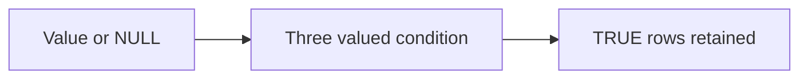

# 02 — Filters, NULL, CASE, strings and dates

[Course map](README.md) · [Practicals](../02-practicals/README.md) · [Questions](../03-questions-and-answers/worked-questions.md#lesson-02)



## On this page

- [The idea](#the-idea)
- [Work through it](#work-through-it)
- [Common mistakes and practical limits](#common-mistakes-and-practical-limits)

## The idea

**Analogy:** NULL is an unknown marker, not a zero or an empty string.

SQL uses three-valued logic: comparisons involving NULL commonly yield UNKNOWN. WHERE retains TRUE, not FALSE or UNKNOWN. Use IS NULL/IS NOT NULL rather than =NULL. COUNT(*) counts rows; COUNT(column) counts non-NULL values. SUM ignores NULL operands but an empty input often returns NULL, so choose COALESCE deliberately.

CASE expresses conditional logic; COALESCE selects a first non-NULL value. Parenthesize AND/OR conditions to reflect the intended rule. LIKE matches patterns with engine-specific case behaviour. Date arithmetic differs by engine, so keep portable concepts separate from dialect syntax.

NOT IN can surprise when its subquery contains NULL: comparisons may become UNKNOWN. NOT EXISTS is often a clearer anti-match pattern, with the desired join condition stated explicitly. Replacing every NULL with 0 can corrupt the difference between missing revenue and known zero revenue.

## Work through it

```sql
SELECT id,
       CASE WHEN amount >= 100 THEN 'large' ELSE 'small' END AS band
FROM orders
WHERE amount IS NOT NULL
  AND (status = 'paid' OR status = 'refunded')
ORDER BY id;
```

For amounts[10,NULL,20], COUNT(*)=3, COUNT(amount)=2 and AVG(amount)=15. Treating the missing amount as 0 would yield 10, answering a different question.

## Common mistakes and practical limits

A predicate in WHERE after a LEFT JOIN can discard the NULL-extended unmatched rows. CASE ELSE0 and ELSENULL have different effects on averages/counts. SQL NULL semantics differ from Python None comparisons.

---

[← Tables, grain, keys, types and SELECT](lesson-01-relational-foundations.md) · [GROUP BY, HAVING, conditional aggregation and weighted metrics →](lesson-03-aggregation-and-grain.md)
