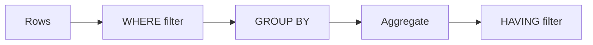

# 03 — GROUP BY, HAVING, conditional aggregation and weighted metrics

[Course map](README.md) · [Practicals](../02-practicals/README.md) · [Questions](../03-questions-and-answers/worked-questions.md#lesson-03)



## On this page

- [The idea](#the-idea)
- [Work through it](#work-through-it)
- [Common mistakes and practical limits](#common-mistakes-and-practical-limits)

## The idea

**Analogy:** Grouping turns individual receipts into a summary ledger; every selected number needs the right denominator.

GROUP BY forms groups at chosen keys; aggregate functions summarize within each. WHERE filters before aggregation; HAVING filters groups after it. Selecting ungrouped nonaggregate columns is invalid or ambiguous under standard semantics; do not rely on permissive engine behaviour.

Conditional aggregation uses CASE inside SUM/COUNT/AVG to build multiple metrics in one grouped query. Define whether missing and zero values should contribute. A total conversion rate is total conversions divided by total eligible users, not the unweighted average of arbitrary subgroup rates.

Joins and aggregation interact. Aggregate order lines to the order grain before joining order-level facts if subsequent sums would otherwise repeat them. Reconcile the resulting totals with a source calculation. A well-formatted query can still be mathematically wrong if its grain changed halfway through.

## Work through it

```sql
SELECT customer_id,
       COUNT(*) AS order_count,
       SUM(CASE WHEN status='paid' THEN amount ELSE 0 END) AS paid_total
FROM orders
GROUP BY customer_id
HAVING COUNT(*) >= 2
ORDER BY customer_id;
```

GroupAhas 1/2 conversion;Bhas 9/18. Combined rate 10/20=50%. But withA1/2 andB1/100, averaging 50% and 1% gives 25.5%, while pooled rate 2/102≈1.96%.

## Common mistakes and practical limits

Use a decimal conversion when integer division would truncate. Counting joined rows is not necessarily counting customers. A percentage with a tiny denominator is volatile and should display its sample size.

---

[← Filters, NULL, CASE, strings and dates](lesson-02-filters-and-null.md) · [Joins, EXISTS, subqueries, CTEs and set operations →](lesson-04-joins-and-subqueries.md)
