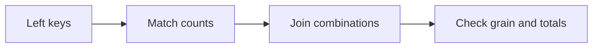
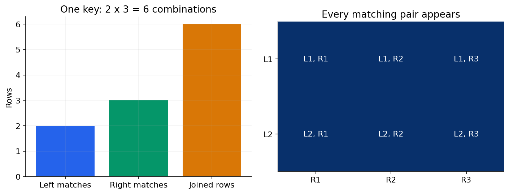

# 04 — Joins, EXISTS, subqueries, CTEs and set operations

[Course map](README.md) · [Practicals](../02-practicals/README.md) · [Questions](../03-questions-and-answers/worked-questions.md#lesson-04)





Duplicate join keys multiply matching rows. See the worked example for its assumptions.

## On this page

- [The idea](#the-idea)
- [Work through it](#work-through-it)
- [Common mistakes and practical limits](#common-mistakes-and-practical-limits)

## The idea

**Analogy:** A join matches ledger entries; its match count determines whether values are repeated.

INNER JOIN retains matched combinations. LEFT JOIN keeps every left row and NULL-extends unmatched right fields. A many-to-many match produces every matching combination: two matching rows on each side yield four output rows. CROSS JOIN intentionally produces all combinations. FULL OUTER support varies by engine/version.

EXISTS tests whether a related row is present without needing all its columns. A correlated subquery refers to the outer row. A CTE names an intermediate query using WITH, improving explanation but not automatically guaranteeing materialization or speed. UNION removes duplicates; UNION ALL preserves them and avoids that deduplication work when it is not needed.

Use joins when you need related columns and semi/anti-match patterns when you need membership. Keep join conditions explicit and qualify same-named columns. A LEFT JOIN filtered on a right-table condition in WHERE may become effectively inner; put conditions in ON when they define eligible matches while retaining unmatched left rows.

## Work through it

```sql
SELECT c.id, c.name, COUNT(o.id) AS paid_orders
FROM customers AS c
LEFT JOIN orders AS o
  ON o.customer_id=c.id AND o.status='paid'
GROUP BY c.id, c.name
ORDER BY c.id;
```

COUNT(o.id), not COUNT(*), yields 0 for an unmatched customer because the synthetic left-join row has no non-NULL order ID.

## Common mistakes and practical limits

Joining by a display name can merge different people or miss spelling variants. A CTE is not an optimization spell. UNION can unintentionally erase legitimately repeated events.

---

[← GROUP BY, HAVING, conditional aggregation and weighted metrics](lesson-03-aggregation-and-grain.md) · [Windows, ranking, running totals and session patterns →](lesson-05-window-functions.md)
