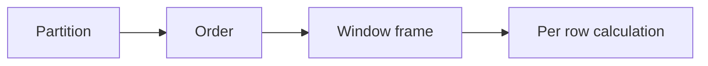
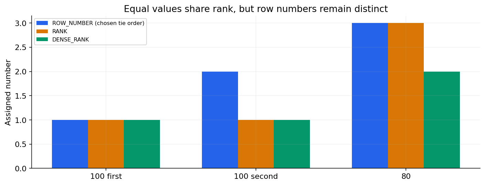

# 05 — Windows, ranking, running totals and session patterns

[Course map](README.md) · [Practicals](../02-practicals/README.md) · [Questions](../03-questions-and-answers/worked-questions.md#lesson-05)





Tie rules distinguish row number, rank and dense rank. See the worked example for its assumptions.

## On this page

- [The idea](#the-idea)
- [Work through it](#work-through-it)
- [Common mistakes and practical limits](#common-mistakes-and-practical-limits)

## The idea

**Analogy:** A window adds a group-aware annotation to each row without collapsing the rows.

Window functions use OVER with partitioning, ordering and sometimes a frame. PARTITION BY restarts calculations for a group; ORDER BY defines sequence within it. ROW_NUMBER produces unique row positions; RANK leaves gaps after ties; DENSE_RANK does not. Specify deterministic tie-breaking only when it matches the intended tie policy.

LAG/LEAD compare neighbouring rows. SUM OVER can compute running totals, but default frames can treat equal ordering keys together. An explicit ROWS frame and unique ordering define row-by-row accumulation. A time-based RANGE frame and a row-count frame answer different questions.

Filtering a window result normally requires a subquery/CTE or a dialect-specific clause. Common patterns include latest record per key, topNper group, gaps-and-islands, change detection and sessions. Define whether “latest” uses event time or ingestion time and what to do with equal timestamps.

## Work through it

```sql
WITH ranked AS (
 SELECT id, customer_id, amount,
        ROW_NUMBER() OVER (
          PARTITION BY customer_id ORDER BY day DESC, id DESC
        ) AS rn
 FROM orders
)
SELECT id, customer_id, amount
FROM ranked WHERE rn=1 ORDER BY customer_id;
```

For values[100,100,80], descending RANK gives[1,1,3]and DENSE_RANK[1,1,2]. ROW_NUMBER requires a tie order if a deterministic chosen row matters.

## Common mistakes and practical limits

A running total with nonunique ordering and an implicit frame may surprise you. Do not use ROW_NUMBER to discard duplicates without explaining which record wins and why.

---

[← Joins, EXISTS, subqueries, CTEs and set operations](lesson-04-joins-and-subqueries.md) · [Data modelling, indexes, transactions and query plans →](lesson-06-modeling-performance-transactions.md)
