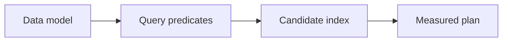

# 06 — Data modelling, indexes, transactions and query plans

[Course map](README.md) · [Practicals](../02-practicals/README.md) · [Questions](../03-questions-and-answers/worked-questions.md#lesson-06)

## On this page

- [The idea](#the-idea)
- [Work through it](#work-through-it)
- [Common mistakes and practical limits](#common-mistakes-and-practical-limits)

## The idea

**Analogy:** A model is a storage contract; an index is a directory, not a replacement for a correct query.

Normalization separates entities and reduces update anomalies. Analytic star schemas put measurable events in a fact table and descriptive attributes in dimensions. Choose the fact grain before adding measures. Slowly changing dimensions track changing descriptions under an explicit history policy.

An index can accelerate selective lookups, joins or ordered access but uses space and slows writes. Composite-column order and predicate structure matter; wrapping a column in a function can prevent an ordinary index strategy. Use EXPLAIN and measured execution evidence rather than assuming a shorter query is faster. Statistics, data distribution and engine versions affect plans.

Transactions group changes with atomicity and defined isolation/durability behaviour. Concurrent updates can create anomalies unless the chosen isolation/locking strategy addresses them. A rollback protects against uncommitted work, not against every external side effect. Parameterized SQL separates data values from query structure and reduces injection risk; it does not automatically validate business meaning.

## Work through it

Consider customers stored with one current address versus a history dimension with effective_start/effective_end. Joining an old order to the current address answers “where is the customer now?”, not “where were they then?”. A time-valid join needs the order time inside the dimension interval.

For a bank-like teaching transfer, debit and credit must either both commit or both roll back. This illustrates atomicity; real payment systems also require idempotency, reconciliation and external-system handling.

## Common mistakes and practical limits

Do not concatenate user-provided values into SQL. An index on every column is not a good universal strategy. Historical dimensions can duplicate facts if effective-date intervals overlap.

---

[← Windows, ranking, running totals and session patterns](lesson-05-window-functions.md) · [EDA, missingness, duplicates and evidence quality →](lesson-07-eda-and-data-quality.md)
