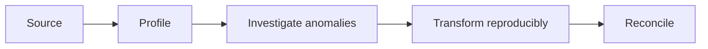

# 07 — EDA, missingness, duplicates and evidence quality

[Course map](README.md) · [Practicals](../02-practicals/README.md) · [Questions](../03-questions-and-answers/worked-questions.md#lesson-07)

## On this page

- [The idea](#the-idea)
- [Work through it](#work-through-it)
- [Common mistakes and practical limits](#common-mistakes-and-practical-limits)

## The idea

**Analogy:** EDA is inspecting ingredients before cooking; attractive charts cannot repair spoiled inputs.

Begin with a data dictionary, provenance, row grain, time coverage and how records were selected. Inspect types, unique counts, ranges, missingness, duplicates and join cardinality. Distinguish exact duplicated records from legitimate repeated events. A missing measurement may be structurally inapplicable, not recorded, or selectively withheld.

Univariate plots show distributions; bivariate plots compare relationships; grouped/time plots expose heterogeneity. Use histograms or ECDFs for distributions, scatterplots for numeric relationships, bars for category comparisons and lines for ordered time. Log scales need positive values and a stated interpretation. Never infer a causal effect from one observed association.

Keep transformations reproducible and preserve raw data. Investigate anomalies before replacing/deleting them. For modelling, split before learning imputers, scalers, encodings or selected predictors. For reporting, audit whether missingness or selection excludes a consequential group. EDA generates hypotheses; confirmatory claims need a suitable design and uncertainty assessment.

## Work through it

A sales dataset has 100 rows and 5 missing amounts. Report missing rate 5%, but also check whether all five belong to one branch. Filling them with the overall mean could conceal a branch-specific reporting failure.

A customer with three purchases is not necessarily a duplicated customer error: the order table legitimately has repeated customer IDs. Uniqueness belongs to the declared key, not every column.

## Common mistakes and practical limits

Do not change data merely to make plots look smooth. Correlation matrices can miss nonlinear relations and include meaningless encoded IDs. A missingness percentage without its relevant subgroup/time context can hide a systematic failure.

---

[← Data modelling, indexes, transactions and query plans](lesson-06-modeling-performance-transactions.md) · [Cohorts, funnels, experiments and analytical communication →](lesson-08-analysis-and-storytelling.md)
