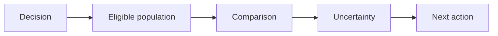

# 08 — Cohorts, funnels, experiments and analytical communication

[Course map](README.md) · [Practicals](../02-practicals/README.md) · [Questions](../03-questions-and-answers/worked-questions.md#lesson-08)

## On this page

- [The idea](#the-idea)
- [Work through it](#work-through-it)
- [Common mistakes and practical limits](#common-mistakes-and-practical-limits)

## The idea

**Analogy:** An analysis should connect a decision to a comparison, not just decorate a dashboard.

A funnel follows eligible entities through ordered stages. Specify whether counts are unique users, sessions or events and whether stages must occur in order within a window. A cohort groups entities by a shared starting event; retention compares later activity against the original eligible cohort, with a defined activity rule and observation window.

Segmented comparisons explain where an aggregate changes, but they can also introduce selection bias. Distinguish composition changes from within-segment changes. Experiment analysis compares assigned groups with a prespecified primary outcome; observational comparisons need more cautious causal language. Report absolute and relative effects together and show denominators.

Write an analytical result as: question, data/window, method, result magnitude, uncertainty/limitations and recommended next measurement/action. Avoid implying that an unexplained correlation identifies the lever to pull. A business decision may need cost, capacity and risk information beyond statistical evidence.

## Work through it

A funnel starts 1000 eligible users;400 view a product;100 purchase. View-to-purchase conversion 25% and start-to-purchase 10% are both valid but answer different questions. A100-user January cohort with 30 active in February has 30% month 1 retention under that activity definition; excluding already-churned users from the denominator would inflate it.

If total revenue rises while revenue per customer falls, investigate customer count and mix before calling the product more valuable per user.

## Common mistakes and practical limits

Do not compare a fully observed old cohort with an immature new cohort without matching follow-up. Rates with changed eligibility rules are not directly comparable. Keep observation separate from explanation and intervention.

---

[← EDA, missingness, duplicates and evidence quality](lesson-07-eda-and-data-quality.md) · [Continue with practicals](../02-practicals/README.md)
