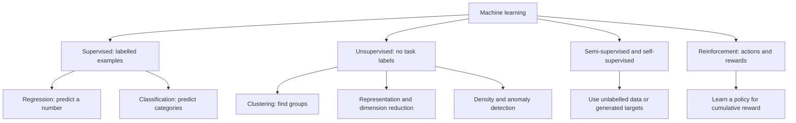

# 01 — What machine learning learns

[Course map](README.md) · [Practicals](../02-practicals/README.md) · [Questions and answers](../03-questions-and-answers/worked-questions.md#lesson-01)

## On this page

- [Start with the problem, not the algorithm](#start-with-the-problem-not-the-algorithm)
- [Read a training table](#read-a-training-table)
- [What counts as success?](#what-counts-as-success)

## Start with the problem, not the algorithm

Machine learning finds patterns from examples so that a rule can make useful decisions on **new** examples. A bank predicting a loan default has a different problem from a shop grouping customers. The first has a target label; the second may have no correct group labels at all. Data science also includes collecting reliable data, measuring outcomes and communicating decisions. AI is broader than ML; deep learning is a family of ML methods using neural networks.

| Learning setting | What is provided? | What is learned? | Example |
|---|---|---|---|
| Supervised regression | Inputs and numeric targets | A number or conditional distribution | Delivery duration |
| Supervised classification | Inputs and category labels | Class probabilities or a decision boundary | Fraud / genuine |
| Unsupervised | Inputs without task labels | Groups, components, densities or unusual observations | Customer segments |
| Semi-supervised | A small labelled set plus unlabelled inputs | A predictor using both | Medical image classification |
| Self-supervised | Targets made from the data itself | Useful representations | Predict hidden words |
| Reinforcement | Interaction, actions and rewards | A policy for long-term reward | Robot control |

Reinforcement learning is a separate interaction setting; it is not a subtype of ordinary supervised learning. Self-supervised representations may later be used in a supervised model. Learning settings and algorithm families overlap: a neural network can be used in any of these settings.

## Read a training table

$X\in\mathbb R^{n\times p}$ means $n$ examples and $p$ input features. $y_i$ is the target for example $i$, $\hat y_i=f_\theta(x_i)$ the prediction, and $\theta$ the learned parameters. A coefficient learned from data is a **parameter**; a maximum tree depth selected by validation is a **hyperparameter**. Rows can be customers, images or time windows; they are not automatically independent.

**Example:** inputs are hours studied and attendance known before an exam. The target is the later score. Regression predicts 74 marks; classification might predict pass/fail. Converting marks to pass/fail loses information but may match the decision. If the input includes the final certificate status, the model can cheat: that information did not exist when the prediction was needed.

## What counts as success?

Write the prediction time, unit of prediction, available inputs, target, cost of errors and baseline before training. A mean predictor, majority class or existing business rule is the first comparison. Good training accuracy proves little about future use. A useful model must improve a relevant held-out metric, operate within latency and cost constraints, and support the action being taken.

**Checkpoint:** given an example, identify its learning setting, target, prediction time and simplest baseline before naming any algorithm.

---

[02: Data preparation, feature engineering and leakage →](02-data-and-features.md)
