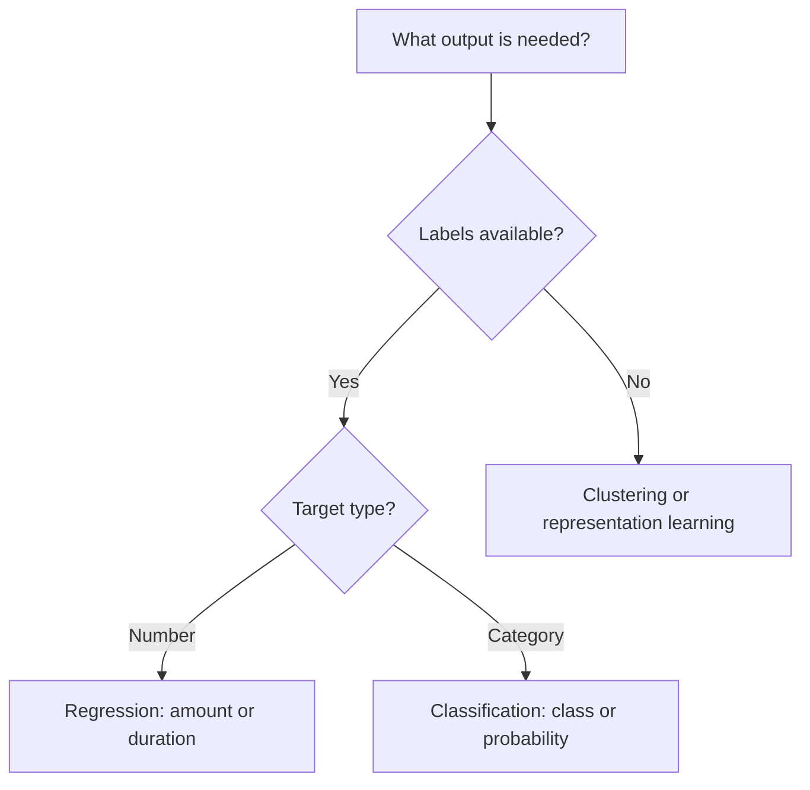
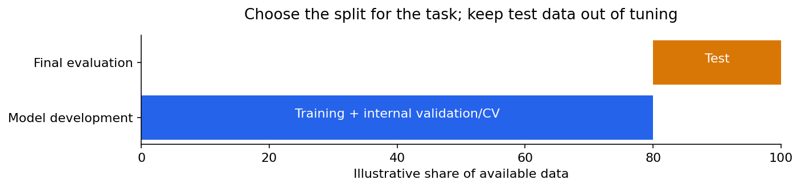
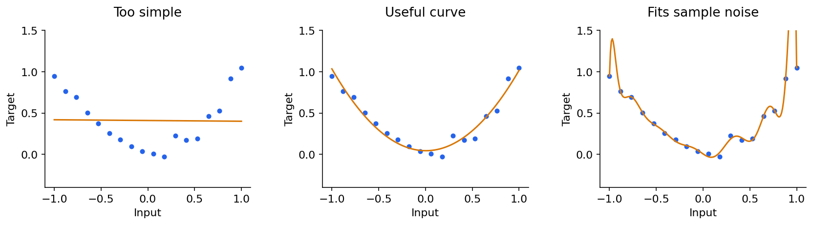

# Machine learning 1: learning, validation and regression

[Subject home](../README.md) · [Theory index](README.md)

A model is a rule whose parameters are learned from examples. The goal is useful behaviour on new data, rather than memorizing the training table. AI is the broader field; machine learning is one approach within it; deep learning uses multilayer neural networks. Data science also includes questions, measurement, statistics and communication.

## On this page

- [1. Start with a decision and a baseline](#1-start-with-a-decision-and-a-baseline)
- [2. Split before learning preprocessing rules](#2-split-before-learning-preprocessing-rules)
- [3. Linear regression as a weighted sum](#3-linear-regression-as-a-weighted-sum)
- [4. Loss and gradient descent](#4-loss-and-gradient-descent)
- [5. R² is not classification accuracy](#5-r²-is-not-classification-accuracy)
- [6. Underfitting, overfitting and regularization](#6-underfitting-overfitting-and-regularization)

## 1. Start with a decision and a baseline

Flight price is a regression target; rain/no rain is classification. Customer segmentation can use clustering without a target label. “Independent features” means inputs here, not that the features are mutually independent. Not every prediction requires a model: compare with a simple existing rule or constant baseline first.

Write when predictions are made, which data is then available, what a mistake costs and how the result will be measured. A future cancellation field cannot be used to predict a cancellation before it occurs.

## 2. Split before learning preprocessing rules

Training fits parameters. Validation chooses modelling decisions. Test data estimates performance after those decisions are fixed. A split ratio is a choice, not a law. Random splits suit some independent samples; use groups for repeated customers and chronological splits for future prediction.

Cross-validation repeats training/validation partitions within the development data. For five folds, each model trains on four and validates on one; combine the scores and inspect variation. Fit imputation, scaling, feature selection and resampling inside each training fold. A pipeline helps enforce this separation. Leave the final test set out of tuning. See [scikit-learn's cross-validation guide](https://scikit-learn.org/stable/modules/cross_validation.html).

## 3. Linear regression as a weighted sum

With one feature, $\hat y=b+wx$. With several, $\hat y=b+\sum_jw_jx_j$. The intercept predicts the value at zero inputs; it may have little real-world interpretation when zero is outside the observed range. A coefficient is the change in prediction per unit of its feature, holding other model inputs fixed. It is not automatically a causal effect.

For $(x,y)=((1,1),(2,2),(3,3))$, $\hat y=x$ has zero training error. The slope 0.5 predicts $(0.5,1,1.5)$, so MSE is $(0.25+1+2.25)/3=1.1667$. Slope zero gives $14/3=4.6667$. We need a systematic way to find good coefficients.

## 4. Loss and gradient descent

A loss scores a prediction; a training objective aggregates losses, possibly with a regularization term. With half MSE,

$$J(b,w)=\frac1{2n}\sum_i(b+wx_i-y_i)^2.$$

Its derivatives are $\partial J/\partial b=\sum_i(\hat y_i-y_i)/n$ and $\partial J/\partial w=\sum_i(\hat y_i-y_i)x_i/n$. Update both using the old parameters: $\theta\leftarrow\theta-\eta\nabla J$.

For the three points above, begin with $b=w=0$. The gradients are $-2$ and $-14/3$. At learning rate 0.1, the first update gives $b=0.2$, $w=0.4667$. Too small a step can be slow; too large can oscillate or diverge. There is no universal best learning rate of 0.001. Least-squares objectives are convex in the coefficients, but the minimizer need not be unique if columns are dependent. Neural-network objectives are generally nonconvex.

| Loss | Formula for residual $r=y-\hat y$ | Meaning |
|---|---|---|
| MSE | Mean of $r^2$ | Large errors receive greater weight |
| RMSE | Square root of MSE | Same units as target; large-error sensitivity remains |
| MAE | Mean of $\lvert r\rvert$ | Less sensitivity to extremes; nondifferentiable at zero |
| Huber | $r^2/2$ for $\lvert r\rvert\le\delta$; $\delta(\lvert r\rvert-\delta/2)$ otherwise | Quadratic near zero, linear far away |

An outlier in **input** can have high leverage even with a robust residual loss. Choosing MAE is not a guarantee against every kind of unusual record.

## 5. R² is not classification accuracy

$$R^2=1-\frac{\sum(y_i-\hat y_i)^2}{\sum(y_i-\bar y)^2}.$$

It compares squared errors with a constant mean predictor on the evaluation data. It can be negative; 0.85 does not mean “85% of predictions are correct”. A constant target makes the ordinary denominator zero. Adjusted R² is $1-(1-R^2)(n-1)/(n-p-1)$ for the usual regression setting with $p$ predictors and $n>p+1$; it penalizes extra predictors but does not replace held-out evaluation.

## 6. Underfitting, overfitting and regularization

A model that performs poorly on training and validation may underfit. Very low training error with worse validation error suggests overfitting, leakage, distribution shift or another mismatch. Bias/variance is a conceptual decomposition, not a label inferred perfectly from one pair of scores.

Ridge adds an L2 coefficient penalty; lasso adds L1 and can produce exact zero coefficients; elastic net combines them. Penalize feature coefficients, typically not the intercept. Scale features when comparing coefficient penalties. A larger penalty trades fit for a simpler/smaller-coefficient model and can underfit. Ridge is not an outlier-removal method.

Polynomial regression adds powers/interactions as features and remains linear in its learned coefficients. It can capture curvature but easily extrapolate badly. Check residuals, heteroscedasticity, correlated errors and multicollinearity. Normal residuals are a condition for some classical inference, not a requirement that every input feature be normally distributed.

**Practical use:** Predict a continuous outcome, compare with a mean baseline, choose error units relevant to the decision, tune within training folds, and inspect the largest errors. Continue to classification next.

[Classification, metrics, KNN and Naive Bayes →](02-ml-classification.md) · [Try the practicals](../02-practicals/README.md)
