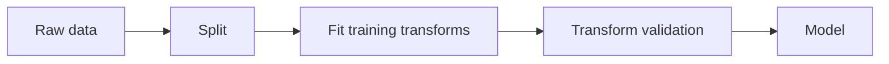
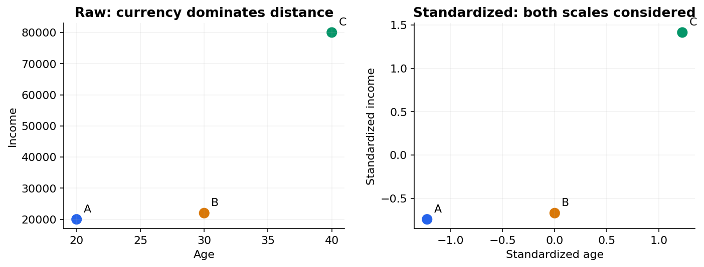

# 02 — Data preparation, feature engineering and leakage

[Course map](README.md) · [Practicals](../02-practicals/README.md) · [Questions and answers](../03-questions-and-answers/worked-questions.md#lesson-02)

## On this page

- [Make the input mean the same thing at training and prediction](#make-the-input-mean-the-same-thing-at-training-and-prediction)
- [Fit inside the fold](#fit-inside-the-fold)

## Make the input mean the same thing at training and prediction

A model only sees the representation you give it. A missing salary is not necessarily zero salary. A postcode number is usually a category, not a measured distance. Start with schema, units, duplicate records, label quality, sampling process and when each field was recorded. Keep an untouched split before learning any transformation.

| Input issue | A reasonable starting method | What can go wrong? |
|---|---|---|
| Missing numeric values | Training-fold median plus a missingness indicator when useful | Missingness may change after deployment |
| Unordered categories | One-hot encoding; handle unseen categories | Huge cardinality creates many columns |
| Ordered categories | Explicit order if it has real meaning | Arbitrary codes invent false order |
| Skewed positive amounts | `log1p` if suitable, with documented units | Transforming targets changes the loss interpretation |
| Unequal scales | Standardize for distances, margins and penalties | Fit scaling on validation data and leak information |
| Date/time | Extract only available seasonality and lag features | A rolling statistic can accidentally include the future |
| Text | Counts or TF–IDF; later embeddings | Fitting vocabulary/IDF on the whole dataset leaks distribution information |

Standard scaling uses $z=(x-\mu_{train})/s_{train}$. With training ages 20,30,40, the mean is 30. An age 35 becomes $(35-30)/s_{train}$, using **the same** training standard deviation at prediction time. Trees usually do not need scaling; KNN, SVM, regularized linear models and neural nets often do.

## Fit inside the fold

A pipeline puts imputation, encoding, scaling, feature selection and estimation into one fitted object. Each cross-validation training fold must learn its own preprocessing. Target encoding uses outcomes to summarize categories, so training encodings need an out-of-fold or appropriately ordered strategy; a category's own target must not explain itself. Apply oversampling only to training folds, never before splitting.

**Leakage example:** predicting cancellation at booking time using refund amount. Refund is recorded after cancellation, so even a perfectly executed random split produces an invalid task. Group leakage happens when the same patient appears in both train and validation. Duplicate images or near-identical text can create the same problem.

Feature engineering can add ratios, interactions, counts and historical aggregates. In a spending model, `spend / active_days` may capture behaviour better than spend alone. Define a zero-denominator rule and compute historical aggregates only from the past. Keep raw data, transformation code and feature names together so you can reproduce a prediction.

**Practical rule:** inspect a few transformed rows and trace every feature back to its availability time. Fancy models cannot repair a target that was defined incorrectly.

---

[← 01: What machine learning learns](01-learning-map.md) · [03: Generalization, bias, variance and learning curves →](03-generalization.md)
