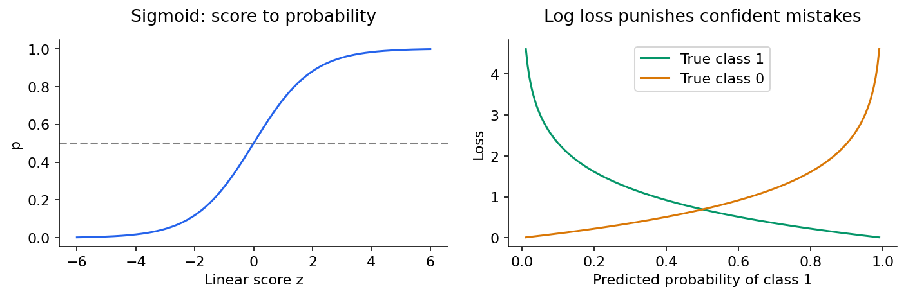

# Machine learning 2: classification, neighbours and Naive Bayes

[Subject home](../README.md) · [Theory index](README.md)

Classification assigns a category or estimates class probabilities. A probability score and a decision threshold are separate parts of the system. Predicting a rare but costly event requires more than maximizing overall accuracy.

## On this page

- [1. Logistic regression](#1-logistic-regression)
- [2. Confusion matrix: name the positive class first](#2-confusion-matrix-name-the-positive-class-first)
- [3. ROC, precision-recall and calibration](#3-roc-precision-recall-and-calibration)
- [4. K-nearest neighbours](#4-k-nearest-neighbours)
- [5. Naive Bayes: combine evidence by class](#5-naive-bayes-combine-evidence-by-class)

## 1. Logistic regression

Compute a linear score $z=b+w^Tx$ and transform it with the sigmoid:

$$p=\sigma(z)=\frac1{1+e^{-z}}.$$

At $z=0$, $p=0.5$; at $z=2$, $p\approx0.8808$; at $z=-2$, $p\approx0.1192$. The linear score models log-odds: $\log[p/(1-p)]=z$. It is not a straight regression line merely clipped at zero and one.

Binary log loss is $-[y\log p+(1-y)\log(1-p)]$. For a true positive, predicting 0.9 gives loss 0.1054; predicting 0.1 gives 2.3026. Confident mistakes are penalized strongly. Standard logistic log loss is convex in its linear coefficients; using squared loss after a sigmoid loses that convenient property. Convexity alone does not guarantee a unique finite optimum in every dataset.

Set a threshold using the cost, capacity and validation results. A 0.5 default is not universally best. Lowering the threshold tends to catch more positives while increasing false positives. For mutually exclusive multiple classes, softmax or another multiclass method is appropriate; independent multiple labels require a different output design.

## 2. Confusion matrix: name the positive class first

Let positive mean “the event we are trying to detect”. Rows below are actual classes; columns are predictions.

| | Predicted positive | Predicted negative |
|---|---|---|
| Actual positive | TP = 40 | FN = 10 |
| Actual negative | FP = 20 | TN = 930 |

Accuracy is $(40+930)/1000=0.97$, precision $40/60=0.6667$, recall $40/50=0.8$, specificity $930/950=0.9789$. F1 is $2PR/(P+R)=0.7273$. High accuracy can hide missing important events.

$$F_\beta=(1+\beta^2)\frac{PR}{\beta^2P+R}.$$

$\beta>1$ emphasizes recall; $\beta<1$ emphasizes precision. Define how zero denominators are handled. Reducing false positives matters when legitimate messages must not be blocked; reducing false negatives matters when missed events are costly. The correct trade-off depends on the specific application.

## 3. ROC, precision-recall and calibration

ROC plots recall/true-positive rate against $FP/(FP+TN)$ as the threshold changes. Precision-recall directly shows how useful positive predictions are at a given recall. Always include class prevalence; PR baselines depend on it. AUC summarizes ranking across thresholds, not performance at the one threshold deployed. A model can rank well and still have poorly calibrated probabilities. Compare predicted probability bands with observed event rates on held-out data.

## 4. K-nearest neighbours

KNN retains labelled examples. For a new row, find the nearest $k$ rows and vote (classification) or average target values (regression). The method is “lazy” because much work happens at prediction time; it is still a machine-learning method.

For a query with neighbours labelled A, A, B, $k=3$ predicts A. For targets 10, 12, 20, the unweighted regression prediction is 14. Distance weighting is an alternative. Small $k$ can be noisy; large $k$ can blur local differences. An odd $k$ can reduce binary vote ties but does not prevent multiclass or distance ties. Use a defined tie rule.

Euclidean distance is familiar, Manhattan sums absolute differences, and cosine compares direction. Scale features so an arbitrary unit does not dominate distance. Irrelevant features and high dimensionality can make distances less informative. KD/ball trees can accelerate some searches; they are not always effective in high dimensions. KNN classification uses labels; it is not the same algorithm as k-means clustering.

## 5. Naive Bayes: combine evidence by class

$$P(c\mid x)\propto P(c)\prod_jP(x_j\mid c).$$

The “naive” assumption is conditional independence of features **given the class**, not unconditional independence. The denominator is shared when comparing classes. Use log probabilities to avoid multiplying many tiny values; use smoothing for unseen categories.

### Weather example from the notes

Out of 14 days, tennis was played on 9 and not played on 5. Sunny occurs 2 times among the 9 yes days and 3 times among the 5 no days. Hot occurs 2 times among yes and 2 among no. For sunny and hot:

$$score_{yes}=\frac9{14}\frac2{9}\frac2{9}\approx0.03175,$$
$$score_{no}=\frac5{14}\frac3{5}\frac2{5}\approx0.08571.$$

Normalize to approximately 27.03% yes and 72.97% no. These are model probabilities under the conditional-independence/count assumptions. Adding high humidity and strong wind yields scores about 0.003527 and 0.041143 using the notes' class counts, giving approximately 7.90% yes. More evidence can change the result; it does not guarantee improved accuracy.

Categorical NB models discrete categories, multinomial NB often models text counts, and Gaussian NB models continuous features with class-specific normal densities. A density can be greater than one; it is not a discrete point probability. For mixed categorical and continuous data, choose an explicit compatible likelihood design rather than assuming every column should be Gaussian. Naive Bayes is often a fast text-classification baseline; check probability calibration and dependence between features.

**Practice:** Explain a high-accuracy model with poor recall, calculate the four confusion counts from predictions, and change a decision threshold without retraining. Then compare logistic regression, KNN and Naive Bayes on the same held-out split.

[← Foundations, validation and regression](01-ml-foundations-and-regression.md) · [Support-vector machines and regression →](03-ml-support-vector-machines.md) · [Try the practicals](../02-practicals/README.md)
