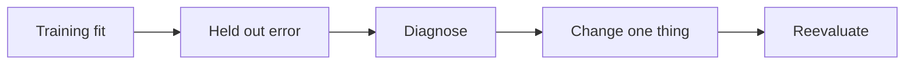
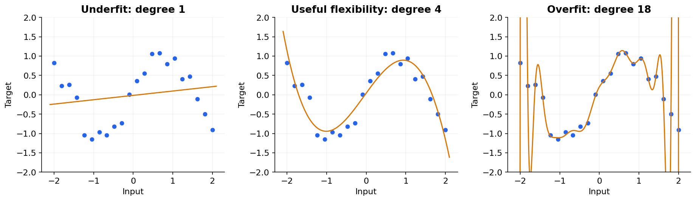

# 03 — Generalization, bias, variance and learning curves

[Course map](README.md) · [Practicals](../02-practicals/README.md) · [Questions and answers](../03-questions-and-answers/worked-questions.md#lesson-03)

## On this page

- [Fit what repeats, not what happened once](#fit-what-repeats-not-what-happened-once)
- [Diagnose with curves](#diagnose-with-curves)
- [Learning theory in plain language](#learning-theory-in-plain-language)

## Fit what repeats, not what happened once

Training minimizes empirical risk, $\hat R(f)=n^{-1}\sum_i\ell(y_i,f(x_i))$. We care about expected risk $R(f)=\mathbb E[\ell(Y,f(X))]$ on the intended population. They differ because a finite sample contains noise and may not represent deployment. The usual independent, identically distributed assumption is useful but often false for customers, hospitals and time series.

A simple model can miss real structure (**bias**). A very flexible model can change dramatically when the training sample changes (**variance**). For squared prediction error, under the standard regression decomposition at a fixed input, expected error separates into squared bias, variance and irreducible noise. This exact decomposition does not transfer unchanged to every loss.

## Diagnose with curves

A learning curve plots training and validation error against training size. If both errors are high and close, inspect underfitting, poor features or noisy labels; merely collecting more identical data may not help much. If training error is low and validation error much worse, regularization or more representative data may help. A gap can also indicate leakage, group differences or distribution shift, so curves suggest investigations rather than prove a cause.

| Evidence | Investigate | Try and validate |
|---|---|---|
| Both errors high | Weak representation, wrong target, excessive regularization | Better features, more suitable model, label audit |
| Training much better | Excess capacity, small sample, split mismatch | Simpler model, regularization, more data, correct split |
| Excellent offline, poor live | Leakage, feedback loops, drift, preprocessing mismatch | Replay prediction-time data and audit serving |

Regularization may mean coefficient penalties, depth limits, early stopping, dropout or restricting features. More regularization is not always better. Cross-validation selects it against a metric; a final test estimates the resulting procedure.

## Learning theory in plain language

A larger hypothesis class gives more ways to fit observations, including accidental ones. Capacity measures such as VC dimension and Rademacher complexity formalize parts of this trade-off; theoretical bounds rely on assumptions and are often too loose to predict one production score. A small training error alone is not a guarantee. The no-free-lunch idea says no method dominates across every possible problem without assumptions; it does not mean all methods are equally useful on a particular dataset.

**Example:** a degree 12 polynomial can pass through a dozen noisy observations. It may swing wildly between them. A straight line misses curvature. A low-degree regularized polynomial can capture the stable pattern while avoiding extreme swings. Evaluate extrapolation separately: no validation inside the training range proves accuracy outside it.

---

[← 02: Data preparation, feature engineering and leakage](02-data-and-features.md) · [04: Splits, cross-validation and hyperparameter search →](04-validation.md)
