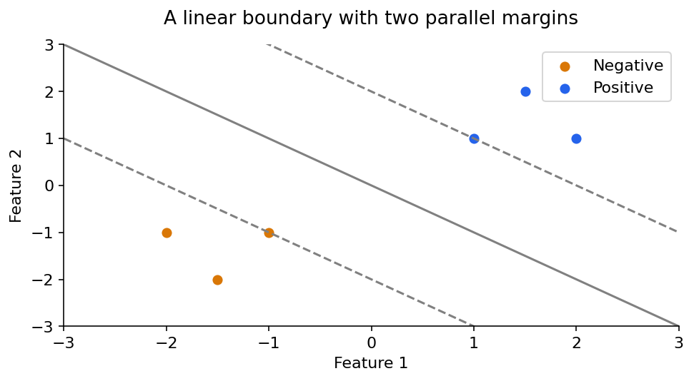
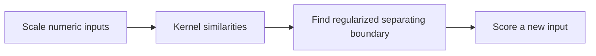

# Machine learning 3: support-vector machines

[Subject home](../README.md) · [Theory index](README.md)

An SVM looks for a decision boundary with a useful margin. The points determining that boundary are support vectors. This connects the geometry of projections to a predictive algorithm.

## On this page

- [1. From a line to a margin](#1-from-a-line-to-a-margin)
- [2. Soft margins and C](#2-soft-margins-and-c)
- [3. Kernels: nonlinear boundaries from similarities](#3-kernels-nonlinear-boundaries-from-similarities)
- [4. Support-vector regression](#4-support-vector-regression)

## 1. From a line to a margin

A boundary is $w^Tx+b=0$. The signed distance of $x$ is $(w^Tx+b)/\|w\|_2$; the ordinary distance is its absolute value. The vector $w$ is normal to the boundary. Its orientation determines which side has a positive score.

With the conventional scaling, margin lines are $w^Tx+b=\pm1$, so total margin width is $2/\|w\|$. For labels $y_i\in\{-1,1\}$, a hard-margin SVM solves

$$\min_{w,b}\frac12\|w\|^2\quad\text{subject to}\quad y_i(w^Tx_i+b)\ge1.$$

Maximizing the width is therefore equivalent to minimizing the norm, subject to the constraints. A hard-margin solution requires separability. It is not an appropriate assumption for most noisy real data.

## 2. Soft margins and C

Allow nonnegative slack $\xi_i$ and minimize $\|w\|^2/2+C\sum\xi_i$. A slack value measures a constraint violation; it is not a count of rows the model is permitted to ignore. Large $C$ places a greater penalty on violations, potentially fitting noise; smaller $C$ tolerates more violations in exchange for regularization. Tune with validation after scaling.

Hinge loss is $\max(0,1-yz)$. A correctly classified point inside the margin can still have positive hinge loss. A point with $yz\ge1$ has zero hinge loss. Thus soft-margin training is more precise than “find any line with the fewest wrong labels”.

## 3. Kernels: nonlinear boundaries from similarities

A kernel computes an inner product in a feature representation without explicitly constructing every transformed coordinate. A linear kernel keeps a linear boundary in the input space. Polynomial and RBF kernels permit nonlinear boundaries. An RBF kernel is $K(x,z)=\exp(-\gamma\|x-z\|^2)$; larger $\gamma$ makes similarity more local and can overfit.

The kernel trick is not limited to taking a 2D dataset to exactly 3D. Kernels also work for regression. Kernel SVMs can become expensive as the sample size grows, so compare with simpler or approximate methods when scale matters.

## 4. Support-vector regression

SVR predicts a number and uses an epsilon-insensitive tube. Errors within $\epsilon$ are not penalized by the tube loss; excess errors are. For a prediction of 100 and $\epsilon=5$, targets 97 and 104 fall inside; a target of 112 has excess error 7.

The objective trades a small coefficient norm against deviations outside the tube. `C`, epsilon and kernel settings control different aspects of the trade-off. Scale inputs and consider target units when choosing epsilon. Outliers can affect both SVC and SVR; a soft margin is not immunity. The practical collection contains census, diabetes, forest and regression examples to compare these ideas.

[← Classification, metrics, KNN and Naive Bayes](02-ml-classification.md) · [Trees, random forests and boosting →](04-ml-trees-and-ensembles.md) · [Try the practicals](../02-practicals/README.md)
