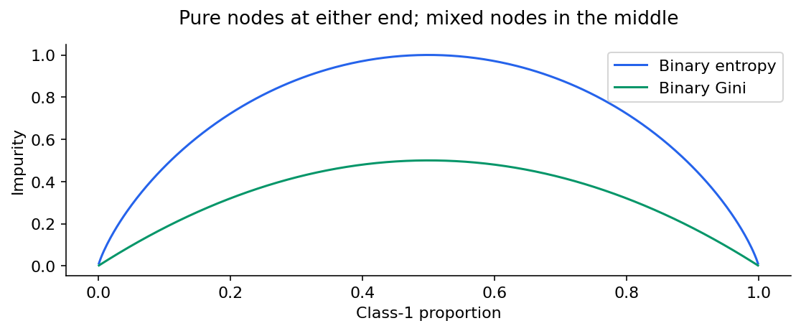
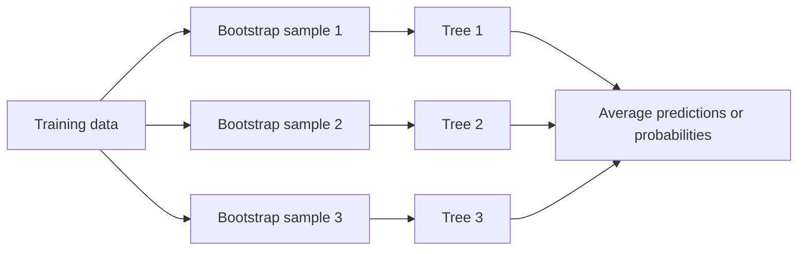

# Machine learning 4: trees, forests and boosting

[Subject home](../README.md) · [Theory index](README.md)

A decision tree learns a sequence of questions. Each internal node makes a split, and a leaf gives a prediction. Classification leaves estimate class frequencies; squared-error regression leaves predict a mean. The tree can capture nonlinear rules without a global straight-line equation.

```mermaid
flowchart TD
 A["Days since last order > 30?"] -->|No| B["Lower estimated churn"]
 A -->|Yes| C["Support tickets > 2?"]
 C -->|No| D["Moderate estimated churn"]
 C -->|Yes| E["Higher estimated churn"]
```

This diagram explains a rule structure; it is not a fitted or validated churn model.


## On this page

- [1. How a split is chosen](#1-how-a-split-is-chosen)
- [2. Control complexity and validate](#2-control-complexity-and-validate)
- [3. Bagging, random forests, voting and stacking](#3-bagging-random-forests-voting-and-stacking)
- [4. AdaBoost: emphasize difficult examples](#4-adaboost-emphasize-difficult-examples)
- [5. Gradient boosting: add corrections](#5-gradient-boosting-add-corrections)
- [6. XGBoost intuition](#6-xgboost-intuition)

## 1. How a split is chosen

Entropy is $H=-\sum p_c\log_2p_c$, treating $0\log0$ as zero. Gini impurity is $1-\sum p_c^2$. For two equally common classes, entropy is 1 and Gini is 0.5. For a pure node, both are zero. Their maxima depend on the number of classes; entropy is not universally bounded by one.



Evaluate a split by the parent impurity minus the **weighted** child impurities. For the weather notes, parent counts 9 yes/5 no have entropy about 0.9403. Children 6 yes/2 no and 3 yes/3 no have entropies 0.8113 and 1. The gain is

$$0.9403-\left(\frac8{14}0.8113+\frac6{14}1\right)\approx0.0481.$$

Numeric split candidates are commonly midpoints between sorted distinct values. Evaluate the permitted candidates; do not use an assumed gain to decide the winner. For squared-error regression, choose the largest decrease in weighted child squared error, equivalently the smallest resulting child error.

### Regression example from the notes

Heights 160,165,170,175,180 have targets 50,65,85,70,90. The parent mean is 72 and mean squared deviation is 206. At threshold 162.5, the left mean is 50 with variance 0; the right mean is 77.5 with variance 106.25. Weighted child error is $(1/5)0+(4/5)106.25=85$; reduction is $206-85=121$. Choose **maximum reduction**, not minimum reduction.

ID3 is associated with information gain and multiway categorical splitting; CART uses binary splits and supports classification and regression. Gini itself can handle more than two classes; binary split does not mean binary target.

## 2. Control complexity and validate

Deep trees can memorize data. Pre-pruning limits growth with maximum depth, minimum samples per leaf or minimum split requirements. Post-pruning, such as cost-complexity pruning, removes branches after growing a tree. Select the controls using validation; raising pruning strength generally favours simpler trees.

Monotonic scaling preserves the order used for threshold splits, so ordinary trees usually do not need standardization. That does not mean outliers never matter: extreme targets can strongly affect regression means and errors. An interpretable tree is useful, but large trees quickly become hard to explain.

Grid search tries a specified combination grid; randomized search samples a chosen parameter distribution. Cross-validation belongs inside the development set, with preprocessing fitted separately in each fold. Never select hyperparameters using the final test scores.

## 3. Bagging, random forests, voting and stacking

Bagging fits base models on bootstrap samples and aggregates them. A bootstrap sample draws rows **with replacement**, often keeping the same number of draws as the original training set; it does not simply partition rows into smaller disjoint sets. A random forest adds random feature choices at splits to reduce tree correlation.



Averaging decorrelated trees often reduces variance, but there is no guarantee of better performance for every dataset. For regression, average predictions; classification can aggregate probabilities. Out-of-bag evaluation predicts each training row only with trees whose bootstrap sample excluded it. About 36.8% of rows are omitted from one size-n bootstrap sample for large n; the actual fraction varies. OOB is a useful development estimate, not an untouched final test set.

Voting combines independently chosen models. Stacking learns a combining model using out-of-fold base predictions to avoid training leakage. Mixing a logistic model and an SVM in a vote is not the definition of a random forest.

## 4. AdaBoost: emphasize difficult examples

In the classic binary $\{-1,1\}$ formulation, start with equal row weights. Fit a weak learner; compute its weighted error $\epsilon$. Its vote strength is

$$\alpha=\frac12\log\frac{1-\epsilon}{\epsilon}.$$

Update row weights using $w_i\leftarrow w_i\exp(-\alpha y_ih(x_i))$ and normalize. Incorrect rows gain relative importance; later models still use correct examples too.

For 7 equally weighted rows and one error, $\epsilon=1/7$ and $\alpha=\log(6)/2\approx0.8959$. After normalization, the one wrong row has weight 0.5 and each of the six correct rows has weight $1/12$. The final decision is the sign of the weighted vote. Multiclass and regression AdaBoost variants use different details; do not mix their formulas with this derivation. Check noise and outliers because repeated emphasis can fit them.

## 5. Gradient boosting: add corrections

For squared-error regression, start with a mean prediction and fit a small tree to residuals. Add a fraction of its prediction:

$$F_m(x)=F_{m-1}(x)+\eta h_m(x).$$

For other losses, trees fit negative gradients, with appropriate leaf updates. The new tree is trained on the input features with those correction targets; it does not simply consume only the wrongly classified rows.

For salaries 50,70,80,100 (thousands), the mean is 75 and residuals are -25,-5,5,25. If a fitted correction for the first row is -23 and $\eta=0.1$, the updated prediction is $75+0.1(-23)=72.7$. Its new residual is $50-72.7=-22.7$. Repeat while monitoring validation loss; too many corrections can overfit.

## 6. XGBoost intuition

XGBoost is a regularized tree-boosting implementation that uses gradient and curvature information. For a leaf, let $G$ be summed first derivatives and $H$ summed second derivatives. A common regularized leaf weight is $-G/(H+\lambda)$. A corresponding split gain uses child values of $G^2/(H+\lambda)$, subtracts the parent term and includes a leaf penalty. Conventions may include a factor of one half.

For binary log loss with raw-score prediction $F$, $p=\sigma(F)$, first derivative $p-y$ and second derivative $p(1-p)$. Thus the denominator is not simply a count for every objective. In squared-error regression, curvature is constant and the count analogy is more direct. A classification tree update changes the **raw score/log-odds** before applying sigmoid, not a probability added without bounds.

Depth, number of trees, learning rate, row/column subsampling and regularization interact. Compare against a baseline; use early stopping or other development-set controls correctly. Package-specific defaults are not universal mathematical rules.


[← Support-vector machines and regression](03-ml-support-vector-machines.md) · [Clustering and representations →](05-ml-clustering.md) · [Try the practicals](../02-practicals/README.md)
