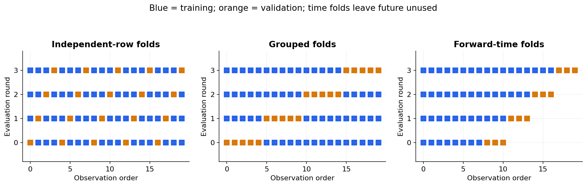

# 04 — Splits, cross-validation and hyperparameter search

[Course map](README.md) · [Practicals](../02-practicals/README.md) · [Questions and answers](../03-questions-and-answers/worked-questions.md#lesson-04)

## On this page

- [Separate learning, choosing and reporting](#separate-learning-choosing-and-reporting)
- [Choose a search method](#choose-a-search-method)
- [Example of accidental optimism](#example-of-accidental-optimism)

## Separate learning, choosing and reporting

Training data fits parameters; validation data chooses features, algorithms and hyperparameters; test data estimates performance after choices are fixed. There is no universal 80:20 ratio. The split must imitate the intended prediction problem. A small test set gives uncertain estimates even when its percentage looks conventional.

| Scenario | Split strategy | Reason |
|---|---|---|
| Independent observations | Shuffled train/test; stratify classification when appropriate | Preserve class representation |
| Several visits per patient | Grouped split or grouped CV | Test generalization to new patients |
| Forecast next month | Forward-chaining with suitable gap | Future must not train the past |
| Multiple branches or regions | Site holdout or grouped split | Measure transfer to a new site |

In $k$-fold CV, train on $k-1$ folds and evaluate on the remaining one, repeating $k$ times. Fit the full pipeline afresh each time. The mean score summarizes performance; variation across folds is useful, but folds overlap in training data, so their scores are not independent observations for a naive confidence interval.

## Choose a search method

Grid search tries a specified Cartesian product and is clear for small spaces. Random search explores more values when only a few hyperparameters matter; sample scale parameters such as regularization over logarithmic ranges. Successive halving allocates more resources to promising candidates. Bayesian optimization models the search response to suggest candidates; it can be efficient but still overfit repeated validation. Search budgets, random seeds and candidate ranges should be recorded.

**Nested CV:** inner folds choose hyperparameters; outer folds evaluate the entire selection procedure. It is useful when estimating a tuned model on limited data. It is more expensive than a single split. After evaluation, refit the chosen procedure using development data; do not report the refit's training score as its expected future score.

## Example of accidental optimism

Try 1000 feature combinations against one validation set. Even mediocre candidates can win by chance. If you then call that validation score the final result, selection has contaminated the estimate. Keep a test set that was never used in these choices, or use nested evaluation.

Bootstrap sampling draws $n$ observations **with replacement** from $n$ originals. It can estimate uncertainty for a statistic under appropriate sampling assumptions. For time-dependent data, use a suitable block bootstrap; resampling individual timestamps destroys dependence. Repeated splits measure one aspect of stability but do not repair an unrepresentative dataset.

**Checkpoint:** describe exactly what “unseen” means for your application before choosing a splitter.

---

[← 03: Generalization, bias, variance and learning curves](03-generalization.md) · [05: Loss functions and optimization →](05-loss-and-optimization.md)
