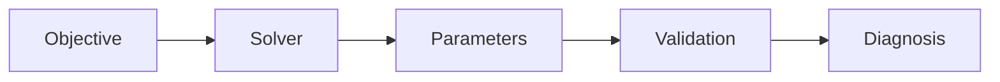
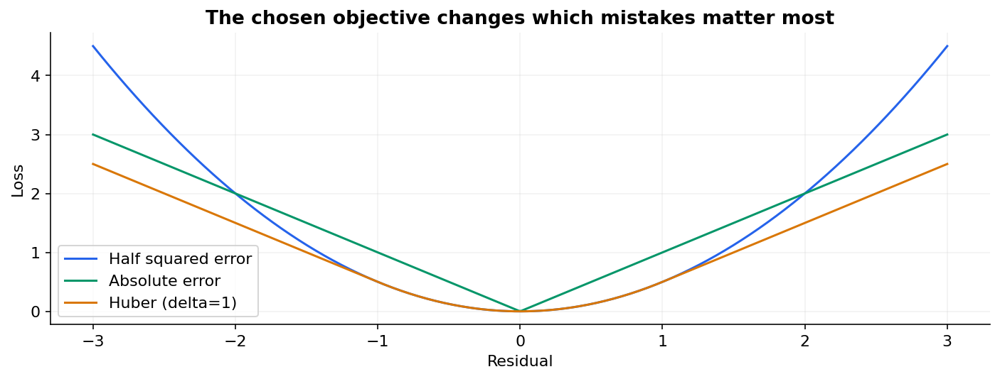
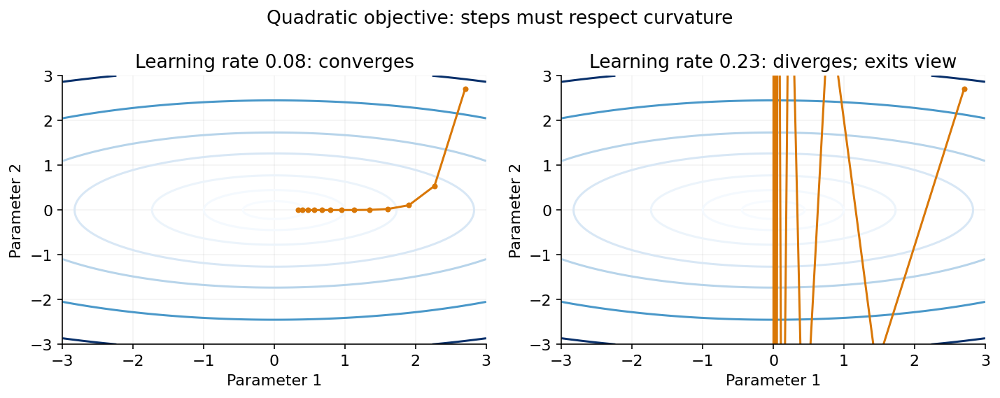

# 05 — Loss functions and optimization

[Course map](README.md) · [Practicals](../02-practicals/README.md) · [Questions and answers](../03-questions-and-answers/worked-questions.md#lesson-05)

## On this page

- [A loss tells learning what to care about](#a-loss-tells-learning-what-to-care-about)
- [How parameters change](#how-parameters-change)
- [Other training strategies](#other-training-strategies)

## A loss tells learning what to care about

The usual objective is $J(\theta)=n^{-1}\sum_i\ell(y_i,f_\theta(x_i))+\lambda\Omega(\theta)$. The loss scores prediction errors; the regularizer expresses a preference for parameter values or simpler fits. The evaluation metric may differ: a classifier may train with log loss but be selected for recall at a fixed false-positive budget.

| Loss | Formula | Appropriate interpretation |
|---|---|---|
| Half squared error | $(y-\hat y)^2/2$ | Conditional mean; sensitive to large residuals |
| Absolute error | $\lvert y-\hat y\rvert$ | Conditional median; less sensitive to extreme residuals |
| Huber | Quadratic near 0, linear beyond $\delta$ | A tunable robust compromise |
| Binary log loss | $-[y\log p+(1-y)\log(1-p)]$ | Penalizes confidently wrong probabilities |
| Hinge | $\max(0,1-yf(x))$, $y\in\{-1,1\}$ | Margin-based classification |
| Quantile pinball | $\max(\tau r,(\tau-1)r)$ | Conditional quantile $\tau$ |

## How parameters change

Gradient descent updates $\theta\leftarrow\theta-\eta\nabla J$. Full-batch descent uses all training observations per step. Stochastic descent uses one, mini-batch descent uses a subset. Momentum smooths steps using previous directions; Adam adapts updates using running gradient moments. Neither makes a badly defined objective correct.

For $x=y=[1,2,3]$, $\hat y=b+wx$, and halfMSE, at $b=w=0$:

$$\frac{\partial J}{\partial b}=-2,\qquad \frac{\partial J}{\partial w}=-\frac{14}{3}.$$

With $\eta=0.1$, update **simultaneously from old parameters** to $b=0.2,w=0.4667$. A large learning rate may overshoot; a tiny one may take too long. Poorly scaled features create elongated loss contours and slow progress. Schedule the rate, scale inputs when appropriate and monitor loss rather than assuming one learning rate fits every model.

The paths minimize $J(a,b)=a^2+5b^2$. The second direction has greater curvature, so a step that seems moderate along the first direction can overshoot along the second. A learning rate0.23 makes the second coordinate alternate and grow;0.08 converges. The diverging path eventually leaves the plotted window.

## Other training strategies

Least squares can use QR/SVD linear algebra. Lasso often uses coordinate descent or proximal methods because L1 is nondifferentiable at zero. Logistic regression may use L-BFGS, Newton-type or stochastic solvers. Trees use greedy split searches, not gradient descent over split thresholds. KNN mostly stores data and searches neighbours. EM alternates hidden-membership estimation and parameter fitting. Boosting adds weak learners sequentially.

A convex objective has no worse local minimum, but uniqueness needs additional conditions, and finite numerical solvers still have tolerances. Neural-network objectives are generally nonconvex. A decreasing training objective is not proof of improving generalization. Monitor a held-out criterion, numerical stability, convergence warnings and sensitivity to initialization.

**Practical calculation:** if $p=0.9$ but $y=0$, log loss is $-\log0.1\approx2.303$. If $p=0.6$, it is $-\log0.4\approx0.916$. Overconfidence is costly even when both predictions fall on the same side of a threshold.

---

[← 04: Splits, cross-validation and hyperparameter search](04-validation.md) · [06: Regression metrics and residual diagnostics →](06-regression-metrics.md)
