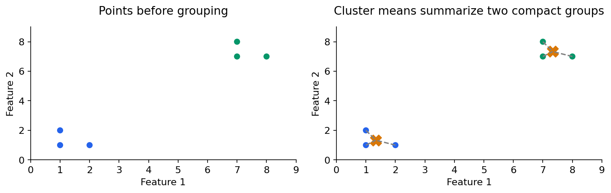
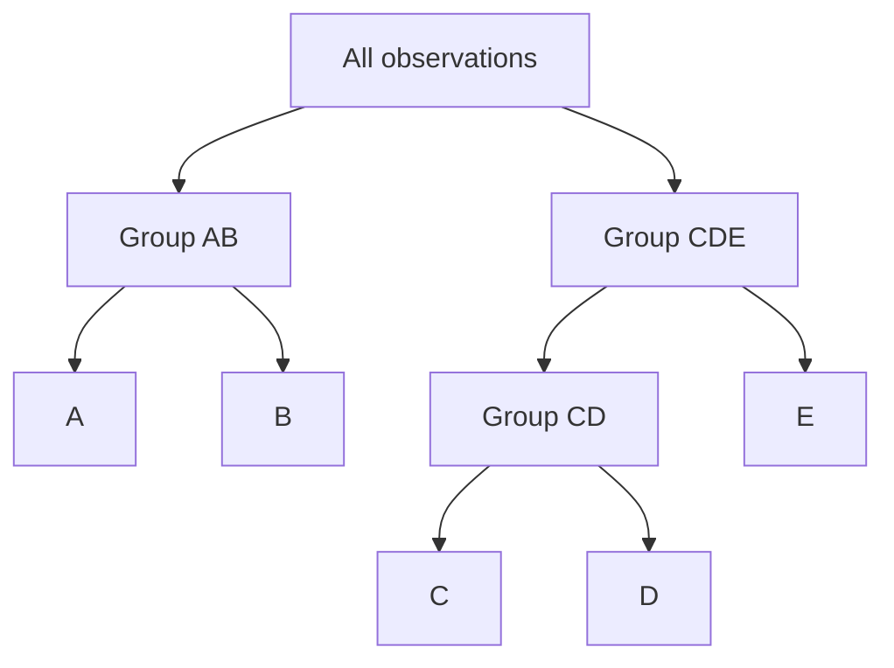

# Machine learning 5: clustering and representations

[Subject home](../README.md) · [Theory index](README.md)

Clustering groups observations by a chosen notion of similarity. It does not discover a guaranteed true customer type. Features, units, distance and algorithm together define what “similar” means.

## On this page

- [1. K-means: alternate assignment and averaging](#1-k-means-alternate-assignment-and-averaging)
- [2. Choose and evaluate k](#2-choose-and-evaluate-k)
- [3. Hierarchical clustering](#3-hierarchical-clustering)
- [4. DBSCAN: density and noise](#4-dbscan-density-and-noise)
- [5. Connect clustering to data science](#5-connect-clustering-to-data-science)

## 1. K-means: alternate assignment and averaging

Choose $k$ centres, assign each observation to the closest centre, recompute centres as assigned-point means, and repeat. The objective is within-cluster sum of squared Euclidean distances:

$$WCSS=\sum_i\|x_i-\mu_{c(i)}\|^2.$$

For one-dimensional points 1,2,8,9 and initial centres 1 and 8, the groups are {1,2} and {8,9}. Updated centres are 1.5 and 8.5. Each of four squared deviations is 0.25, so WCSS is 1. If one centre is used, its mean is 5 and WCSS is 50. More clusters can reduce WCSS without making the grouping more useful.

K-means++ chooses spread-out initial centres using squared-distance weighting; it improves initialization but does not guarantee the global optimum. Run appropriate multiple initializations and compare stability. Scale meaningful numeric features first. Large outliers and elongated/nonconvex clusters can be problematic. Arbitrary numeric codes for cities do not create meaningful Euclidean distances.

## 2. Choose and evaluate k

An elbow graph plots WCSS against k. Look for diminishing returns, but the elbow may be ambiguous. Silhouette for a point is

$$s=(b-a)/\max(a,b),$$

where $a$ is average distance to its own cluster and $b$ is the smallest average distance to another cluster. It ranges from -1 to 1 under the usual definitions. If $a=2$ and $b=5$, $s=0.6$. The denominator is **max(a,b)**, not max(b-a). A singleton convention typically sets its silhouette to zero.

Dunn-style indices compare minimum between-cluster separation with maximum within-cluster diameter; definitions vary. Evaluate geometry, stability, useful segment sizes and business meaning alongside a score. A cluster label is an arbitrary ID, not an ordered category.

## 3. Hierarchical clustering

Agglomerative clustering starts with individual points and merges groups. Divisive clustering starts with a broad group and splits it. A dendrogram records merge distances; cutting at a height selects a grouping.

Single linkage uses the closest pair across clusters and can chain groups; complete linkage uses the farthest; average uses average pairwise distance. Ward minimizes an increase in within-cluster squared error and is tied to Euclidean geometry. Changing linkage changes the hierarchy. Pairwise calculations can be expensive for large datasets.

## 4. DBSCAN: density and noise

DBSCAN uses a neighbourhood radius epsilon and a minimum number of samples. A core point has enough neighbours in its epsilon neighbourhood, normally counting itself. A border point is near a core but lacks enough neighbours to be core. Noise is neither core nor density-reachable border under the fitted clustering.

DBSCAN can find irregular shapes and label noise without specifying k. It is sensitive to scaling, distance, epsilon and varying densities. Noise labels are not proof of faulty records. In high dimensions, distance and density become harder to interpret. Do not assume it always outperforms k-means on every curved dataset.

## 5. Connect clustering to data science

Summarize each cluster with understandable features, inspect records near boundaries and test stability on resamples/time periods. A segment should lead to a defensible question or action. If clustering is a preprocessing feature for a supervised model, fit it within training folds. It does not automatically improve the supervised task.

Use the separate linear-algebra guide for PCA and SVD. PCA creates directions of variance; it does not optimize class separation or guarantee useful customer groups. A low-dimensional visualization is a view of the data, not independent validation of a cluster story.

[← Trees, random forests and boosting](04-ml-trees-and-ensembles.md) · [Try the practicals](../02-practicals/README.md)
