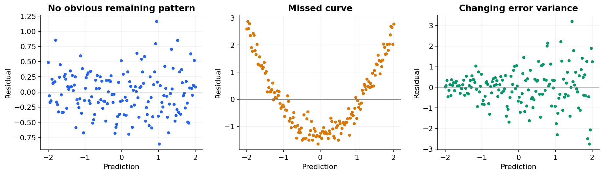

# 06 — Regression metrics and residual diagnostics

[Course map](README.md) · [Practicals](../02-practicals/README.md) · [Questions and answers](../03-questions-and-answers/worked-questions.md#lesson-06)

## On this page

- [Choose an error that matches the decision](#choose-an-error-that-matches-the-decision)
- [Read residuals as evidence](#read-residuals-as-evidence)

## Choose an error that matches the decision

For residual $r_i=y_i-\hat y_i$, MAE is $n^{-1}\sum|r_i|$, MSE is $n^{-1}\sum r_i^2$, and RMSE is $\sqrt{MSE}$. MAE and RMSE have target units; MSE has squared units. RMSE emphasizes occasional large mistakes more strongly. Neither tells you which customer group receives those mistakes.

For actual values $[10,20,30]$ and predictions $[12,18,33]$, residuals are $[-2,2,-3]$. MAE is $7/3=2.333$, MSE is $17/3=5.667$ and RMSE is 2.380. A percentage metric may sound easier to compare, but MAPE divides by the actual value and is undefined at zero; near-zero actuals dominate it. For intermittent sales, choose an alternative matched to the business instead of silently adding an arbitrary denominator constant.

$$R^2=1-\frac{\sum_i(y_i-\hat y_i)^2}{\sum_i(y_i-\bar y)^2}.$$

Here the target mean is 20, denominator 200, so $R^2=1-17/200=0.915$. This is **not 91.5% prediction accuracy**. A negative value means worse squared error than the constant evaluation-set mean. A constant target makes the ordinary expression undefined. AdjustedR² is $1-(1-R^2)(n-1)/(n-p-1)$ in its usual setting; it is not a replacement for held-out error.

## Read residuals as evidence

Residuals versus predictions should not contain an obvious remaining curve if the mean structure is captured. A fan shape suggests changing error variance. Residuals over time can expose drift or autocorrelation. Inspect large errors, target ranges, groups and business segments. Heteroscedasticity need not make a predictor useless, but constant-width intervals and classical standard errors may be misleading.

| Decision | Useful measure | Additional check |
|---|---|---|
| Typical absolute error | MAE | Tail errors by segment |
| Expensive large mistakes | RMSE | Worst-case failures and outliers |
| Underprediction costs more | Quantile/pinball loss | Coverage of desired quantile |
| Compare related forecasts | MASE with valid naive baseline | Time split and denominator definition |
| Predict distribution | Log likelihood / proper score | Calibration and interval width |

**Training assumptions versus inference assumptions:** linear least squares can fit without normally distributed features or residuals. Classical tests and intervals need additional error assumptions. Prediction accuracy does not establish causal coefficient interpretation. Always report the split, units, sample size and baseline beside a metric.

---

[← 05: Loss functions and optimization](05-loss-and-optimization.md) · [07: Classification metrics, thresholds and calibration →](07-classification-metrics.md)
