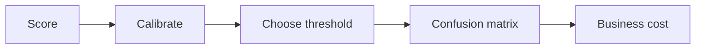
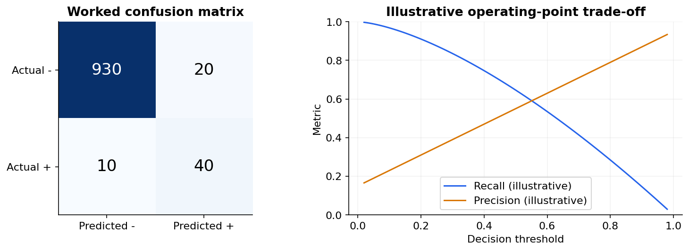
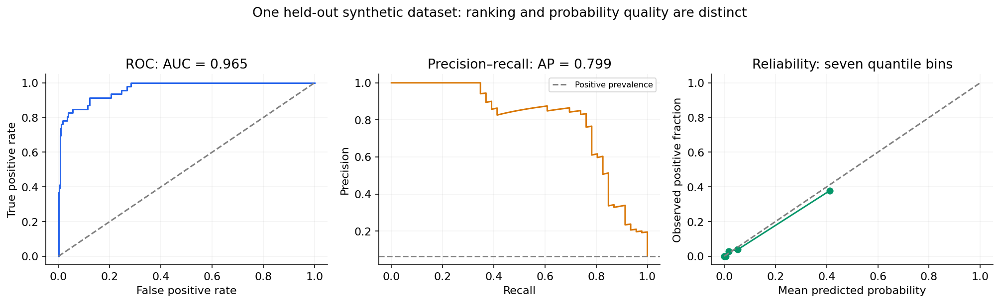

# 07 — Classification metrics, thresholds and calibration

[Course map](README.md) · [Practicals](../02-practicals/README.md) · [Questions and answers](../03-questions-and-answers/worked-questions.md#lesson-07)

## On this page

- [Probability, label and decision are different](#probability-label-and-decision-are-different)
- [Select a decision, then freeze it](#select-a-decision-then-freeze-it)

## Probability, label and decision are different

A classifier may return a score or estimated probability. A threshold turns that output into a decision. Changing the threshold changes precision and recall without retraining the underlying score model. A good ranking score is not automatically a calibrated probability.

For actual rows and predicted columns, let TP40,FN10,FP20,TN930. There are 1000 cases and 50 actual positives. Accuracy is $(40+930)/1000=0.97$, precision $40/60=0.667$, recall $40/50=0.8$, specificity $930/950=0.979$, and F 1 is $2TP/(2TP+FP+FN)=80/110=0.727$.

A majority-negative baseline already has 95% accuracy. Our 97% result therefore needs more context: how much fraud was caught, how many legitimate users were blocked, and what each error cost. Precision conditions on predicted positives; recall conditions on actual positives. F 1 ignores true negatives and assumes a particular balance between precision and recall. $F_\beta$ weighs recall more when $\beta>1$.

| Measure | What it assesses | Limitation |
|---|---|---|
| ROC–AUC | Ranking via TPR against FPR over thresholds | A high value can coexist with low precision on rare positives |
| Precision–recall curve / average precision | Positive retrieval quality across thresholds | Changes with prevalence; AP is a summary convention, not always trapezoidal PR area |
| Log loss | Quality of probabilities | Confident mistakes are heavily penalized |
| Brier score | Mean $(p-y)^2$ | Combines calibration and discrimination effects |
| Balanced accuracy | Mean class recall | Does not incorporate actual monetary costs |

These three curves are measured from one fixed held-out synthetic sample. Compare the ROC and PR views, then inspect probability reliability; the seven-bin calibration plot is noisy evidence from a finite sample, not a calibration guarantee.

## Select a decision, then freeze it

For calibrated binary probabilities, FP cost $C_{FP}$ and FN cost $C_{FN}$, predicting positive has expected cost $C_{FP}(1-p)$ and negative has cost $C_{FN}p$. Choose positive when $p>C_{FP}/(C_{FP}+C_{FN})$, assuming these are the only costs. If missing fraud costs 100 and a false alarm costs 5, the threshold is $5/105\approx0.0476$, not 0.5. Review capacity and intervention costs can alter this rule.

Calibration means cases assigned probability 0.7 occur positive about 70% of the time in a comparable population. Reliability diagrams compare predicted bins with observed rates. Sigmoid or isotonic calibration requires separate calibration data or appropriate CV; never fit it on the final test labels. Evaluate discrimination **and** calibration after class reweighting or prevalence changes.

For multiclass problems, inspect per-class metrics plus macro, micro and support-weighted averages. Macro treats every class equally; weighted averages can conceal weak minority performance. Multilabel tasks permit several labels per example and need their own threshold and averaging choices.

---

[← 06: Regression metrics and residual diagnostics](06-regression-metrics.md) · [08: Linear regression: the full reasoning →](08-linear-regression.md)
