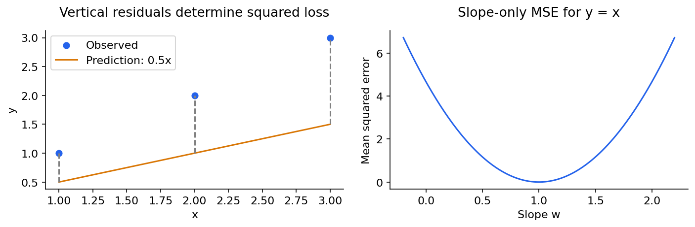

# 08 — Linear regression: the full reasoning

[Course map](README.md) · [Practicals](../02-practicals/README.md) · [Questions and answers](../03-questions-and-answers/worked-questions.md#lesson-08)

## On this page

- [What problem does it solve?](#what-problem-does-it-solve)
- [Work through an example](#work-through-an-example)
- [Assumptions and practical fit](#assumptions-and-practical-fit)

## What problem does it solve?

Linear regression predicts a continuous target as $\hat y=b+\sum_{j=1}^{p}w_jx_j$. Think of it as a base amount plus contributions from inputs: delivery time may be a base preparation time plus minutes per kilometre. It is linear in **parameters**, so polynomial features can represent curved relationships while using linear regression.

With an intercept column included in $X$, ordinary least squares minimizes $\|y-X\theta\|_2^2$. The normal equations are $X^TX\theta=X^Ty$. If $X$ has full column rank, a mathematical expression is $(X^TX)^{-1}X^Ty$. In code, do not explicitly invert this matrix: QR or SVD solves are more numerically reliable. Rank deficiency creates nonunique coefficient vectors; predictions may still be uniquely determined on the observed column space.

## Work through an example

For $x=[1,2,3]$ and $y=[1,2,3]$, $b=0,w=1$ fits perfectly. A candidate $w=0.5$ predicts $[0.5,1,1.5]$, giving MSE $(0.25+1+2.25)/3=1.1667$. The slope can also be calculated as $\sum(x_i-\bar x)(y_i-\bar y)/\sum(x_i-\bar x)^2=2/2=1$, with $b=\bar y-w\bar x=0$. For several features use a solver rather than extending this one-feature formula incorrectly.

A coefficient measures prediction change per unit of its input, **holding other model inputs fixed**. Correlated inputs can make coefficients unstable; it does not follow that each input causes the outcome. If age and years employed move together, either may receive much of their shared signal.

## Assumptions and practical fit

For estimating the conditional mean, a linear functional form and suitable error behaviour matter. Classical unbiasedness uses zero conditional mean error; independent errors, constant variance and normality enter particular standard-error or finite-sample inference results. Inputs themselves do not have to be Gaussian. For prediction, test residuals, generalization and deployment relevance rather than treating an assumption checklist as automatic approval.

| Strength | Limitation | Response |
|---|---|---|
| Fast, transparent baseline | Misses nonlinear structure | Interactions, splines or another family |
| Coefficients have units | Collinearity destabilizes coefficients | Ridge; inspect conditioning |
| Can extrapolate linearly | Extrapolation can be unrealistic | Domain constraints and explicit stress tests |
| Simple fitting objective | Squared loss magnifies outliers | Audit errors; compare robust regression |

Scale when penalties or iterative optimization require it, encode categories, and avoid an intercept plus every one-hot category when interpreting an unregularized full-rank design. Tune feature transformations and any regularization inside CV. Evaluate MAE/RMSE and residual slices; compare a mean baseline. A good use is stable numeric prediction with moderate data and a relationship that is approximately additive. A poor use is treating a straight line as a physical law far outside observed inputs.

---

[← 07: Classification metrics, thresholds and calibration](07-classification-metrics.md) · [09: Ridge, lasso, elastic net and generalized regression →](09-regularized-and-generalized-regression.md)
