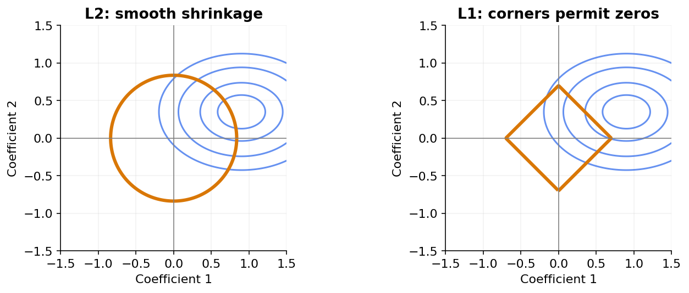

# 09 — Ridge, lasso, elastic net and generalized regression

[Course map](README.md) · [Practicals](../02-practicals/README.md) · [Questions and answers](../03-questions-and-answers/worked-questions.md#lesson-09)

## On this page

- [Penalize unstable fits](#penalize-unstable-fits)
- [Choose the mean function and error model](#choose-the-mean-function-and-error-model)

## Penalize unstable fits

Using the convention $J=\|y-Xw\|^2/(2n)+\lambda\Omega(w)$, ridge sets $\Omega=\|w\|_2^2/2$, lasso uses $\|w\|_1$, and elastic net mixes L 1 and L 2. Libraries use different constants, so compare objective definitions before comparing penalty values. Usually leave the intercept unpenalized.

Ridge shrinks correlated coefficients smoothly and has solution $(X^TX+n\lambda I)^{-1}X^Ty$ for this convention without an intercept. It improves stability but does not normally produce exact zero coefficients. Lasso can set coefficients to zero because its sharp L 1 corner makes zero an optimum for a range of gradients. With correlated features it can choose one somewhat arbitrarily. Elastic net can combine sparsity with greater stability for correlated predictors.

In an orthogonal standardized one-coordinate problem with unpenalized coefficient $z=0.7$ and penalty 0.2, the corresponding scalar ridge minimizer of $(w-z)^2/2+0.2w^2/2$ is $0.7/1.2=0.5833$; lasso minimizes $(w-z)^2/2+0.2|w|$ at $\max(0.7-0.2,0)=0.5$. If $z=0.1$, lasso gives 0. This soft-threshold formula is a simple coordinate example, not a formula for an arbitrary correlated design.

## Choose the mean function and error model

| Method | Objective / training | Suitable target or data | Main caution |
|---|---|---|---|
| Polynomial / spline regression | Least squares plus optional penalty on transformed basis | Smooth nonlinear numeric relationships | Degree/knots tuned; unstable extrapolation |
| Huber regression | Piecewise quadratic/linear residual loss | Some unusually large residuals | High-leverage inputs can still distort a fit |
| RANSAC | Repeatedly fit candidate inlier subsets | Strong inlier relationship amid gross outliers | Inlier threshold and enough uncontaminated subsets matter |
| Quantile regression | Pinball loss for quantile $\tau$ | Delivery-time 90th percentile | Crossing quantiles and tail sample size |
| Poisson GLM | Poisson deviance, log link $\mu=\exp(x^Tw)$ | Nonnegative counts | Exposure and overdispersion need attention |
| Gamma GLM | Gamma deviance, often log link | Strictly positive skewed amounts | Zero amounts violate the assumed support |
| Tweedie GLM | Deviance with variance power | Selected nonnegative mixed/count-continuous settings | Match power, link and target support |

A generalized linear model combines a response distribution with a link connecting its mean to a linear predictor. Logistic regression is the Bernoulli example. Negative-binomial regression handles a particular kind of overdispersed count data; zero-inflated/hurdle models separate structural zeros where justified. These are distributional assumptions, not automatic fixes for skew.

**Tune:** penalty strength over a logarithmic range, elastic-net mixture, spline complexity, Huber threshold or quantile level. Standardize before comparing penalties. Choose MAE/RMSE/deviance/pinball to match the prediction target; do not select a 90th-percentile model by expecting unbiased mean residuals. Ridge is not an outlier-removal algorithm.

---

[← 08: Linear regression: the full reasoning](08-linear-regression.md) · [10: Logistic regression and softmax classification →](10-logistic-and-softmax.md)
