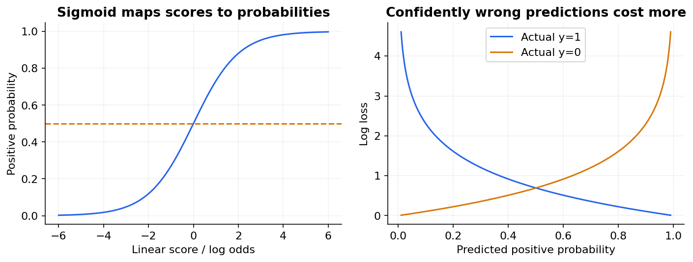

# 10 — Logistic regression and softmax classification

[Course map](README.md) · [Practicals](../02-practicals/README.md) · [Questions and answers](../03-questions-and-answers/worked-questions.md#lesson-10)

## On this page

- [A linear score becomes a probability](#a-linear-score-becomes-a-probability)
- [Train with likelihood, not squared labels](#train-with-likelihood-not-squared-labels)
- [Multiclass and multilabel](#multiclass-and-multilabel)

## A linear score becomes a probability

Despite its name, logistic regression is primarily a classification model. For binary labels, $z=b+x^Tw$, $p=\sigma(z)=1/(1+e^{-z})$. Predict class 1 when $p$ exceeds a chosen threshold. The decision boundary at 0.5 is $b+x^Tw=0$. Feature transforms can curve the boundary in the original inputs.

Its log odds are $\log[p/(1-p)]=b+x^Tw$. Increasing a feature by one unit multiplies model odds by $e^{w_j}$ while holding other model inputs fixed; it does not add $w_j$ to probability. If $z=\log3$, probability is $3/4=0.75$. If a coefficient is $\log2$, a unit increase doubles odds, not probability.

## Train with likelihood, not squared labels

Minimize average binary log loss plus a chosen penalty. For one observation, derivative with respect to score is $p-y$, giving $\nabla_w\ell=(p-y)x$. At $x=2,w=0.1,b=0,y=1$, $p=0.549834$. The weight gradient is $-0.900332$ and intercept gradient $-0.450166$. Learning rate 0.1 gives $w=0.190033,b=0.045017$, raising probability to about 0.604699 and reducing log loss from 0.598139 to 0.503025.

The ordinary binary objective is convex in coefficients. Completely separable unregularized data can drive coefficients toward infinity rather than a finite maximum-likelihood solution. Regularization helps control such behaviour; convergence warnings still need investigation.

## Multiclass and multilabel

For exclusive classes, softmax gives $p_k=e^{z_k}/\sum_j e^{z_j}$ and cross-entropy is $-\log p_{true}$. For numerical stability subtract the largest logit before exponentiating. One-vs-rest fits one binary classifier per class; one-vs-one fits each pair. These are reduction strategies, not the same probability model as a jointly fitted multinomial model. Multilabel problems use several binary outputs because classes can coexist.

| Good fit | Why | Limitation |
|---|---|---|
| Sparse text, interpretable tabular baseline | Fast linear model, efficient sparse input | Needs engineered nonlinear relationships |
| Small/moderate labelled data | Relatively controlled capacity | Correlated coefficients complicate interpretation |
| Probability-driven decisions | Explicit probability output | Calibration still must be checked |

Tune penalty type/strength, class weights, representation and threshold. In many libraries `C` is inverse regularization strength: larger `C` means weaker penalty. Solver and penalty compatibility varies, so check the installed API. Class weighting changes the fitted objective and can shift calibration. Select by appropriate discrimination, probability and decision metrics. Compare against trees for nonlinear interactions and linear SVM for high-dimensional margin-based prediction.

---

[← 09: Ridge, lasso, elastic net and generalized regression](09-regularized-and-generalized-regression.md) · [11: Naive Bayes, LDA and QDA →](11-bayes-and-discriminant-analysis.md)
