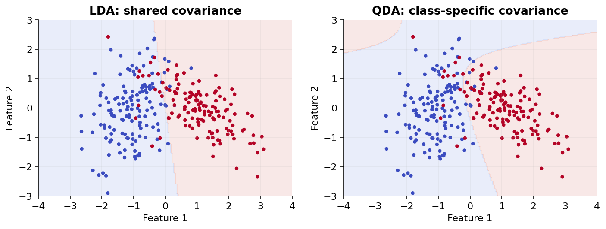

# 11 — Naive Bayes, LDA and QDA

[Course map](README.md) · [Practicals](../02-practicals/README.md) · [Questions and answers](../03-questions-and-answers/worked-questions.md#lesson-11)

## On this page

- [Bayes changes the direction of the question](#bayes-changes-the-direction-of-the-question)
- [Discriminant analysis relaxes a different assumption](#discriminant-analysis-relaxes-a-different-assumption)

## Bayes changes the direction of the question

Bayes' rule gives $P(c\mid x)\propto P(c)P(x\mid c)$. Naive Bayes assumes input features are conditionally independent **given the class**, yielding $\log P(c)+\sum_j\log P(x_j\mid c)$ up to a common constant. This is not the assumption that all inputs are unconditionally independent. Log probabilities prevent tiny products underflowing.

For a simple weather example, priors are $P(yes)=9/14,P(no)=5/14$. Suppose $P(sunny|yes)=2/9$, $P(hot|yes)=2/9$, $P(sunny|no)=3/5$ and $P(hot|no)=2/5$. Unnormalized scores are 0.031746 and 0.085714. Normalize by their sum to obtain $P(yes|sunny,hot)\approx0.2703$. The predicted class is no. Real weather features are correlated; the arithmetic illustrates the modelling assumption rather than proving it.

| Variant | Feature model | Training | Useful for / caution |
|---|---|---|---|
| GaussianNB | Per-class Gaussian per feature | Estimate means, variances and priors | Continuous features; not full-covariance Gaussian modelling |
| MultinomialNB | Feature counts conditioned on class | Smoothed count probabilities | Word counts; input must be nonnegative |
| BernoulliNB | Presence/absence | Estimate Bernoulli probabilities | Binary occurrence patterns |
| ComplementNB | Complement-class count statistics | Estimate complement weights | Often useful for imbalanced count-text tasks |
| CategoricalNB | Discrete category probabilities per feature | Smoothed category frequencies | Encoded categorical values, not arbitrary continuous numbers |

Laplace smoothing adds $\alpha$ to counts and $\alpha K$ to a categorical denominator with $K$ outcomes. It prevents one unseen event forcing a class score to zero. Tune smoothing and representation; do not add 1 to only the numerator.

For GaussianNB, each continuous feature uses a class-specific density $p(x_j\mid c)=\frac{1}{\sqrt{2\pi\sigma_{cj}^2}}\exp[-(x_j-\mu_{cj})^2/(2\sigma_{cj}^2)]$. Variance smoothing prevents extremely small fitted variances dominating numerically. This density can exceed1 for narrow distributions; a density value is not itself an event probability.

## Discriminant analysis relaxes a different assumption

LDA assumes a multivariate Gaussian per class with a shared covariance matrix. It allows correlated features and produces linear boundaries. QDA estimates a separate covariance per class and gives quadratic boundaries. They fit distribution parameters through likelihood estimates; they do not minimize logistic log loss in the same way as logistic regression.

LDA needs fewer covariance parameters and can be stable on small samples; QDA is more flexible but needs more data. Shrinkage covariance can help ill-conditioning. If two classes have means−1 and 1 with equal 1D variance and priors, their boundary is 0; unequal variances can produce quadratic log-density differences. GaussianNB instead uses diagonal class covariances.

**Choose:** NB is a strong fast text baseline; LDA suits roughly ellipsoidal shared-covariance classes; QDA suits differing covariances with enough observations. Their probabilities can be poorly calibrated if assumptions fail. Evaluate log loss as well as classification metrics; correlated duplicate word features can make NB overconfident.

---

[← 10: Logistic regression and softmax classification](10-logistic-and-softmax.md) · [12: K-nearest neighbours and distance →](12-nearest-neighbours.md)
